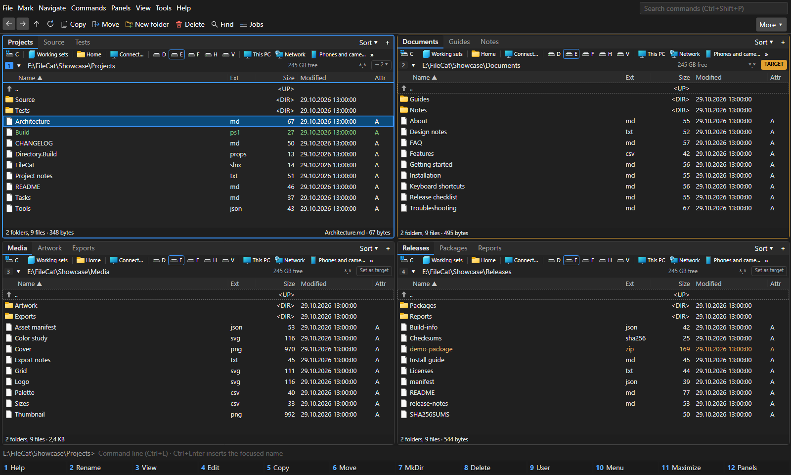
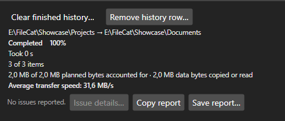
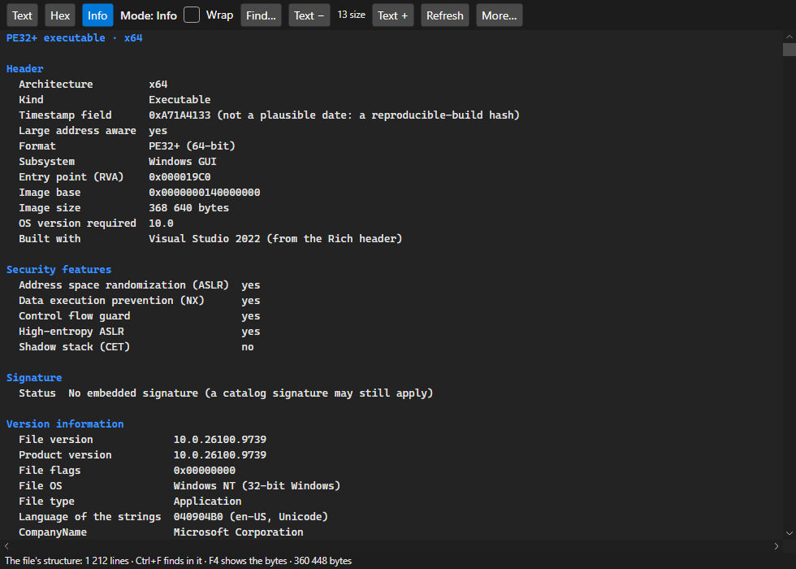

#  FileCat

**A file manager for everyday work, with serious tools when you need to go deeper.**

FileCat puts local disks, removable storage, archives and remote servers in a multi-panel,
multi-tab workspace on Windows, Ubuntu and macOS. See the destination before an operation and
its result afterward; inspect unfamiliar files or recover deleted data when the work goes deeper.

**Release status:** FileCat 1.0.0 is still in validation, and no public binary release is
available yet. [See the release dashboard](docs/release/1.0.0/FILECAT_1_0_RELEASE_EXECUTION_REPORT.md).

**Start here:** [**Build from source**](#try-a-local-build) · [Recovery](#recover-deleted-files) · [Safety](#work-with-visible-outcomes) · [Screenshots](#make-it-yours) · [Capabilities](docs/CAPABILITIES.md)

[](docs/screenshots/windows/WorkspaceSelected-20261030.png)

*Architecture.md is selected in Projects, with Documents marked as the target. Four panels and
twelve tabs stay in view. This is a [development-source render](docs/screenshots/CAPTURE-2026-10-30.md)
on Windows, not an installed-package test.*

## Why FileCat

| When you need to… | FileCat gives you… |
|---|---|
| Keep several places in view | Dockable panels, tabs, bookmarks, named workspaces and an explicit source and destination for each operation. |
| Get a large job done without losing track | Per-drive queues, progress and results for individual items, a durable job journal, and a review of work interrupted by a crash. |
| Rescue deleted files | Read-only NTFS, FAT and exFAT scans of disks or images, lost-partition search, evidence-based recovery states and partial-byte reporting. |
| Understand a file before acting | Built-in text, hex, picture, page and structured-info viewers; checksums and signatures; streams, attributes and filesystem-record reports. |
| Work outside a local folder | Archives, SMB, SFTP, FTPS, FTP, and Windows phones/cameras, with each location's supported actions explained in the UI. |

## See the work

### A copy with a visible result

[](docs/screenshots/windows/CopyResult-20261030.png)

*A detail crop of a real copy of three demonstration files. The [full window](docs/screenshots/windows/CopyResult-20261030.png)
shows the source, target and Operations pane together. Its transfer speed belongs to this one
local run, not a general performance claim.*

### Inspect a program without running it

[](docs/screenshots/windows/InspectorPE-20261030.png)

*Info view reads the structure of `notepad.exe` without executing it. No embedded signature is
shown; a catalog signature may still apply, and this view does not verify trust.*

The hero and these workflow views are genuine off-screen renders of current Windows source,
not installed-package or native-interaction acceptance. The [new capture record](docs/screenshots/CAPTURE-2026-10-30.md)
describes the scenarios and the cropped detail.

## Try a local build

Install the .NET SDK selected by [`global.json`](global.json). From the repository root:

```sh
dotnet build FileCat.slnx
dotnet run --project src/FileCat.App
```

Pass a folder after `--` to open it, or choose two starting locations:

```sh
dotnet run --project src/FileCat.App -- --left PATH --right PATH
```

Try opening two folders, viewing a file with F3, and reviewing the displayed destination
before starting a copy with F5. This runs local source code; it is not a signed or
release-qualified package.

Use `--profile NAME` for another saved workspace identity or `--data FOLDER` to put settings,
history, journals, logs, caches and scratch in one chosen folder. A Windows portable ZIP uses
`FileCat.portable` to keep that state in `Data/` beside the app. For disk recovery, put `--data`
on another disk so FileCat's state cannot write to the source.

## Explore FileCat

### Arrange the workspace around the task

- Start with two panels or dock more beside and above them. Each panel keeps its own tabs,
  target and history. Lock a tab, reopen a closed one, save a workspace, or jump to a bookmark.
- Browse very large folders with virtualized listings. Search names as you type, filter with masks,
  switch column profiles, and request expensive metadata only when you need it.
- Find files by name, content or metadata (Alt+F7). Results act on the original files. Flat view,
  persistent working sets and duplicate finding give different ways to assemble a task.
- Compare files in text or binary; compare folder trees and preview **Update** or **Mirror**
  actions before applying them.
- Git status appears on local file and folder icons: clean, changed, added, untracked or conflicted.
  It refreshes in the background without fetching missing objects or running repository hooks.

### Recover deleted files

Open **Tools → Recover deleted files** on a supported drive, whole disk or raw/fixed-VHD
image. FileCat reads NTFS, FAT12/16/32 and exFAT; it can find deleted partitions, use a
backup GPT or boot sector, and look for deleted FAT folders no live directory points to.
Results open in an ordinary panel, so you can preview candidates and copy them to a safe target.

Instead of a confidence percentage, each item says **Recoverable**, **Uncertain**,
**Partly lost**, **Overwritten** or **Name only**, with the evidence behind that state.
Unknown bytes are shown as missing in the viewer and as named zero-filled ranges in a copy;
overwritten items cannot be copied. FileCat requests read-only source access and refuses a
recovery destination on the same physical disk. A mounted filesystem can still update its own
metadata during a scan; use a disk image or storage-level read-only protection when the source
must remain byte-identical. Recovery is not guaranteed, and ext4/APFS undelete is not supported.
[Recovery details and limits](docs/CAPABILITIES.md#locations).

### Work with visible outcomes

- **Know the target.** Copy and move show their destination before Start. Jobs can start now or
  queue per drive; a later panel navigation cannot silently retarget them.
- **Know the result.** The Operations view separates completed, failed, skipped and uncertain
  items. Replacement copies are staged before publication where the provider permits it.
  A journal records interrupted work for review and supports guarded undo only where it is safe.
- **Know the delete semantics.** FileCat checks the Recycle Bin or Trash outcome. Where a provider
  cannot recycle, it asks before permanent deletion instead of presenting a false safety net.
- **Know the source.** Download-origin marks follow supported copies and archive extraction.
  SFTP host keys and FTPS certificates are checked; plain FTP requires an explicit choice.
  Checksum matches show integrity, while a trusted signature can establish provenance.
- **Limit elevated work.** In an installed Windows build, access-denied items can be retried
  through a helper for the displayed plan, with an administrator approval for that plan.
  The portable and framework-dependent ZIPs have no such helper.

Untrusted content crosses narrower boundaries where implemented: pictures decode in a worker,
HTML Page preview has scripts and network requests disabled, and Windows Shell extensions run
outside the main process. These boundaries differ by platform; the
[capability matrix](docs/CAPABILITIES.md) and [security policy](SECURITY.md) state their limits.
Some Unix workers still have the ordinary user's filesystem access; process separation alone
does not make every parser a full sandbox.

### Look inside files, not just at their names

- **Built-in viewers:** F3 reads text and hex from very large files without loading the whole
  file. Search, go to line or byte offset, follow a growing file, inspect encodings and checksums,
  or use Ctrl+Q for quick view. Picture view supports zoom and pan. Page view renders local HTML
  and Markdown without fetching from the web; a contained Markdown link opens in another viewer.
- **Inspectors:** Info view reports PE, ELF, Mach-O, APK/AAB, image, audio, video and HTML
  structure without executing or playing the file. A fixed-length hex editor offers a protected
  baseline, bounded undo, journaled save, Save As and patch export; in-place saves are not atomic.
- **Data beneath the file:** inspect NTFS streams, Unix extended attributes, macOS resource forks,
  permissions, sparse ranges and filesystem records. Windows reports include MFT, USN,
  `$LogFile` and `$Secure` data where access allows it; Linux and macOS show their native fields.
- **Verify deliberately:** calculate hashes, check checksum manifests and automatic sidecars,
  or verify minisign/OpenPGP signatures. Weak hashes are labelled as integrity checks rather than
  proof of origin.

### Go beyond a local directory

- Browse nested **ZIP, 7z, RAR 1.5–7, TAR/compressed TAR, single compressed files and ISO/UDF**
  images. Damaged members are reported. ZIP changes rebuild and verify a replacement archive;
  other archive formats are read-only.
- Work with **SMB shares, SFTP, FTPS and FTP** from panels, including explicit remote edit
  sessions. Remote uploads use temporary names where supported; FileCat reports providers that
  cannot replace atomically. An SSH terminal opens from an SFTP panel.
- On Windows, browse **phones and cameras over MTP**, the **Registry** in explicit 32/64-bit
  views, and native Shell actions. Windows native copy keeps supported ReFS block cloning and
  SMB offload. Platform-specific behavior is documented in the
  [capability matrix](docs/CAPABILITIES.md).

## More ways to work

- **Rename many files without surprises.** Use masks, counters, dates or regular expressions.
  A live preview catches collisions before the job starts, with guarded undo afterward.
- **Run your own tools on a selection.** Preview each command for selected files and folders on
  disk, then see its exit code and output tail in the job results.
- **Keep control close.** Search the command palette, change keyboard bindings, open a terminal
  at the current folder, or start an SSH terminal from an SFTP panel.
- **Create links where supported.** Make symbolic or hard links, or Windows junctions, after
  FileCat checks the target and file system.

## Make it yours

Choose **View → Theme…** to preview a theme on FileCat itself. Press Enter to keep it or Esc to return.
Animated effects can be turned off, and system high contrast takes priority.

Here are an everyday look, an expressive choice, DOS Commander and the dark macOS view. Select
any image for its full-size version. The remaining themes and Ubuntu view follow below.

| Windows · Classic | Windows · Psychedelic |
|---|---|
| [](docs/screenshots/windows/Classic.png) | [](docs/screenshots/windows/Psychedelic.png) |

| Windows · DOS Commander | macOS · Classic Dark |
|---|---|
| [](docs/screenshots/windows/DosCommander.png) | [](docs/screenshots/macos/ClassicDark.png) |

### More themes and platform views

[Windows Classic Dark](docs/screenshots/windows/WorkspaceSelected-20261030.png) is shown in the workspace image
above. Classic, Psychedelic, DOS Commander and macOS Classic Dark are shown immediately above.

| Windows · Cyberpunk | Windows · Steampunk |
|---|---|
| [](docs/screenshots/windows/Cyberpunk.png) | [](docs/screenshots/windows/Steampunk.png) |

| Windows · High Contrast | Ubuntu · Classic Dark |
|---|---|
| [](docs/screenshots/windows/HighContrast.png) | [](docs/screenshots/ubuntu/ClassicDark.png) |

These are real MainWindow renders from development source on their named operating systems.
The [capture record](docs/screenshots/CAPTURE-2026-10-29.md) documents their producers; they do
not establish installed-package or native-interaction acceptance.

## Platforms

For 1.0.0, **Windows 11 x64 is the planned stable tier**. Windows 11 ARM64,
Ubuntu 24.04/26.04 x64 with GNOME, and macOS 26+ on Apple silicon are planned previews.
These labels describe validation targets, not currently available public packages. Windows
provides MTP, Registry and native Shell actions; the Unix builds use their own trash,
permission, keyring and device-authorization paths. [What works where](docs/CAPABILITIES.md)
lists the differences by platform and location.

## Development and validation

FileCat keeps you oriented as routine file work grows into a deeper investigation. It is built
with **C# · .NET 10 · Avalonia 12** and is **MIT-licensed**.

AI helps build FileCat and helps question it. Security reviews probe trust boundaries; QA tests
exercise failures and interruptions; UX/UI reviews challenge awkward paths and unclear results.
Findings are checked with automated tests and native platform runs. People decide what ships;
the [release dashboard](docs/release/1.0.0/FILECAT_1_0_RELEASE_EXECUTION_REPORT.md) records the
remaining qualification gates.

Contributors can run the full solution suite from the repository root:

```sh
dotnet test FileCat.slnx
```

Local package scripts, dependency-lock updates, SBOMs and the pinned AppImage runtime are
covered in the [developer build guide](docs/BUILDING.md).

## Documentation

- [What works where](docs/CAPABILITIES.md) — supported platforms, locations and actions
- [Third-party notices](THIRD-PARTY-NOTICES.md)
- [Security policy and vulnerability reporting](SECURITY.md)
