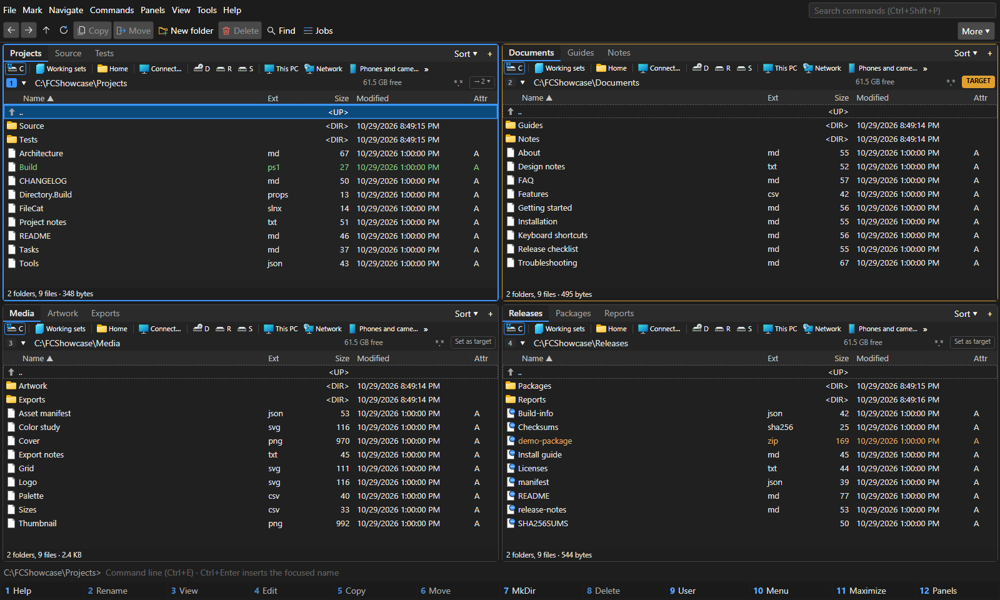
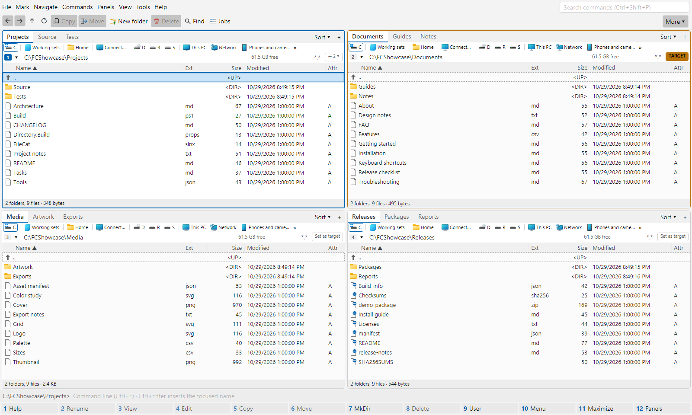
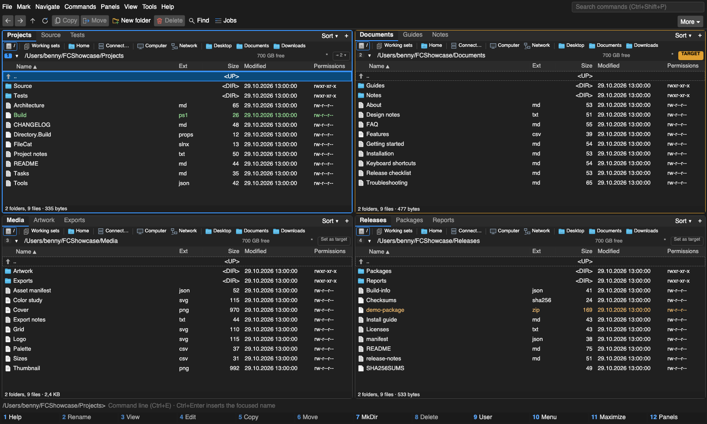
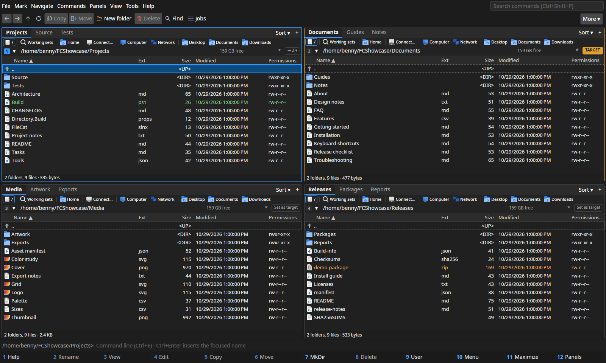
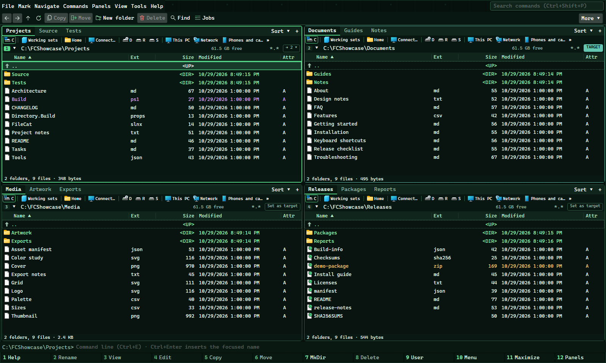
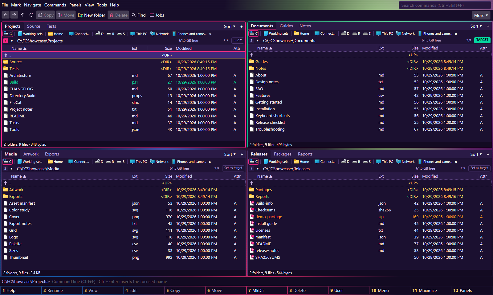
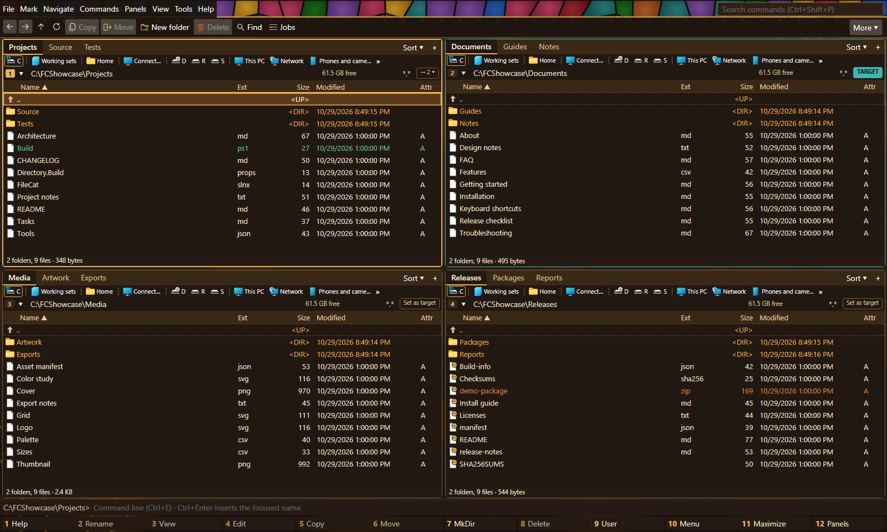
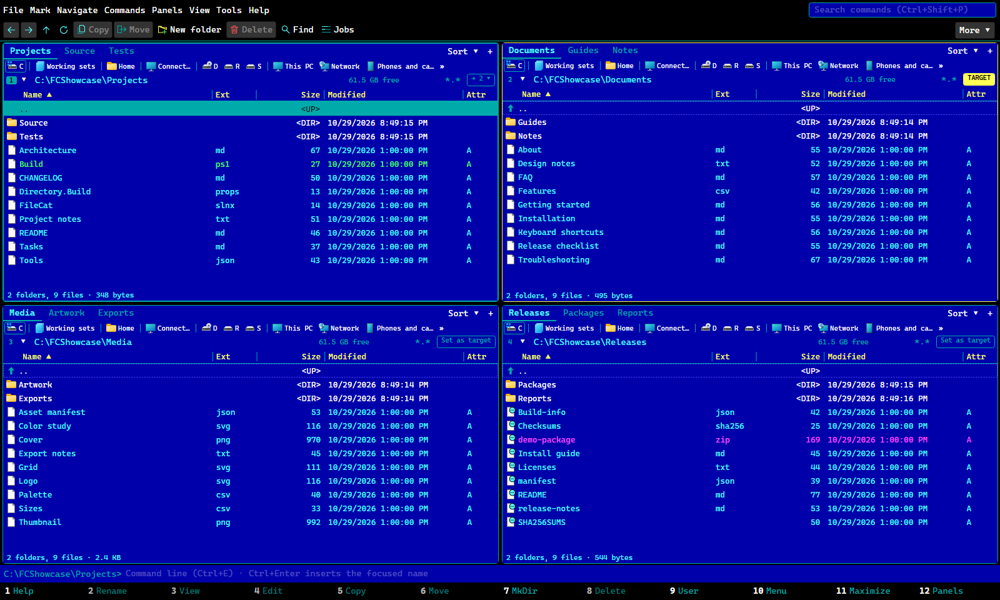
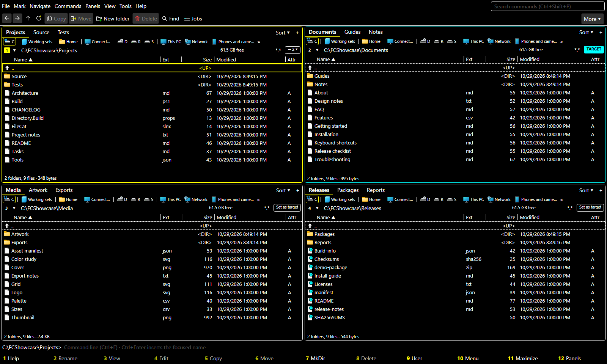

# FileCat

**A file manager for everyday work, with serious tools when you need to go deeper.**

FileCat is a multi-panel, multi-tab file manager for Windows, Ubuntu and macOS. Browse local disks,
removable storage, archives and remote servers in one workspace; on Windows, reach phones and
cameras too.
Search and compare files, recover deleted data from supported NTFS, FAT and exFAT disks or images,
and go deeper with text and hex viewers, a hex editor, and inspectors for executables, images,
audio and video. FileCat follows each operating system's native file behavior and makes platform
and location limits clear.

FileCat shows the destination before an operation starts and distinguishes completed work from
failures and uncertainty afterward. It is built with **C# · .NET 10 · Avalonia 12** and is
**MIT-licensed**. For 1.0.0, Windows 11 x64 is the planned stable tier; Windows 11 ARM64,
Ubuntu 24.04/26.04 x64 and macOS 26+ on Apple silicon are planned previews. The
[capability matrix](docs/CAPABILITIES.md) describes the differences.

[Why FileCat](#why-filecat) · [Recovery](#recover-deleted-files) · [Safety](#work-with-visible-outcomes) ·
[Themes and screenshots](#make-it-yours) · [Keyboard](#keyboard-essentials) · [Build](#build-and-run)



*Four panels, twelve tabs, one workspace. Current FileCat MainWindow rendered on Windows with demonstration files.*

| Windows · Classic | macOS · Classic Dark | Ubuntu · Classic Dark |
|---|---|---|
| [](docs/screenshots/windows/Classic.png) | [](docs/screenshots/macos/ClassicDark.png) | [](docs/screenshots/ubuntu/ClassicDark.png) |

*These are current-source MainWindow renders on their named operating systems. The [capture record](docs/screenshots/CAPTURE-2026-10-29.md) separates them from installed-app testing.*

See [all seven Windows theme screenshots](#make-it-yours), including Psychedelic and DOS Commander,
plus Classic Dark on macOS.

**Release status:** FileCat 1.0.0 is still in validation. The images show development builds;
the [release dashboard](docs/release/1.0.0/FILECAT_1_0_RELEASE_EXECUTION_REPORT.md) tracks
what has passed and what remains before a public release.

## Why FileCat

| When you need to… | FileCat gives you… |
|---|---|
| Keep several places in view | Dockable panels, tabs, bookmarks, named workspaces and an explicit source and destination for each operation. |
| Get a large job done without losing track | Per-drive queues, progress and results for individual items, a durable job journal, and a review of work interrupted by a crash. |
| Rescue deleted files | Read-only NTFS, FAT and exFAT scans of disks or images, lost-partition search, evidence-based recovery states and partial-byte reporting. |
| Understand a file before acting | Built-in text, hex, picture, page and structured-info viewers; checksums and signatures; streams, attributes and filesystem-record reports. |
| Work outside a local folder | Archives, SMB, SFTP, FTPS, FTP, and Windows phones/cameras, with each location's supported actions explained in the UI. |

The point is to keep the same workflow as a task grows: find a file, inspect it, compare it,
copy it to a known target, and see precisely what happened. The sections below describe
implemented capabilities; the [release dashboard](docs/release/1.0.0/FILECAT_1_0_RELEASE_EXECUTION_REPORT.md)
tracks which of them have completed final qualification.

### Arrange the workspace around the task

- Start with two panels or dock more beside and above them. Each panel keeps its own tabs,
  target and history. Lock a tab, reopen a closed one, save a workspace, or jump to a bookmark.
- Browse very large folders with virtualized listings. Search names as you type, filter with masks,
  switch column profiles, and request expensive metadata only when you need it.
- Find files by name, content or metadata (Alt+F7). Results act on the original files. Flat view,
  persistent working sets and duplicate finding give different ways to assemble a task.
- Compare files in text or binary; compare folder trees and preview **Update** or **Mirror**
  actions before applying them.
- Git status appears on local file and folder icons: clean, changed, added, untracked or conflicted.
  It refreshes in the background without fetching missing objects or running repository hooks.

### Recover deleted files

Open **Tools → Recover deleted files** on a supported drive, whole disk or raw/fixed-VHD
image. FileCat reads NTFS, FAT12/16/32 and exFAT; it can find deleted partitions, use a
backup GPT or boot sector, and look for deleted FAT folders no live directory points to.
Results open in an ordinary panel, so you can preview candidates and copy them to a safe target.

Instead of a confidence percentage, each item says **Recoverable**, **Uncertain**,
**Partly lost**, **Overwritten** or **Name only**, with the evidence behind that state.
Unknown bytes are shown as missing in the viewer and as named zero-filled ranges in a copy;
overwritten items cannot be copied. FileCat requests read-only source access and refuses a
recovery destination on the same physical disk. A mounted filesystem can still update its own
metadata during a scan; use a disk image or storage-level read-only protection when the source
must remain byte-identical. Recovery is not guaranteed, and ext4/APFS undelete is not supported.
[Recovery details and limits](docs/CAPABILITIES.md#locations).

### Work with visible outcomes

- **Know the target.** Copy and move show their destination before Start. Jobs can start now or
  queue per drive; a later panel navigation cannot silently retarget them.
- **Know the result.** The Operations view separates completed, failed, skipped and uncertain
  items. Replacement copies are staged before publication where the provider permits it.
  A journal records interrupted work for review and supports guarded undo only where it is safe.
- **Know the delete semantics.** FileCat checks the Recycle Bin or Trash outcome. Where a provider
  cannot recycle, it asks before permanent deletion instead of presenting a false safety net.
- **Know the source.** Download-origin marks follow supported copies and archive extraction.
  SFTP host keys and FTPS certificates are checked; plain FTP requires an explicit choice.
  Checksum matches show integrity, while a trusted signature can establish provenance.
- **Limit elevated work.** In an installed Windows build, access-denied items can be retried
  through a helper for the displayed plan, with an administrator approval for that plan.
  The portable and framework-dependent ZIPs have no such helper.

Untrusted content crosses narrower boundaries where implemented: pictures decode in a worker,
HTML Page preview has scripts and network requests disabled, and Windows Shell extensions run
outside the main process. These boundaries differ by platform; the
[capability matrix](docs/CAPABILITIES.md) and [security policy](SECURITY.md) state their limits.
Some Unix workers still have the ordinary user's filesystem access; process separation alone
does not make every parser a full sandbox.

### Look inside files, not just at their names

- **Built-in viewers:** F3 reads text and hex from very large files without loading the whole
  file. Search, go to line or byte offset, follow a growing file, inspect encodings and checksums,
  or use Ctrl+Q for quick view. Picture view supports zoom and pan. Page view renders local HTML
  and Markdown without fetching from the web; a contained Markdown link opens in another viewer.
- **Inspectors:** Info view reports PE, ELF, Mach-O, APK/AAB, image, audio, video and HTML
  structure without executing or playing the file. A fixed-length hex editor offers a protected
  baseline, bounded undo, journaled save, Save As and patch export; in-place saves are not atomic.
- **Data beneath the file:** inspect NTFS streams, Unix extended attributes, macOS resource forks,
  permissions, sparse ranges and filesystem records. Windows reports include MFT, USN,
  `$LogFile` and `$Secure` data where access allows it; Linux and macOS show their native fields.
- **Verify deliberately:** calculate hashes, check checksum manifests and automatic sidecars,
  or verify minisign/OpenPGP signatures. Weak hashes are labelled as integrity checks rather than
  proof of origin.

### Go beyond a local directory

- Browse nested **ZIP, 7z, RAR 1.5–7, TAR/compressed TAR, single compressed files and ISO/UDF**
  images. Damaged members are reported. ZIP changes rebuild and verify a replacement archive;
  other archive formats are read-only.
- Work with **SMB shares, SFTP, FTPS and FTP** from panels, including explicit remote edit
  sessions. Remote uploads use temporary names where supported; FileCat reports providers that
  cannot replace atomically. An SSH terminal opens from an SFTP panel.
- On Windows, browse **phones and cameras over MTP**, the **Registry** in explicit 32/64-bit
  views, and native Shell actions. Windows native copy keeps supported ReFS block cloning and
  SMB offload. Platform-specific behavior is documented in the
  [capability matrix](docs/CAPABILITIES.md).

## Make it yours

Choose **View → Theme…** to preview a theme on FileCat itself. Press Enter to keep it or Esc to return.
Animated effects can be turned off, and system high contrast takes priority.

Seven Windows themes and Classic Dark on macOS are shown below, with four panels and three tabs in
each panel. Select an image to see it at full size. The Ubuntu view is [near the top](#filecat).

| **Classic** | **Classic Dark** |
|---|---|
| [](docs/screenshots/windows/Classic.png) | [](docs/screenshots/windows/ClassicDark.png) |

| **Cyberpunk** | **Psychedelic** |
|---|---|
| [](docs/screenshots/windows/Cyberpunk.png) | [](docs/screenshots/windows/Psychedelic.png) |

| **Steampunk** | **DOS Commander** |
|---|---|
| [](docs/screenshots/windows/Steampunk.png) | [](docs/screenshots/windows/DosCommander.png) |

| **High Contrast** | **Classic Dark on macOS** |
|---|---|
| [](docs/screenshots/windows/HighContrast.png) | [](docs/screenshots/macos/ClassicDark.png) |

[Capture method and exact source](docs/screenshots/CAPTURE-2026-10-29.md).

All gallery images render FileCat's MainWindow on their named operating systems. They show
the UI at the recorded source; [release qualification](docs/release/1.0.0/FILECAT_1_0_RELEASE_EXECUTION_REPORT.md)
tracks installed-app and native interaction checks separately.

## Keyboard essentials

| Keys | Action |
|---|---|
| F3 / F4 / Shift+F4 | View / edit (external editor) / edit new file |
| F5 / F6 / Shift+F5 | Copy / move or rename / duplicate here |
| F7 / F8 / Shift+F8 | Create folder / delete to Recycle Bin / delete permanently |
| F2 | Rename in place |
| Insert / Space | Mark and move down / mark (sizes folders) |
| Num+ / Num− / Num* / Num/ | Select by mask / unselect / invert / restore selection |
| Tab / Ctrl+U | Switch to target panel / swap locations |
| Ctrl+T / Ctrl+W / Ctrl+Tab | New / close / next tab |
| Alt+F7 / Ctrl+B / Ctrl+F10 | Find files / flat view / compare directories |
| Ctrl+Shift+P / F1 / Ctrl+J | Command palette / keyboard reference / operations |
| Ctrl+E, then Tab | Command line; Tab completes names from the panel's folder (again for the next) |

Every binding can be changed: in the keyboard reference (F1), select a command and press F2, then the new keys; or in Settings (Ctrl+,).

## Platforms and validation

The planned 1.0.0 distribution has **Windows 11 x64** as its stable tier, with
**Windows 11 ARM64**, **Ubuntu 24.04/26.04 x64** and **macOS 26+ on Apple silicon**
labelled as previews. Windows provides Registry, Windows Shell, MTP and installed-build
administrator retry; the Unix builds use their own trash, permission, keyring and device
authorization paths. [What works where](docs/CAPABILITIES.md) lists the per-location limits.

The implementation is backed by automated suites, failure and interruption tests, and native
Windows, Ubuntu and Mac checks. We retain exact build and package provenance and record failed
tests alongside passes in the [release evidence](docs/release/1.0.0/FILECAT_1_0_RELEASE_EVIDENCE_INDEX.md).
That work is still in progress: it does not make a development screenshot or source build a
qualified release. [Current acceptance and gates](docs/release/1.0.0/FILECAT_1_0_RELEASE_EXECUTION_REPORT.md).

## Build and run

Install the .NET SDK version selected by [`global.json`](global.json), then from the repository root:

```sh
dotnet build FileCat.slnx
dotnet test FileCat.slnx
dotnet run --project src/FileCat.App
```

Pass a folder after `--` to open it, or choose the two starting panels explicitly:

```sh
dotnet run --project src/FileCat.App -- --left PATH --right PATH
```

Use `--profile NAME` for another saved workspace identity or `--data FOLDER` to put settings,
history, journals, logs, caches and scratch in one chosen folder. A Windows portable ZIP uses
`FileCat.portable` to keep that state in `Data/` beside the app. When recovering from a disk,
run FileCat with `--data` on **another disk** so its own state cannot write to the source.

Local package scripts, dependency-lock updates, SBOMs and the pinned AppImage runtime are
covered in the [developer build guide](docs/BUILDING.md). A local build is not a signed or
qualified 1.0.0 release.

## Documentation

- [What works where](docs/CAPABILITIES.md) — supported platforms, locations and actions
- [Third-party notices](THIRD-PARTY-NOTICES.md)
- [Security policy and vulnerability reporting](SECURITY.md)
