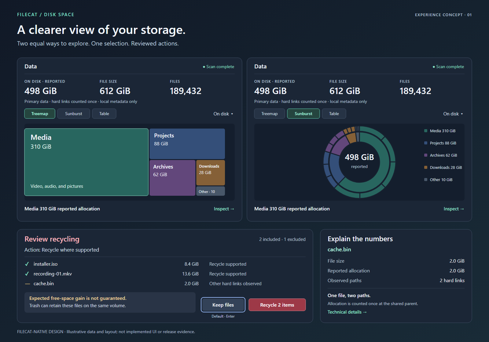

# FileCat Disk Space — Product, UX/UI, Accounting, and Delivery Plan

> **Product promise:** See what occupies storage, understand why the numbers differ, and act on a reviewed selection.
>
> **Experience:** A polished visual explorer for everyday users, with inspectable evidence and precise controls for technical users.
>
> **Status:** Proposed functionality; this document does not claim implementation or authorize release.
> **Revision:** 1.2 · 4 November 2026 · dedicated security audit and mandatory release gates
> **Repository baseline reviewed:** 42829297
> **Audience:** Product owners, designers, developers, testers, accessibility reviewers, and future implementation agents.

This document is self-contained. It records the product decisions, describes the complete intended tool, defines accounting and interaction rules, and supplies delivery and acceptance criteria. No earlier conversation, external task, or open Page is needed to use it. Repository references explain integration opportunities; the requirements remain understandable without opening them.

Implementation starts with sections 27–29 and their golden fixtures. Section 31 is the mandatory security contract for every packet; new affected capabilities stay UNQUALIFIED/OFF until its gates have actual implementation evidence. The separate [security review and disposition](../security/FILECAT_DISK_SPACE_ANALYSIS_SECURITY_REVIEW.md) explains the 16 security findings and the distinction between design closure and native qualification.

---

## Contents

1. [Confirmed product decisions](#1-confirmed-product-decisions)
2. [Product intent and representative journeys](#2-product-intent-and-representative-journeys)
3. [Principles and scope boundaries](#3-principles-and-scope-boundaries)
4. [What the numbers mean](#4-what-the-numbers-mean)
5. [Hard links, shared data, and additive charts](#5-hard-links-shared-data-and-additive-charts)
6. [Locations and platform behavior](#6-locations-and-platform-behavior)
7. [Opening and configuring an analysis](#7-opening-and-configuring-an-analysis)
8. [The analysis window](#8-the-analysis-window)
9. [Treemap and Sunburst](#9-treemap-and-sunburst)
10. [Ranked table and synchronized selection](#10-ranked-table-and-synchronized-selection)
11. [Inspector and technical explanations](#11-inspector-and-technical-explanations)
12. [Filters, groups, and useful questions](#12-filters-groups-and-useful-questions)
13. [Scanning, progress, and freshness](#13-scanning-progress-and-freshness)
14. [Insights and guided recipes](#14-insights-and-guided-recipes)
15. [Cleanup inside the analyzer](#15-cleanup-inside-the-analyzer)
16. [Saved analyses and comparison](#16-saved-analyses-and-comparison)
17. [Export and interoperability](#17-export-and-interoperability)
18. [Visual language and accessibility](#18-visual-language-and-accessibility)
19. [Architecture and integration](#19-architecture-and-integration)
20. [Performance and resource budgets](#20-performance-and-resource-budgets)
21. [Privacy, permissions, and failure containment](#21-privacy-permissions-and-failure-containment)
22. [Delivery slices and requirement ownership](#22-delivery-slices-and-requirement-ownership)
23. [Verification and acceptance matrix](#23-verification-and-acceptance-matrix)
24. [Adversarial review: grill the design](#24-adversarial-review-grill-the-design)
25. [Decisions, qualification gates, and handoff](#25-decisions-qualification-gates-and-handoff)
26. [Evidence and integration references](#26-evidence-and-integration-references)
27. [Normative implementation contracts](#27-normative-implementation-contracts)
28. [Security and operation qualification specification](#28-security-and-operation-qualification-specification)
29. [Implementation packets and decision-free handoff](#29-implementation-packets-and-decision-free-handoff)
30. [Closed-gap register for revision 1.1](#30-closed-gap-register-for-revision-11)
31. [Mandatory security contract — revision 1.2](#31-mandatory-security-contract--revision-12)

---

## 1. Confirmed product decisions

The following choices are requirements, not open questions.

| ID | Decision | Consequence |
|---|---|---|
| D01 | Build a full FileCat tool, covering visual exploration, detailed accounting, comparison, and cleanup. | The roadmap must deliver complete workflows, not stop at a chart. |
| D02 | Everyday use, Commander productivity, and technical investigation have equal importance. | Evaluate all three in design reviews; technical detail must remain available without dominating the initial screen. |
| D03 | Treemap and Sunburst are equal view choices. | Same capabilities, selection, metrics, and acceptance bar; neither is a decorative secondary mode. |
| D04 | Cleanup is available directly inside the analyzer, with review before execution. | Use FileCat's normal job policy and outcomes; opening a separate panel is optional. |
| D05 | Host the tool in a dedicated modeless window. | Main panels stay usable and their navigation cannot retarget an analysis or cleanup plan. |
| D06 | Include optional fast Windows NTFS scanning through a narrowly scoped read-only helper. | Standard scanning remains available without elevation; the helper is a separately qualified backend. |
| D07 | Offer both explainable candidates and guided cleanup recipes. | Recommendations explain their evidence; recipes stage candidates and do not execute themselves. |
| D08 | Save named analyses only when requested; offer optional rolling history in Settings. | No automatic persistent inventory of filenames by default. |
| D09 | Design in FileCat's own visual language, from user needs. | Study existing tools for lessons, but do not copy their layout, visual treatment, or interaction vocabulary. |
| D10 | Show useful, well-themed tooltips on hover, with keyboard/focus equivalents. | Reuse FileCat RichTip/theme resources and provide exact measurements, reasons, and command help without hiding essential information. |
| D11 | Every destructive action uses alerting colors, clear consequences, and user Include/Skip choices. | Apply danger semantics to source removal and target replacement, including downstream job conflicts. |
| D12 | Destructive actions never have the default button or initial focus. | Cancel/Keep/No/Skip is default; protect against accidental Enter, auto-repeat, and gesture carry-through. |

Treemap and Sunburst occupy the same view switcher. Showing both at once is optional future experimentation, not required parity.

## 2. Product intent and representative journeys

### 2.1 Questions the tool must answer

- What is taking up room in this folder or on this drive?
- Which large items do I recognize and want to act on?
- Why does a file's size differ from its reported allocation?
- Why do the analyzed totals differ from the drive's used space?
- What grew since my last saved analysis?
- Which suggested cleanup candidates fit my rules, and why were they suggested?
- What will this specific action do, and what can be said about its effect on free space?
- What information is missing, stale, shared, or unsupported?

The tool must also make an ordinary short visit successful: open Downloads, identify a large installer, preview or reveal it, review deletion, and see the result without learning filesystem terminology.

### 2.2 Representative journeys

| Person and trigger | End-to-end journey | Success criterion |
|---|---|---|
| Everyday user: a drive is nearly full. | Analyze drive → inspect largest folders → filter familiar files → add candidates → review → recycle → see results and the explanation of retained Trash space. | Finds a useful candidate without confusing recycling with immediate reclamation. |
| Commander user: reorganizing projects. | Analyze selected roots → navigate chart/table → mark files across folders → copy/move through a reviewed job → reveal results in a FileCat panel. | No loss of selection or destination ambiguity. |
| Developer: build folders keep growing. | Analyze repository → inspect generated-output recipe → review exact paths and exclusions → stage selected outputs → delete through normal policy → refresh affected branches. | Generated files are candidates, never automatically declared disposable. |
| Technical user: an enormous sparse VM file. | Switch between File size and On disk → inspect measurement basis and sparse state → open filesystem record. | Understands the observed difference without a false claim about exclusive physical blocks. |
| Administrator: used-space totals do not reconcile. | Analyze volume → inspect gaps and issues → inspect hard links, metadata coverage, and snapshot caveats → optionally run authorized fast scan. | Sees evidence and limits rather than a fabricated category that makes a pie chart balance. |
| Collector: an external disk changed. | Save named analysis → scan again later → compare growth and additions → inspect a large change → export report. | Comparison retains scope, measurement basis, and coverage differences. |
| Accessibility user: navigating without a chart. | Use ranked table, filters, inspector, keyboard, and announcements to complete the same cleanup journey. | Every essential operation is possible without interpreting pixels or dragging. |

### 2.3 Outcome measures

Measure through local benchmarks and consented user studies, not new telemetry.

- Time to identify the largest relevant item and complete a reviewed action.
- Correct understanding of File size, On disk, and expected cleanup effects.
- Ability to find excluded or unreadable areas.
- Ability to switch chart modes without losing context.
- Ability to complete the core journey using a keyboard and a screen reader.
- Responsiveness and resource use on the qualified large-tree fixtures.
- No silent broadening of scope, destructive execution, or invented measurement.

## 3. Principles and scope boundaries

### 3.1 Non-negotiable rules

| ID | Rule |
|---|---|
| INV01 | Scanning is explicitly requested and does not modify source contents or deliberately change their attributes. Ordinary OS/provider metadata side effects remain possible. |
| INV02 | Unknown, unsupported, excluded, failed, zero, and not-yet-measured are distinct states. |
| INV03 | OS-reported allocation is not presented as exclusive physical ownership or guaranteed reclaimable space. |
| INV04 | Every chart identifies its metric, component basis, scope, denominator, and completeness. |
| INV05 | Hard-link identity is handled separately from content duplication and shared-block clones. |
| INV06 | Navigation, focus, chart selection, marked items, and the cleanup basket are separate concepts. |
| INV07 | The reviewed operation captures its exact sources and destination. Later navigation cannot change them. |
| INV08 | A suggestion is evidence for review, not a safety guarantee or permission to delete. |
| INV09 | Cancellation, limits, and failures preserve useful results and visibly qualify them. |
| INV10 | All essential workflows have keyboard and nonvisual equivalents. |
| INV11 | Analysis results are observations over time unless backed by an actual immutable filesystem snapshot. |
| INV12 | Persistent history and inventory export follow the user's explicit choices. |
| INV13 | Useful hover/focus help inherits the active theme and exposes plain accessible text; task-critical information remains visible elsewhere. |
| INV14 | Destructive reviews visibly name consequences, allow explicit Include/Skip, and default/focus to the preserving choice. |
| INV15 | Serialized data, metadata hashes, settings and consent-correlated nonces cannot create runtime action or privileged authority. |
| INV16 | Mutation binds the selected namespace entry and preserves protected app/recovery objects; object identity alone is insufficient. |
| INV17 | Approved membership and tokens are process-owned, integrity-checked, single-use and never restored as consent after restart. |

### 3.2 Included in the complete target

- Multi-root analysis of local filesystems and explicitly chosen mounted shares.
- Equal Treemap and Sunburst views, ranked tables, grouping, filtering, and a details inspector.
- Portable scanning and qualified native measurement adapters.
- Explicit deeper allocation/stream analysis and optional NTFS acceleration.
- Explainable insights, guided recipes, a cleanup basket, reviewed actions, and job results.
- Named saved analyses, optional rolling history, comparisons, and exports.
- Logical-content analysis for additional providers where capabilities allow it.
- Integration with existing viewers, filesystem reports, working sets, duplicate analysis, and operations.

### 3.3 Boundaries

This feature does not add a disk repair engine, secure wipe, automatic storage optimizer, file deduplication writer, application uninstaller, snapshot deletion service, quota manager, always-running scanning daemon, or automatic system cleaner.

It does not promise exact per-file physical ownership on copy-on-write, deduplicated, snapshot-backed, thin-provisioned, remote, or cloud storage. Mapping virtual files to physical devices is not enough to establish that ownership.

A saved analysis is a metadata inventory, not a backup of file contents and not an OS filesystem snapshot. Cross-disk offline catalog search is a possible reuse of saved inventories, but is not required to deliver disk-space analysis.

## 4. What the numbers mean

### 4.1 User-facing measures

| Label | Meaning | Important limit |
|---|---|---|
| File size | Logical length of the primary content of every included file path. | Hard-linked paths repeat content here; archives count as container files in disk mode. |
| Unique file size | Logical primary-content length counted once per verified file identity within this scan scope. | Distinct files with matching hashes remain distinct objects. |
| On disk — reported | Sum of allocation values reported by the selected backend and component policy, with verified hard links counted once. | Clones or deduplication can still share physical blocks; backend coverage differs. |
| Files | Count of included file paths. | Distinguish paths from unique file objects in the inspector. |
| Extra data | Separately measured named streams, forks, or other exposed components. | Logical extra-data length is not assumed to equal allocated space. |
| Volume free | Free space reported for the relevant volume or storage pool at a stated time. | Space available to the current user may differ because of quotas or reservations. |
| Expected space effect | A qualified explanation for the proposed action. | Never substitute the selected file-size total for an expected free-space gain. |

The primary metric switch offers File size, On disk, and Files. Unique file size and component controls are available under metric options. Explain each option next to its control.

For local disk analysis, default to On disk when the adapter supports it. Show known measured values as they arrive and make pending/unavailable values conspicuous. For logical-only sources, default to File size with the sentence: “This location reports file lengths, not storage allocation.”

Do not change the selected metric silently during a scan or when changing views.

### 4.2 A measurement is more than a number

Every metric value carries:

- Value in bytes or count, stored without display rounding.
- State: known, pending, unsupported, excluded, failed, or changed during observation.
- Method and component basis.
- Observation time or scan interval.
- Identity assurance and backend capability.
- Relevant caveats, including possible shared extents.
- Coverage of the requested component policy.

Use checked wide accumulators for totals. Malformed provider values, negative lengths, and arithmetic overflow become reported issues, never wrapped or plausible-looking totals.

### 4.3 Component policies

The scan dialog exposes two understandable presets.

| Preset | Work requested | Presentation |
|---|---|---|
| Standard | Enumerate names, primary logical lengths, identity and primary allocation where safely supported. No file-content reads. | Fast path for exploration. Any omitted named streams, forks, or metadata components are identified. |
| Detailed allocation | Standard plus supported stream/fork allocation, directory self-allocation, and additional storage facts. Still no general content hashing. | More I/O; component coverage and unsupported fields remain visible. |

The backend supplies a machine-readable measurement-basis descriptor. For example, a primary-stream allocation measurement and a total-file allocation measurement are different bases.

Requirements:

1. A component already included in a total must not be added again.
2. Directory self-allocation is distinct from the sum of descendants.
3. Extended-attribute payload length is not used as allocated size.
4. A compressed/sparse file's allocation is not guessed by rounding its logical length to cluster size.
5. Missing allocation is never replaced with logical length inside an On disk total.
6. Detail enrichment creates a new result revision and updates coverage.
7. Comparison can compare like bases; incompatible bases require explicit limited comparison.
8. The UI says what is covered, such as “Primary data; named streams not measured.”

### 4.4 Aggregation and denominators

For a fixed result revision:

- File-size totals sum included primary logical lengths per file path.
- Unique-file-size totals use verified identity groups once; identity-unknown contributions are shown separately.
- On disk totals use known component allocation with hard-link attribution from section 5.
- Unknown-size items appear in a separate count/list; no invented chart area represents their unknown bytes.
- Excluded and unreadable subtrees are separate coverage facts.
- Zero-byte files are reachable in the table and Files mode even when they have no area in a byte chart.

All percentages state their denominator: “of known displayed allocation,” “of this folder's measured file size,” or “of matching files.” Coverage by item count must never be described as coverage by bytes.

During incomplete scanning, use “Known reported allocation: 43.2 GiB; still scanning” or “Allocation unavailable for 312 observed files.” Do not use “43.2 GiB of your disk explained” unless that stronger claim is justified.

Use the profile's unit preference; always show GB versus GiB unambiguously. Tooltips and copy-details expose exact byte values. Round display text only.

Persist observation timestamps in UTC together with source precision. Display local times with the timezone available in details, and provide exact UTC values for copying/export. Do not invent creation times or nanosecond precision where the provider did not report them.

### 4.5 Used-space reconciliation

Present volume capacity in a separate ribbon, with timestamp and storage-pool identity where relevant. Do not put free space into the file hierarchy as a deletable tile.

A full-volume analysis may show:

- OS-reported used and free values.
- Known file allocation under the selected basis.
- Coverage issues and observed directory/extra-data allocation.
- A signed comparison difference labelled “Difference from reported used space.”

A positive difference is not automatically “system files.” A negative difference is not clamped away. Either can reflect shared blocks, inaccessible areas, different measurement bases, snapshots, concurrent activity, metadata, reservations, or provider behavior. List possible explanations separately from observed evidence.

For a folder scan, explicitly state that its file totals are not expected to explain the volume's full used space. Shared APFS pools and similar storage pools must not have their available space summed once per member volume.

## 5. Hard links, shared data, and additive charts

### 5.1 Separate three relationships

| Relationship | How it is recognized | Accounting treatment |
|---|---|---|
| Hard links | Verified same filesystem object identity. | One allocation contribution; retain all observed paths. |
| Content duplicates | Separate objects with matching verified content evidence. | Each object keeps its allocation contribution. Potential cleanup candidates only. |
| Clones/shared extents | Filesystem-specific sharing evidence, sometimes unavailable. | Keep reported allocation and sharing caveat; do not infer exclusive blocks. |

Volume/device plus file identity is the starting key. Identity must be scoped to backend, connection, scan, and filesystem context as appropriate. IDs can be reused over time; saved comparisons also need revision evidence and assurance labels.

If identity is unavailable, do not silently deduplicate. Show a separate “Identity not verified” allocation contribution. The result is then a reported sum with possible hard-link overcount, not an exact unique-object total.

### 5.2 Chosen chart rule: shared allocation stays at the common parent

Arbitrarily assigning a shared object's bytes to the first traversed path makes folder rankings depend on scan order. The target design instead attributes a verified hard-linked object's allocation at the lowest common ancestor of all its observed in-scope paths.

- If all paths belong under one folder, that folder contains the charge.
- If paths cross sibling folders, the common parent has a synthetic “Shared hard-linked files” bucket.
- Individual alias rows retain their logical lengths and identities; the allocation column explains where the shared charge appears.
- Selecting the shared bucket shows the objects and all their observed paths.
- A synthetic bucket is not a directory and cannot itself be deleted or moved.
- Switching to File size makes the repeated path lengths visible by definition.

Example:

~~~text
Projects/
  Alpha/cache.bin   ┐
  Beta/cache.bin    ┴ same file object, 4 GiB reported allocation

File size: 8 GiB across two paths
Unique file size: 4 GiB
On disk: 4 GiB, shown in Projects → Shared hard-linked files
Alpha and Beta: badges explain their references to that shared allocation
~~~

An inspector can show “References 4 GiB counted at Projects.” That reference total is explicitly non-additive; it is not added again to the branch's chart charge.

Attribution is fixed to the analysis root and result revision. Zooming changes the visible scope but does not secretly reassign ownership. “Analyze this folder separately” creates a new scope with a clearly different attribution basis.

For type/age groupings, an object whose aliases belong to different groups goes into “Shared across groups.” A hierarchy switch may change attribution projection, but never the overall known total for the same metric and included set.

### 5.3 Incomplete discovery and filters

Hard-link attribution remains provisional while enumeration or identity enrichment is incomplete. The live layout can update at controlled publication points; the completed revision is deterministic under traversal-order changes.

Display filters project the existing accounting contributions. They do not reattribute hidden aliases to visible ones. For a path-based filter, include an object's charge once when at least one observed alias matches; include only that object's matching contribution inside a shared bucket, not every object in the unfiltered bucket. Preserve the charge's existing parent location and show nonmatching aliases as context rather than extra matches. When a matching alias points to allocation charged elsewhere, show the linked shared bucket and explain it. “Analyze matches as a new scope” may explicitly build a separate scope if desired.

The same identity can return conflicting size/allocation observations during live mutation. Do not merge fields from incompatible revisions into a seemingly stable object. Retain the last coherent observation with a changed/stale marker, or withhold its stable metric until remeasured; publish that choice consistently across totals and views.

A scan finding fewer paths than the reported link count says “Other links may exist outside this analysis.” Even observing the reported count is not a guarantee that no link appeared afterward.

### 5.4 Cleanup is not chart attribution

Removing one path to a hard-linked object normally leaves other paths and their data. Cleanup review must re-evaluate current identities and observed link counts; it cannot derive a reclaim claim from the chart charge.

Even after all known paths are selected, snapshots, clones, unobserved links, open handles, Trash behavior, and concurrent changes can affect the result. The UI therefore avoids guaranteed freed-byte estimates.

**Design gate:** Prototype the shared bucket with ordinary users. If they cannot explain why a folder references data counted at its parent, revise the wording/visual treatment before shipping. Do not replace it with silent double counting.

## 6. Locations and platform behavior

### 6.1 Capability matrix

| Location | Target support | Allocation and action contract |
|---|---|---|
| Local Windows NTFS/ReFS/FAT/exFAT | Standard analysis, detailed facts where exposed, normal cleanup. | Measure actual supported allocation; qualify hard-link, stream, compression, and sharing coverage. |
| Local Linux filesystems | Portable enumeration plus native identity/allocation adapters. | Honor returned field validity; do not treat reflink or deduplication sharing as exclusive ownership. |
| Local macOS filesystems | Native metadata through supported interfaces and portable traversal. | Show APFS sharing/snapshot caveats; explain package and resource-fork policy. |
| Mounted SMB/network shares | Explicitly chosen analysis with bounded work and normal provider operations. | Server-reported facts and volume/quota views may be incomplete or non-comparable. |
| Cloud-synchronized local folders | Metadata-only scan that avoids content recall through qualified adapter paths. | Distinguish logical length, locally present data, and reported allocation. |
| SFTP/FTP and similar providers | Logical-content analysis in the complete roadmap. | No physical-allocation or server-free-space claims without a separately supported capability. |
| Archive contents | Separate “Container contents” analysis where enumeration is supported. | Logical member sizes and compressed-member metadata are not disk allocation. |
| Recovery results | No “free disk space” cleanup mode. | Existing recovery investigation remains separate; deleted entries are not ordinary deletable live storage. |
| Registry, working-set membership, synthetic nodes | Explain unsupported disk analysis or offer an explicit live-file scope. | No fabricated bytes for non-file resources. |

### 6.2 Scope and traversal

- Include hidden and system entries by default where access permits; identify them without classifying them as disposable.
- Do not follow symbolic links, junctions, aliases, or arbitrary reparse targets.
- Display link entries with target information where safe and available; opening the target is explicit.
- Do not cross filesystem/mount boundaries by default. Show boundary nodes and offer “Analyze this location” separately.
- Distinguish cloud reparse points from navigation links; blanket “all reparse points are links” logic would lose valid placeholder metadata.
- Exclude pseudo-filesystems, devices, sockets, and pipes from content/length reads. Count and explain special entries separately.
- On macOS, show packages as recognizable units by default while allowing inspection of their contents; scan policy must record whether package contents were included.
- Canonicalize overlapping roots for enumeration while preserving the user's chosen root labels. A contained or verified alias root becomes a reference to the already covered tree, not a second additive copy. A virtual analysis root provides a common ancestor when distinct chosen roots share objects. Do not rely only on string-prefix tests.
- Raw case and Unicode names remain provider-owned. Sorting/display normalization must not change identity.

### 6.3 Windows NTFS acceleration

The first qualified fast backend accepts explicitly selected whole local NTFS volumes only. Folder/subtree requests use standard anchored scanning. Any future subtree fast mode needs a separate confinement decision; it is not implicit scope expansion. Section 28 fixes the helper contract.

The optional backend accelerates namespace discovery using qualified native NTFS metadata facilities. It is not advertised as instantaneous, complete by virtue of elevation, or equivalent to directly reading every file's allocation.

Requirements:

1. Explicit “Fast NTFS scan” choice with the volume and requested scope shown before authorization.
2. Narrow helper protocol, read-only volume access, validated identity of the selected volume, bounded lifetime, and cancel support.
3. Discovery records must be supplemented where they do not establish allocation, streams, complete aliases, permissions, or current paths.
4. A root/subtree request must not leak unrelated volume paths back to the ordinary UI, logs, or exports.
5. The first helper rejects subtree roots. Do not widen a folder request silently; offer a separately named whole-volume analysis with new explicit consent.
6. Helpers provide observations, never execute cleanup and never open arbitrary privileged paths supplied by the UI.
7. No silent switch to privileged discovery after an access error.
8. Portable ZIPs or platforms without a qualified helper retain standard scanning and truthful unavailable explanations.
9. Fast and standard backends use the same metric contracts, issue taxonomy, and comparison fingerprints.
10. No USN-journal creation, source repair, or write access to make a scan faster.

Microsoft documents FSCTL_ENUM_USN_DATA as an NTFS enumeration facility; that contract alone does not supply a complete disk-accounting engine. See [Microsoft's enumeration reference](https://learn.microsoft.com/en-us/windows/win32/api/winioctl/ni-winioctl-fsctl_enum_usn_data).

## 7. Opening and configuring an analysis

### 7.1 Entry points

- Tools → Disk space…
- Drive/folder context menu → Analyze disk space…
- Command search synonyms: disk space, storage, largest files, folder usage, disk map.
- Explicit “Analyze selected folders” action where marked roots are applicable.
- Optional link from This PC's capacity display.

Do not repurpose the existing Analyze folder command, which currently computes a metadata column, or change Space's mark-and-size behavior. These remain useful lightweight tools.

A general Tools command preloads the active folder. A context command preloads the invoked item(s). Multiple marked folders are used only by the explicitly named selection action. Do not accidentally scan a whole drive because no folder was marked.

### 7.2 Start screen

~~~text
Disk space
Understand this storage. Choose what to measure.

Locations       [ D:/Data                         ] [Add location]
                [ E:/Projects                     ] [Remove]

Scan            [ Standard ▼ ]
                Metadata only. File contents are not read.

Boundaries      [✓] Stay within each filesystem
                [ ] Exclude these folders…       [Edit]
                Cloud files: inspect local metadata; do not download content

Extra options   [Show]
                Detailed allocation · Fast NTFS scan · Resource limits

                                            [Cancel] [Start analysis]
~~~

Show selected roots, expected capability, and notable scope changes in plain language. Advanced options expand in place. A local start needs one clear Start action, not a wizard.

Exclusions are scan policy and affect what can be concluded. Current panel filters do not silently become scan exclusions. Offer “Use panel filter for display after scan” as an explicit independent choice.

### 7.3 Session capture

Start captures immutable roots, provider/session identities, component preset, exclusions, mount policy, requested backend, user context, and limits. Later navigation and settings changes do not silently alter the running request.

A new request can reuse the same window as a new analysis tab. Tabs are analysis sessions inside this tool window, not additional main workspaces. One tool window per FileCat instance is the initial design; analysis sessions can be compared there.

## 8. The analysis window

This original concept board illustrates the visual direction and equal chart treatment. Its values and simplified controls are illustrative, not implemented UI or release evidence. The complete window layout and behavior are specified below; the document remains understandable without the graphic. [Editable SVG concept](../images/filecat-disk-space-concept.svg).

### 8.1 Wide layout

~~~text
┌ Disk space — Data                                        [Save] [Compare] [More] ┐
│ Data › Projects › Media                 [Pause] [Stop]   Scanning • 12 issues    │
│                                                                                │
│ ON DISK — REPORTED       FILE SIZE             FILES           VOLUME FREE      │
│ 498 GiB known            612 GiB               189,432          176 GiB           │
│ Primary data • incomplete allocation coverage                 measured 14:32    │
│                                                                                │
│ [Treemap] [Sunburst] [Table]    Size: [On disk ▼]    Color: [File type ▼]          │
│ [Search within results…             ] [Type] [Age] [Size] [More filters] [Clear] │
├──────────────────────────────────────────────────────┬─────────────────────────┤
│                                                      │ Selection inspector     │
│   VISUAL EXPLORER                                    │ recording-01.mkv        │
│   clear hierarchy, calm category colors,             │ 18.4 GiB reported       │
│   stable selection, labels where they fit            │ 18.4 GiB file size      │
│                                                      │                         │
│                                                      │ [Preview] [Reveal]      │
│                                                      │ [Add to cleanup]        │
├──────────────────────────────────────────────────────┤ [Technical details ▸]   │
│ Name             On disk    File size  Files  State  │                         │
│ Media            310 GiB    320 GiB    2,901  Partial │                         │
│ Projects          88 GiB    180 GiB  123,004  Scanning│                         │
│ …                                                    │                         │
├──────────────────────────────────────────────────────┴─────────────────────────┤
│ Cleanup basket: 12 paths • 24 GiB file size • expected free-space gain unknown  │
│ [Review cleanup]                       Metadata scan • 00:24 elapsed           │
└────────────────────────────────────────────────────────────────────────────────┘
~~~

Values are illustrative design content, not a performance or accuracy claim.

### 8.2 Layout responsibilities

- Header: analysis identity, root/breadcrumb, lifecycle controls, save/compare.
- Summary strip: selected-scope facts and a separately labelled volume context.
- View toolbar: chart choice, metric, hierarchy/grouping, color dimension.
- Filter row: query and visible chips; chips distinguish view filters from scan exclusions.
- Main explorer: chart or full table, never an empty decorative dashboard.
- Ranked table: synchronized with the current visual scope; resizable.
- Inspector: selected-item explanations and relevant actions.
- Cleanup basket: persistent task summary with explicit review.
- Status line: scan state, freshness, issues, and resource/operation feedback.

Summary values must identify whether they describe the full analysis, current zoom, or filtered subset. Volume free space always names its volume/pool and is not implicitly scoped to a folder.

### 8.3 Responsive layout

| Available width in DIP | Behavior |
|---|---|
| 1280 and above | Chart, resizable table below, and inspector beside them. |
| 900–1279 | Inspector becomes a toggleable drawer; summary wraps to two lines. |
| 640–899 | Chart/Table tabs, compact metric strip, full-width inspector sheet; basket remains accessible. |
| Below 640 or at high text scaling | Table-first layout, stacked controls, no horizontal scrolling for essential actions. |

These are design starting points to validate with actual fonts and themes. Do not hard-code a window minimum that makes the tool unusable on smaller displays. At 200% text scale, content can reflow and panels can collapse without hiding review controls.

### 8.4 Modeless lifecycle

- Main FileCat panels remain available throughout scanning and review.
- Analysis jobs and filesystem operations participate in the existing application-wide operation view.
- Closing an idle temporary analysis discards it unless named/saved; explain an unsaved basket or comparison when meaningful work would be lost.
- Closing an actively scanning tab offers Stop and close or Keep open, with Keep open default. Continuing in the running FileCat instance is a separate explicit Hide window action.
- No option implies survival after FileCat exits; there is no new daemon.
- A running cleanup job is owned by the normal operation system and remains visible after the analysis view closes.
- Esc dismisses the topmost overlay first, then requests closure of the tool window, with the same active-work safeguards.

## 9. Treemap and Sunburst

### 9.1 Equal functionality

Both views must support:

- The same source tree/grouping and active metric.
- Hover/focus details, selection, marking, drill-down, breadcrumbs, and history.
- Filter-state visibility, shared buckets, zero/unknown-item access, and issue indicators.
- Preview, reveal, add-to-cleanup, copy paths, and accessible table equivalents.
- Stable selection when switching views.
- Comparison mode and export with their semantic limits.

Do not build separate filtering or accounting engines for the charts.

### 9.2 Treemap specification

Use a stable rectangular layout with visible folder grouping, restrained borders, and labels at usable sizes.

- Area is proportional to the chosen known metric.
- Parent boundaries remain distinguishable without heavy nested bevels.
- Large tiles show name and formatted value; smaller tiles use tooltip/focus details.
- Do not distort tile size to make a tiny item selectable. Aggregate small items into a labelled “Other small items” bucket that can be opened.
- Aggregation thresholds are screen-space/rendering decisions; totals and exports retain the full underlying result.
- Synthetic buckets use a distinct outline/pattern plus text.
- Selection uses a clear outline and a table mark; it is not merely a hue change.
- Double-click or Enter on a folder drills down; a single click selects.
- Files open the inspector; F3 previews. A chart double-click does not unexpectedly launch an executable.
- Mouse wheel scrolls the relevant surface; chart zoom uses explicit controls or a modified gesture, not a surprise replacement for scrolling.

### 9.3 Sunburst specification

Use concentric hierarchy rings with a useful center, not an ornamental gauge.

- Arc angle reflects the active metric; ring depth reflects hierarchy.
- Center displays current scope name and value, with an Up action where applicable.
- Direct-file allocation and directory self-allocation receive explicit leaves/buckets so angle totals remain consistent.
- A limited visible depth prevents microscopic rings. More depth is reached by drilling in.
- Labels rotate only where readable; never require users to read upside-down text.
- Thin/unlabelled segments are selectable through their corresponding table rows and an “Other small items” drill-down.
- Selected ancestors and the current path are highlighted consistently across rings and breadcrumbs.
- Resizing preserves scope, selected identity, and navigation history.
- Zero/unknown values appear in an adjacent status row/list rather than an arbitrary-angle wedge.

### 9.4 Live layout and interaction stability

Publish data continuously, but apply chart relayout at controlled intervals. While the pointer is down, a selection drag is active, or an action menu is open, freeze hit targets and defer the next layout revision.

Show “New results available” when a frozen projection is materially behind. Apply updates after the interaction ends. Keyboard focus stays on its item identity, not its previous rectangle.

Use short spatial transitions only for deliberate drill-down, view switching, and requested refresh. Scanning does not produce continuous animated rearrangement. Reduced-motion mode uses immediate transitions.

### 9.5 Comparison charts

Use the same spatial hierarchy with a separate Growth coloring mode. Area is current observed allocation/file size; it cannot represent negative space.

Removed entries belong in a clearly labelled Removed view/table or previous-snapshot chart. A diverging legend distinguishes growth, shrinkage, added, removed, and unknown comparison status with symbols and text. Do not use negative tile areas or combine “net change” and “current size” under one unlabeled number.

## 10. Ranked table and synchronized selection

### 10.1 Default and optional columns

Default: Name, active metric, File size, Files, State. Path is included for flat/multi-root results.

Optional: allocation basis, unique objects, observed hard links, modified/created time, age bucket, extension/type, owner where supported, sparse/compressed flags, extra-data size, sharing evidence, change since saved analysis, and source observation time.

Unavailable values show their state and reason. Unknowns sort after known values in either direction. Sorting a live partial result says “Known results so far.” Do not imply that a current top ten is the final top ten.

### 10.2 Selection contract

- Focus identifies the current item.
- Marking identifies the current batch selection.
- Chart highlighting mirrors focus and marks.
- The cleanup basket is an explicitly staged set independent of current marks.
- Zoom and sorting preserve marks by stable record identity.
- View filters retain hidden marks, with “N marked items hidden by filters” and a Review marked action.
- “Select all” names its scope: visible matches in the current result revision. It cannot quietly include unread future scan results.
- “Select all after scan completes” is a separately named deferred selection request, materialized and reviewed later.
- A group mark records a bounded snapshot of its current members, not a standing rule that selects future files.
- Adding a folder to cleanup covers its descendants at review; ancestor/descendant overlap is normalized and shown.
- Adding a synthetic group expands to real items only through an explicit action naming the member scope and count.

Large selections must not force one managed UI object per entry. If the existing result-set provider cannot safely hold the handoff scale, add a bounded adapter or provide a clear limit; never silently truncate selected items.

### 10.3 Keyboard model

| Action | Behavior |
|---|---|
| Tab / Shift+Tab | Move between toolbar, filter, chart summary, table, inspector, basket, and status actions. |
| Arrow keys | Navigate the focused table/tree or the chart's logical node structure. |
| Space | Toggle mark on the focused item; follow existing Commander behavior where appropriate. |
| Enter on folder/group | Drill into it. |
| Enter on file | Focus/open its details in the analyzer. |
| Backspace; Alt+Left/Right | Parent scope; navigation history. |
| F3 | Preview selected/focused file using the existing viewer. |
| F5 / F6 | Open reviewed copy/move for marked/focused real items, with destination explicitly chosen or captured. |
| F8 / Delete | Open deletion review for the current real-item selection. Never execute immediately. |
| Ctrl+F | Focus result filtering. |
| Esc | Close the topmost overlay; otherwise request tool closure. |

New shortcuts require a keymap conflict review and remain configurable. Synthetic accounting rows cannot inherit real-file mutation commands. The command titles and help text must make the analyzer's Enter behavior discoverable.

## 11. Inspector and technical explanations

### 11.1 Everyday layer

Show name/path, file/folder type, primary metrics, scan freshness, and a short explanation of any unusual state.

Examples:

- “This file has 200 GiB of logical content, with 12 GiB of allocation reported by the filesystem.”
- “This folder includes unreadable locations. The displayed totals cover the entries measured so far.”
- “These two paths name the same file. Its allocation is counted once at Projects.”
- “Only metadata is available for this cloud file; its contents were not downloaded.”
- “This is a suggested build-output folder. Review it before deleting; generated folders can contain files you chose to keep.”

Actions: Preview, Reveal in panel, Copy path, Add to cleanup, Compare when available.

### 11.2 Technical layer

Expandable sections provide:

- Exact logical length and allocation by component.
- Source API/backend and metric-basis descriptor.
- Volume/device identity and file ID/inode, with assurance limitations.
- Observed paths and link count, with out-of-scope links noted.
- Sparse/compression flags; allocation method; supported sharing evidence.
- Named streams/forks and unknown components.
- Timestamp values, precision, observation interval, and change warnings.
- Scope/exclusion reasons and provider capability details.
- Links to existing Hidden data, File-system record, checksums, or viewer tools.

Deep details are demand-driven and cancellable. Opening an inspector must not automatically invoke privileged/raw-record parsing, hash large content, query a network service, or hydrate a placeholder.

### 11.3 Explanations are evidence-based

Use “Possible explanation” for inference and name observed evidence separately. Sparse/compressed flags alone do not prove why every byte of a size difference exists. A generic “shared blocks possible” capability flag is not proof that this individual file is a clone.

## 12. Filters, groups, and useful questions

### 12.1 Common filters

Offer visible controls for name/path, type/extension, size range, modified age, roots, hidden/system state, item kind, measurement/issue state, and added/removed/changed status in comparisons.

Advanced filters add owner where available, primary/extra-data measurements, sparse/compressed/cloud flags, observed hard-link groups, and duplicate-analysis evidence.

Filter chips summarize the current request; each can be removed. “Clear” resets view filters, not scan policy or cleanup basket.

### 12.2 Grouping

Group by folder hierarchy, file type/extension, modified-age bands, owner where supported, root/volume, or comparison status. Type classification uses a recorded rule version. Unknown extensions and missing timestamps have explicit groups.

Age means modification age by default. Say so in labels. Access time is not a reliable “last used” indicator and must not become a default cleanup recommendation.

Generated folders and application caches are recipe classifications with evidence, not file types. Package and archive contents stay under the explicitly chosen analysis mode.

### 12.3 Optional expert query input

Provide a query builder first, with a textual expression view using the same parsed model. Suggested grammar:

~~~text
type:video size>2GiB modified-before:2025-01-01
path:"Projects/Client A" sparse:true
state:unreadable
change:growing delta>500MiB
~~~

The exact grammar, fields, units, precision and error rules are fixed in section 27.6. Requirements: no command execution, clear unit/date semantics, literal quoting, bounded regex if offered, accessible syntax errors, and exact round-tripping with controls. Relative dates resolve once per query and show their reference time.

Search within already observed results reads no additional file content. “Find duplicate contents” is a distinct explicit analysis.

## 13. Scanning, progress, and freshness

### 13.1 Lifecycle

~~~mermaid
stateDiagram-v2
    [*] --> Ready
    Ready --> Scanning: Start
    Scanning --> Paused: Pause requested and reached
    Paused --> Scanning: Continue within session
    Scanning --> Complete: Requested work finished
    Scanning --> Partial: Stop, limit, or unresolved failure
    Paused --> Partial: Stop
    Complete --> Refreshing: Explicit refresh
    Partial --> Refreshing: Retry or rescan
    Refreshing --> Complete: Work finished
    Refreshing --> Partial: Gaps remain
    Complete --> Saved: Save named analysis
    Partial --> Saved: Save with partial state
~~~

Completion is qualified by enumeration and measurement coverage. “Complete under policy” means the requested traversal and component work finished; it does not mean every source area was accessible or that OS free-space accounting was explained.

### 13.2 Progress

Show elapsed time, observed files/folders, directories remaining where known, current location, phase, issues, and measured quantities. Use indeterminate progress when total work is unknown.

Do not invent a scan percentage from bytes discovered so far. An entry-count percentage applies only when a qualified backend knows a stable denominator; label its phase. An ETA is shown only after a supported estimator is stable and remains approximate.

### 13.3 Pause, stop, disconnect, and resume

- Pause prevents admission of new work and settles currently interruptible work. It may read “Pausing…” while an OS call remains blocked.
- Stop ends scheduling promptly, retains observed results, and publishes a partial state.
- UI cancellation is immediate even when an underlying synchronous call cannot be forcibly canceled.
- Hung native/provider calls use bounded worker isolation/quarantine; do not keep spawning replacements without a cap.
- Disconnect preserves the inventory, marks the source unavailable, and does not redirect actions to another volume with the same drive letter.
- Continue within the same live session can resume a controlled frontier, with new observation times.
- Continuing an interrupted saved analysis requires revalidation and a new epoch. It is not presented as a consistent continuation of an old immutable snapshot.
- If trustworthy resumability cannot be implemented for a backend, offer Rescan with saved settings.

### 13.4 Freshness

Watchers and provider notifications mark affected branches stale; they do not prove that all changes were observed. Avoid a recursive watcher per directory.

Offer Refresh branch and Rescan all. Refreshing creates a new revision, preserves the previous stable result for comparison, and retains current focus where identity can be established.

A missed journal interval, watcher overflow, permission change, mount change, or identity mismatch invalidates the appropriate scope. Do not continue showing a green “up to date” state.

## 14. Insights and guided recipes

### 14.1 Insight cards

Insights answer useful questions with a concrete list and an explanation.

| Insight | Evidence | Caution shown |
|---|---|---|
| Largest files/folders | Current known metric ranking. | Partial results may change. |
| Old large files | Size plus modification timestamp. | Old does not mean unused or safe to delete. |
| Many small files | Counts and known allocation. | Metadata/cluster overhead coverage varies. |
| High logical-to-allocation difference | Measured lengths and allocation. | Sparse, compression, sharing, or measurement basis may contribute. |
| Duplicate content | Explicit content analysis with identity/revision checks. | Hard links are not independent copies; hashes do not establish user intent. |
| Large extra data | Qualified stream/fork observations. | Deleting streams can alter application behavior or provenance. |
| Growing locations | Compatible saved-analysis comparison. | Unknown old coverage is not proven growth. |
| Unmeasured/unreadable locations | Issue records. | Unknown size is not zero and not a cleanup candidate by itself. |

Every card names its scope, observation time, rule, and limitations, and offers View candidates. No hidden action occurs when a card is opened.

### 14.2 Guided recipes

Initial recipe families: large downloads/installers, old large files, recognized build outputs, application-specific caches with qualified rules, duplicate review, and growth since a saved analysis.

A recipe is a saved declarative candidate query plus evidence requirements and review defaults. It is not a shell script, executable folder-local configuration, or automatic cleaner.

Recipe flow:

1. Choose recipe and roots.
2. Show rule summary and exclusions.
3. Preview candidates, evidence, and uncertain classifications.
4. Let the user include/exclude items and inspect contents.
5. Stage chosen real items in the cleanup basket.
6. Review the operation and execute through normal jobs.

Built-in rules are versioned and tested. A folder name such as cache, bin, obj, node_modules, or target is insufficient proof that everything inside is reproducible. Recognize context where possible; show classification confidence in words and its actual evidence.

Include active/locked-item checks when supported, but never promise that an application is not using a file. Explain synchronized-cloud deletion effects. OS-managed areas route to relevant system tools where appropriate rather than inventing deletion recipes for them.

Users may save custom recipe filters through the GUI. Custom recipes cannot elevate themselves, suppress destructive review, broaden roots, or run arbitrary code.

### 14.3 Duplicate work

Content reads are explicit, show expected I/O based on known candidates, use the existing device scheduler, and avoid offline/cloud recall unless separately requested. Reuse existing exact-duplicate logic where it meets the required identity/change contract.

Candidate grouping, hashing, unreadable states, and revalidation are retained in provenance. “Keep one” chooses a proposed keeper and explains the rule; it does not silently select all other copies for deletion. No automatic hard-link replacement or block deduplication is part of this feature.

## 15. Cleanup inside the analyzer

### 15.1 Basket and direct actions

Users can:

- Stage marked/focused real items in a cleanup basket.
- Review deletion directly through F8/Delete.
- Copy or move selected real items with an explicit destination.
- Reveal items in normal panels or add them to a working set.
- Remove basket entries without touching files.

The basket records explicit source observations, not just paths. It displays paths, logical size, known allocation basis, hidden/excluded-selection warnings, and provenance. It does not label its total “Space you will free.”

### 15.2 Review screen

~~~text
Review cleanup — 12 paths

Action       [Recycle where supported ▼]
Scope        D:/Downloads and 2 other folders
Selection    12 paths • 24 GiB file size
Allocation   21 GiB reported for measured components
Space effect Moving to Trash on this volume may leave free space unchanged

Items        Included  Path                         State / effect
             [✓]       D:/Downloads/installer.iso  Recycle supported
             [ ]       D:/Projects/cache.bin       Other hard links observed
             [ ]       CloudDrive/archive.zip     Deletion may sync to cloud

Checks       1 item changed since analysis • Review changed items
             2 locations cannot recycle • Keep excluded or choose permanent deletion

                              [Cancel — default] [Recycle included items]
~~~

The preserving Cancel/Keep button is the default and initial focus; the destructive button is never the default. Alerting theme colors, explicit Include/Skip controls and an action-specific confirmation label are required by section 27.9.

The review names the captured scope and operation, displays the exact item count, and exposes all included items through a scalable list. Show directory contents/counts to the extent reviewed; a folder label alone cannot hide an unbounded unreviewed deletion.

A current folder filter is not proof of a folder's deletion scope. If a directory is selected, review its actual included tree and exclusions. Ancestor/descendant overlap is normalized once.

If the analysis excluded, could not read, or has not yet enumerated part of a selected folder, do not turn the observed subset into recursive deletion of the whole folder. Offer two explicit paths: review the entire current folder through a fresh, unfiltered operation scope, or operate only on reviewed eligible descendants and retain excluded/unknown branches and their ancestors. The first path may broaden what is reviewed and must say so before enumeration; it is not a silent correction to the analysis scope. A helper's wider read access does not authorize wider cleanup.

### 15.3 Revalidation

Before confirmation and again at execution boundaries, the operation engine must:

- Rebind volume/provider identity and source paths.
- Check available stable identities, kind, revision evidence, and link/reparse state.
- Review directory contents using the established guarded-tree contract.
- Detect items replaced, moved, changed, or newly appeared.
- Capture the destination and its semantics.
- Keep changed/unknown items excluded until explicitly reviewed again.
- Avoid following new links or substituting a different object occupying the old path.

A path-based review alone is not an atomic guarantee against malicious concurrent swaps. Prefer handle-relative/no-follow operations where qualified. If the existing executor cannot preserve the required contract, narrow or disable that action for the affected location until it can. Do not add a less guarded analyzer-specific delete route.

### 15.4 Action semantics

| Action | Space explanation |
|---|---|
| Recycle/Trash on same volume | Usually retains data on that volume; recoverability and free-space change are separate. |
| Permanent delete | Can release unreferenced storage after filesystem/open-handle processing; shared blocks and snapshots may retain it. |
| Move within same filesystem | Usually renames/reorganizes without releasing that filesystem's file data. |
| Move across filesystems | Copy/publish/verify/delete semantics; destination capacity and source release depend on actual outcomes. |
| Copy | Requires destination capacity and normally leaves source storage unchanged. |
| Remove from basket or working set | Changes references only; no file-storage gain. |

Permanent deletion is an explicit choice, including providers without recycling. Never silently convert a recycle request into permanent deletion. The explicit action-specific button (for example “Recycle 12 items”) commits only the reviewed plan. Cancel/Keep is the default and initially focused button; Enter cannot select destruction by default.

Emptying the whole system Trash is not a shortcut in this feature. If a narrowly scoped operation on items just recycled is added later, it needs a separate supported contract and review.

### 15.5 Results

Results retain completed, failed, skipped, canceled, and uncertain item states. Failed items remain available for retry/review. Undo is offered only when the operation engine can prove its supported reverse action.

Refresh affected branches after results are recorded. Capture volume free space before/after where available and label the delta “Observed free-space change.” Concurrent activity can affect it; do not attribute the whole delta to this cleanup.

Example: “10 items recycled; 2 skipped. Observed free space: +0.1 GiB. Recycled items may still occupy this volume.”

## 16. Saved analyses and comparison

### 16.1 Persistence defaults

Sessions are temporary by default. Save named analysis captures inventory, policy, observation interval, coverage, backend/version, metric basis, identity assurance, and view settings. No file contents are saved unless a separately requested report explicitly contains them.

A saved partial analysis remains visibly partial. Opening it does not automatically rescan, reconnect a server, request elevation, or validate every path.

Saving while a scan is running captures one internally consistent published revision and marks its unfinished coverage as partial; the live scan can continue independently. A saved inventory does not imply that a resumable scan frontier was persisted.

Optional rolling history is off by default. If enabled, Settings names the storage location, inclusion policy, count/byte/age caps, and deletion controls. Use the fixed defaults of 10 successful analyses, 30 days, and 1 GiB, whichever is reached first; settings cannot make retention unbounded. Oversized entries are not silently substituted for a complete snapshot.

### 16.2 Comparison compatibility

Before comparing, check source/volume identity, roots, exclusions, mount/package policy, component basis, backend assurance, schema, and observation coverage.

| Match condition | Allowed interpretation |
|---|---|
| Same scope/basis, compatible verified identity and coverage | Full inventory/allocation comparison, still qualified as observations over time. |
| Paths match but identity is unavailable | Path-based comparison labelled as such. |
| Same identity with changed path and supporting revision evidence | Observed rename/move, with assurance label. |
| Changed policy, missing prior subtree, or incompatible measurement basis | Limited comparison; affected changes unknown, not zero-to-current growth. |
| Different volume or intentionally mapped root | Explicit structural comparison; no automatic identity continuity claim. |

A saved analysis timestamp is not a file creation date. An item missing from an unreadable prior subtree is “Previously unknown,” not “Added.” A file ID reused after deletion must not become a confident rename.

### 16.3 Comparison experience

Show total current/previous metric, net observed change, added, removed, grown, shrunk, moved/renamed where supported, and unknown.

The ranked Growth table supports absolute delta and relative change, with zero-baseline cases shown as New/Previously unknown rather than infinite percentages. A very small denominator must not dominate the default ranking.

Retain old and new paths, values, timestamps, and compatibility explanations in the inspector. Comparing saved inventories offline is supported; file actions require current source availability and fresh review.

Unchanged size/timestamp observations do not prove unchanged content. Use “No observed metadata change” unless content comparison was explicitly performed. If a hard-link alias change moves an allocation charge between common-parent buckets, classify that effect as attribution movement; do not advertise it as newly consumed or freed storage. Removed historical rows have no live mutation target by default, and a new file occupying an old path is a different candidate requiring current review.

## 17. Export and interoperability

### 17.1 Outputs

- Human-readable Markdown or HTML report: scope, timestamps, metric definitions, coverage, summary, top items, selected insights, and caveats.
- CSV: selected rows or a named full-result export with declared columns.
- Versioned machine-readable JSON/JSONL or a documented container: raw names, identities, measurement states/bases, policies, issues, and comparisons.
- PNG/SVG chart export where supported: title, legend, metric, scope, observation time, and partial-state watermark.
- Copy summary/path/details; reveal in panel; handoff selected real items to working sets or result sets.

Exporting a filtered view and exporting an entire inventory are separately labelled choices. Large exports stream from the store. Canceling an export removes its unfinished output or leaves it explicitly marked partial; never publish a partial file as a successful full inventory.

### 17.2 Safety and fidelity

Use proper escaping for Markdown/HTML/XML/CSV; filenames are untrusted text. Local reports do not execute scripts or fetch remote resources.

Offer spreadsheet-safe CSV with formula-leading cells neutralized and documented. Preserve exact raw values in machine-readable export; do not mutate stored path identities to make a spreadsheet safe. Distinguish display paths from raw provider names.

Importing saved analyses is data-only, bounded by record/path/depth/byte limits, schema-validated, and never executes actions, recipes, commands, or automatic source connections. Checksums detect accidental corruption; authenticity requires a separate trust mechanism.

Full inventories can be sensitive. Offer path omission/redaction for human reports, explain its effect, and show export destination before writing. Nothing is uploaded automatically.

Headless/CLI export is a possible later entry point into the same engine. It is not needed for the first complete interactive tool and must not introduce a second accounting implementation.

## 18. Visual language and accessibility

### 18.1 FileCat-native direction

The aesthetic is a precise, spacious storage workbench:

- Strong readable typography, compact numeric facts, calm functional surfaces.
- Colorful maps inside a restrained frame.
- A clear visual hierarchy from scope → metric → evidence → action.
- Useful transitions and responsive details rather than decorative motion.
- Technical information presented like an instrument panel, with labels and explanations.

Use FileCat theme tokens. Classic, Classic Dark, DOS Commander, Cyberpunk, Psychedelic, Steampunk, and High Contrast retain the same layout and state meaning. Decorative effects stay outside chart labels, tables, and review surfaces.

### 18.2 Design tokens and density

| Element | Target direction |
|---|---|
| Spacing | 4-DIP base scale; common gaps 8/12/16/24 DIP. |
| Default row | Approximately 30–34 DIP; optional compact density around 26 DIP after accessibility validation. |
| Body text | Inherit FileCat/platform preference; typically 13–14 DIP; no fixed clipping heights. |
| Numeric totals | Approximately 24–30 DIP with tabular digits where available. |
| Labels | Sentence case, concise, descriptive; secondary text remains readable. |
| Corners | Modest 4–8 DIP where consistent with the active theme; DOS/high-contrast variants can remain square. |
| Primary actions | 32-DIP-class targets or larger; compact secondary actions need adequate spacing. |
| Focus | Distinct visible outline, never identical to selection or warning. |

These values are starting specifications, not excuses to override system text scaling. User-resizable separators have button/keyboard alternatives.

### 18.3 Color rules

Default color dimension is file-type family. Use a small, stable categorical palette, with explicit legend and a neutral Unknown category. Generate theme-specific variants rather than assuming one palette works on every background.

Do not also use the same hue to mean selection, danger, age, and type. A user can change color dimension to depth, age, or growth; the legend and label change together.

Shared buckets, incomplete measurements, stale records, and removed comparison entries have distinct text/symbol/pattern treatments. Red is reserved for errors or destructive emphasis, not “large file = bad.”

### 18.4 Accessibility acceptance

- WCAG 2.2 AA principles guide contrast and interaction design; native Windows/macOS/Linux accessibility needs direct testing too.
- Normal text targets 4.5:1 contrast; large text and important nontext boundaries target at least 3:1.
- Color is never the only carrier of meaning.
- Treemap and Sunburst each have a concise accessible summary and equivalent table navigation.
- Do not expose millions of chart fragments as individual accessibility objects. Expose the current logical scope, selection, navigation commands, and a virtualized table/tree with meaningful accessible names.
- Announce phase changes and important issues; throttle progress announcements to avoid constant interruption.
- Hover details are also available on focus, persist while inspected, and do not cover the action target. The required theme, timing, disabled-action, safe-name, DPI and accessible-content contract is in section 27.8.
- At high contrast, outlines, patterns, labels, and state icons remain legible.
- Reduced motion disables chart morphs and decorative motion.
- No drag-only selection, separator, or navigation function.
- Large numbers are announced with their unit and meaning; “498 GiB reported allocation, incomplete” is better than an unlabelled number.

W3C's [WCAG 2.2](https://www.w3.org/TR/WCAG22/) provides the contrast, keyboard, focus, and pointer-interaction reference. Conformance is not established merely by listing these targets.

### 18.5 Microcopy catalogue

| Situation | Proposed text |
|---|---|
| First scan | “Start with a drive or folder. You can explore results while scanning continues.” |
| Partial traversal | “Some locations could not be read. Totals cover the entries observed.” |
| Unknown allocation | “Allocation is unavailable for 312 observed files.” |
| No filter matches | “No observed items match these filters. Clear filters or keep scanning.” |
| Pausing blocked I/O | “Pausing after the current filesystem request returns.” |
| Stale branch | “Files here may have changed. Refresh this folder before acting.” |
| Shared hard links | “These paths name the same file. Allocation is counted once at Projects.” |
| Saved inventory | “Saved analysis — observed 4 November 2026, 14:32–14:36. Current files have not been checked.” |
| Recipe | “Suggested by this rule: build-output folder inside a recognized project. Review its contents.” |
| Trash effect | “Moving these files to Trash may leave this volume's free space unchanged.” |
| Limited comparison | “The earlier analysis did not read this folder. Its previous size is unknown.” |

## 19. Architecture and integration

### 19.1 Existing foundation

At the reviewed baseline, FileCat has explicit folder sizing, provider capability discovery, device I/O scheduling, spillable listings, demand-driven metadata, result sets/working sets, guarded jobs, platform identities, filesystem-record reports, themes, and viewers.

The existing DirectorySizer reports logical bytes, file/folder counts, inaccessible areas, and completion. It is not a full allocation/tree-analysis engine. MetadataService is designed for individual fields and visible-row work; do not force millions of recursive analysis records through its cache.

### 19.2 Proposed components

All names below are proposed contracts, not existing APIs.

~~~mermaid
flowchart LR
    Request[Captured analysis request] --> Coordinator[Analysis coordinator]
    Coordinator --> Backends[Traversal and measurement adapters]
    Backends --> Facts[Bounded observation stream]
    Facts --> Store[Spillable analysis store]
    Store --> Aggregate[Identity and aggregate engine]
    Aggregate --> Projection[Immutable view revision]
    Projection --> Views[Treemap / Sunburst / Table / Inspector]
    Store --> Saved[Saved analyses and export]
    Saved --> Compare[Comparison engine]
    Compare --> Projection
    Views --> Review[Captured cleanup review]
    Review --> Jobs[Existing FileCat operation engine]
    Jobs --> Refresh[Invalidate and refresh affected scope]
    Refresh --> Coordinator
~~~

| Component | Responsibility |
|---|---|
| AnalysisRequest | Immutable roots, source/session identity, policy, backend choice, budgets, and user context. |
| AnalysisCoordinator | Lifecycle, work admission, scheduling, progress, cancellation, epochs, and backend composition. |
| AnalysisBackend | Explicit traversal and measurement capabilities, including non-hydrating metadata support. |
| AllocationFact | Value/state, component identity, method, time, evidence, and basis. |
| AnalysisStore | Compact path tree, object records, observations, indexes, issues, and leases; spillable and bounded. |
| AggregateEngine | Incremental known sums, identity groups, shared attribution, coverage, and grouping projections. |
| AnalysisProjection | Immutable revision used consistently by layout, hit-testing, selection, and accessibility. |
| AnalysisViewModel | Scope/history, view/filter state, inspector requests, marks, and basket. |
| RecipeEngine | Declarative candidate matching with evidence and provenance; no execution. |
| AnalysisSnapshotStore | Explicit save/load, retention, schema migration, validation, and corruption handling. |
| AnalysisComparison | Compatibility checks, matching, delta calculations, and unknown classifications. |
| CleanupReviewAdapter | Materializes reviewed real-item sources and delegates to ordinary job policy. |

### 19.3 Data model requirements

Separate namespace nodes from filesystem objects and storage components.

A path node records parent/root, exact raw name, kind, provider locator, object reference if verified, observed times, and issue flags. An object record carries stable-identity evidence, logical length, links, storage facts, and observed aliases. Storage components carry their own metric basis and inclusion relationship.

Store additional distinctions: observed versus requested coverage, scan-policy exclusions, live freshness, content-analysis evidence, and saved-comparison assurance.

Avoid storing full ancestor path strings in every record. Retain reversible raw names and construct display paths on demand. Use typed synthetic nodes, not fake filesystem paths.

### 19.4 Concurrency and revisions

- Traversal uses explicit queues; do not recurse on the language stack.
- Publish bounded batches through backpressure-aware channels.
- Identity resolution, aggregation, and indexing have bounded work queues and spill strategies.
- UI projections refer to one published revision; charts and table totals cannot come from different epochs.
- Workers attach session/epoch IDs to observations. Canceled or replaced sessions cannot publish into current state.
- No mutable object graph is shared unsafely between scan workers and rendering.
- Sorting/filtering/layout run away from the UI thread where significant.
- Inspector detail jobs are independent of full traversal and cannot silently broaden its source privileges.

### 19.5 Integration constraints

Reuse the existing device scheduler, job manager, platform credential/permission routes, viewer APIs, and theme tokens where their contracts fit.

EntryStore's private record representation may inform the design, but extending or reusing it requires an explicit compatibility/memory review. A hierarchical allocation store needs more than a flat listing.

Result sets currently use managed collections. A large handoff needs a scalable lease/adapter or an explicit limit. Working sets must keep their “references only” semantics.

The command ID is tools.diskSpace, and must not collide with view.analyze. Add command search text, icons, keymap support, accessibility names, and unavailable explanations together.

Before NTFS-helper work, record the fixed whole-volume/protocol/installation/trust requirements from section 28 in its ADR and qualification manifest; changes need explicit review. Reusing an existing privileged process name does not automatically authorize a new capability.

## 20. Performance and resource budgets

These are proposed acceptance targets to measure on declared reference machines. They are not present capabilities or calendar estimates.

| Area | Initial target |
|---|---|
| Tool shell | Useful initial UI within 500 ms warm start; cold-start baseline recorded separately. |
| First observations | Display first available results within 1 s on the local reference fixture when storage responds. |
| Interaction | p95 input-to-visible-feedback below 100 ms during scanning. |
| Chart interaction | p95 frame work below 33 ms at supported visual complexity; table remains usable if rendering is limited. |
| Progress publication | About 4 updates/second; coalesce rather than flood the dispatcher. |
| Layout publication | Normally no more than 2 live relayouts/second; freeze during active interaction. |
| Cancellation UI | Acknowledge within 100 ms; stop admission promptly; separately report blocked native calls. |
| Managed/owned working data | 256 MiB shared active-store soft budget before spill; 512 MiB process-private analysis increment budget on the reference workload. Admission and parser caps are fixed in section 27.12. |
| Scale qualification | 1 million, 10 million, and deep/wide adversarial namespace fixtures with disclosed names/path distributions. |
| Scan overhead | Standard logical scan measured against DirectorySizer/appropriate native traversal; proposed <=25% overhead for equivalent work, excluding extra allocation calls. |
| NTFS acceleration | Measured against standard mode on identical policy/coverage; no universal speed multiplier claim. |

Do not promise 10-million-entry analysis until measured end-to-end, including sorting, filtering, hard-link groups, and bounded export. Mutation review has its own explicit 100,000-path/payload caps and lower adapter limits; analyzing a tree does not imply deleting it as one unbounded job.

Bound handles, native requests, path/depth, queues, sorting runs, projection nodes, issue detail, open sessions, and scratch usage. When a limit is reached, stop or degrade explicitly with partial state and a reason. Keep exact issue counts while sampling detail if necessary.

Use top-K indexes and screen-space aggregation; the chart never needs one rectangle/path object per scanned file. Table and export retain the full qualified dataset.

### 20.1 Low-space operation

The analyzer is most likely to be opened when storage is nearly full.

- Show the chosen scratch location and current footprint under details.
- Prefer another user-selected disk when available; never silently write large scratch beside source files.
- Apply byte and free-space reserve limits to scratch.
- If spill cannot continue, keep a labelled partial result with options to change scratch location or narrow scope.
- Exclude only the tool's own session scratch artifacts from its requested inventory, recording that exclusion. Do not silently omit arbitrary user files in FileCat directories.
- Chart exports and snapshots are explicit writes with capacity checks and failure reporting.
- Cleaning a stale scratch directory requires proving ownership and containment; it cannot recursively remove a computed unverified path.

## 21. Privacy, permissions, and failure containment

### 21.1 Data handling

File names, paths, owners, timestamps, hashes, and storage identities may be sensitive. Store temporary data in private profile/scratch locations with user-only access where supported.

Do not add telemetry or inventory uploads. Diagnostic logs follow FileCat's path-redaction defaults. Export reports and elevated results must not bypass those defaults.

Deleting a named analysis or rolling history removes its logical records and managed files. Do not claim secure erasure on modern storage.

### 21.2 Source access

The scanner requests metadata/read access only. It does not proactively hydrate cloud content, decompress archive members, hash files, query remote protocols, or inspect raw records unless the user requests the corresponding capability.

Enumeration itself can cause provider activity or namespace population. When a provider cannot guarantee non-hydrating metadata behavior, show that limit and exclude unsupported deeper work by default. “Metadata only” means no requested content reads, not proof of zero network traffic by another process/provider.

No blanket privilege escalation. A failed branch remains failed until an explicit supported retry is requested. A raw/fast scan cannot leak unrelated privileged names through counts, issue strings, temporary files, or exports.

### 21.3 Untrusted and changing data

Treat paths, provider metadata, archive listings, saved analyses, recipe imports, and helper messages as untrusted. Validate lengths, numeric ranges, parent relations, cycles, encodings, counts, and protocol versions.

Do not invoke Shell thumbnail/property handlers or file-type parsers for every entry. Native metadata operations should be limited and isolated where hangs require it. Content inspection uses existing qualified workers.

Directory swaps, mount replacements, drive-letter reuse, ambiguous names, malformed reparse data, interrupted writes, and partial journal records must result in qualified data or explicit failure, not broadened access.

## 22. Delivery slices and requirement ownership

The full target includes every required slice below. Ordering resolves dependencies; it does not silently downgrade later workflows to optional ideas.

| Slice | Concrete deliverable | Exit gate |
|---|---|---|
| S0 — Contracts and design prototype | Metric/basis model, hard-link examples, command entry, interaction prototype, review language, benchmark fixtures, helper ADR draft. | Product/design/engineering reviewers can independently explain totals and cleanup semantics. |
| S1 — Complete basic exploration | Standard local scanning; equal Treemap/Sunburst; table/inspector; partial states; filters; modeless lifecycle; identity-aware accounting; keyboard/accessible path. | Usable exploration on each qualified platform; no cleanup shortcuts needed to compensate for missing UI. |
| S2 — Detailed accounting | Allocation adapters, detailed components, shared hard-link projection, volume reconciliation, cloud behavior, resource/spill limits, issue workflows. | Native fixtures demonstrate numbers and caveats; large-tree budgets measured. |
| S3 — Reviewed action loop | Basket, direct deletion review, copy/move, guarded source revalidation, ordinary jobs/results/undo, affected-branch refresh. | Race/failure/Trash/hard-link fixtures pass; observed free-space change is labelled correctly. |
| S4 — Insights and recipes | Explainable candidates, guided recipes, explicit duplicate-content integration, saved custom filters. | Rule provenance, exclusions, false-positive cases, and opt-in content reads verified. |
| S5 — Save, compare, export | Named analyses, optional capped rolling history, compatibility-aware comparison, offline review, human/machine/chart exports. | Round-trip, corruption, policy-difference, privacy, and comparison fixtures pass. |
| S6 — Native acceleration and provider reach | Qualified read-only NTFS helper; mounted-share qualification; logical remote/container modes under capabilities. | Security/permission review, backend parity, cancellation, and provider-specific caveats demonstrated. |
| S7 — Whole-tool qualification | All themes, view parity, accessibility, performance, installer/portable behavior, documentation, release evidence. | Required acceptance matrix closed with artifacts and disclosed limits. |

Platform adapters can proceed alongside UI work within the development team, but source scope and accounting contracts must stabilize before optimizations rely on them. No calendar or staffing estimate is assumed.

### 22.1 Requirement ownership map

| Requirement family | Definition | Delivery / main acceptance |
|---|---|---|
| REQ01 | Launch, roots, modeless window, captured scope. | S1; A01–A04 |
| REQ02 | Equal charts, shared projection, stable navigation. | S1/S2; A05–A08 |
| REQ03 | Metrics, state, basis, unknowns, reconciliation. | S0/S2; A09–A15 |
| REQ04 | Identity, hard links, shared blocks, filters. | S1/S2; A16–A20, A58 |
| REQ05 | Boundaries, cloud, packages, providers. | S1/S2/S6; A21–A25 |
| REQ06 | Progress, pause/stop, freshness, limits. | S1/S2; A26–A30 |
| REQ07 | Selection and large handoffs. | S1/S3; A31–A32 |
| REQ08 | Reviewed cleanup and truthful outcomes. | S3; A33–A38, A57 |
| REQ09 | Insights, recipes, explicit content work. | S4; A39–A41 |
| REQ10 | Save, history, compare, export. | S5; A42–A47, A97–A98 |
| REQ11 | Accessibility and theme fidelity. | S1/S7; A48–A50 |
| REQ12 | Resource and scale behavior. | S2/S7; A51–A53 |
| REQ13 | Privileged fast-scan boundary. | S6; A54–A55 |
| REQ14 | Untrusted data and private handling. | S1/S5/S6/S7; A46–A47, A55–A56 |
| REQ15 | Themed hover/focus help and disabled reasons. | S1/S7; A73–A74 |
| REQ16 | Destructive colors, user Include/Skip, preserving defaults and gesture barriers. | S3/S5/S7; A68–A72, A96–A99 |
| REQ17 | Typed models, exact queries, inventory schema and bounded resources. | S0/S1/S2/S5; A59–A64, A75–A81, A91–A92, A95 |
| REQ18 | Helper/profile/output authority and private boundaries. | S2/S5/S6/S7; A82–A90 |
| REQ19 | Packet dependencies, capability manifest and no-weakening fallbacks. | S0/S3/S6/S7; A65–A67, A93–A94 |
| REQ20 | Dedicated security contract, authority separation and release gate enforcement. | All slices; A101–A124, SG01–SG06 |

An implementation task should name the requirement family, relevant invariants, exact supported locations, and evidence needed for its gate.

## 23. Verification and acceptance matrix

Test meaningful behavior and adversarial boundaries, not only method-level mirrors. Every test record includes backend, platform/filesystem, source fixture, measurement basis, expected result, actual result, and artifact location.

| ID | Scenario | Required outcome |
|---|---|---|
| A01 | Launch from Tools, folder context, drive context, explicit marked roots. | Correct roots shown; no implicit whole-drive expansion or panel-filter exclusion. |
| A02 | Navigate/close main source tab while scan runs. | Captured analysis remains correct; no publication into disposed panels. |
| A03 | Resize, high text scaling, narrow display. | Essential scope, filter, selection, inspector, and review controls remain usable. |
| A04 | Close tool during scan, with basket, and during cleanup job. | Correct choices; no daemon promise; ordinary job survives view closure where supported. |
| A05 | Same tree in Treemap and Sunburst. | Same metric totals, scope, marks, actions, issue access, and navigation capability. |
| A06 | Tiny/zero/unknown entries and highly skewed tree. | Reachable in table/count view; no artificial byte area or lost items. |
| A07 | Results publish during pointer-down/context menu. | Hit targets remain stable; later revision applies predictably. |
| A08 | View switch, sort, drill-down/up, history, refresh. | Focus/marks preserved by identity; no accidental external executable launch. |
| A09 | Ordinary file, empty file, preallocated file, sparse file, compressed file. | Logical and reported allocation follow qualified native fixtures; zero differs from unknown. |
| A10 | Allocation unsupported or denied for part of tree. | Unknown count and basis visible; no fallback to logical length in allocation sum. |
| A11 | Named streams, resource forks, xattrs, directory self-allocation. | Explicit component coverage; no double count; xattr length is not invented allocation. |
| A12 | Metadata fixture exceeds numeric totals or returns invalid values. | Checked arithmetic and issues; no wraparound or plausible corrupted total. |
| A13 | Volume used/free with quotas and mixed measurement basis. | Separate values/timestamps; no fabricated system category or clamped difference. |
| A14 | Two APFS volumes share a pool; clone/snapshot fixture. | No duplicated pool-free total or exact-exclusive/freeable claim. |
| A15 | Live mutation during scan. | Observation interval/freshness visible; no atomic-snapshot claim. |
| A16 | Hard links in one folder, across siblings, across roots. | One verified-object charge; deterministic common-parent bucket; alias paths retained. |
| A17 | Traversal order changes, alias discovered late. | Final totals/projection deterministic; provisional state visible while scanning. |
| A18 | Filter hides an alias; zoom into one referencing folder. | No silent reattribution; shared reference/charge explanation remains available. |
| A19 | Identity unavailable, unstable IDs, ID reused across saved scans. | Unknown assurance retained; no invented unique total or confident rename. |
| A20 | Duplicate contents versus hard links versus reflink clones. | Separate relationships and allocation treatment. |
| A21 | Symlink/junction loop, mount point, bind mount, reparse replacement. | No implicit traversal beyond policy; cycle/scope issues surfaced. |
| A22 | Windows placeholders and qualified macOS/Linux cloud locations. | No requested content hydration; unsupported safe metadata routes are disclosed/excluded. |
| A23 | Device files, sockets, pipes, proc/sys-like trees. | No content reads or blocking length probes; special/boundary state visible. |
| A24 | Package policy, nested archives, remote logical mode. | Recorded scope; container/member logical totals not mixed with disk allocation. |
| A25 | Network share disconnect, quota-limited account, provider permissions. | Bounded UI impact; server-report caveats; supported actions only. |
| A26 | Unknown total workload. | Honest progress counters; no invented percentage or precise ETA. |
| A27 | Pause/stop with slow or hung native request. | UI acknowledges promptly; bounded worker behavior; partial results retained. |
| A28 | Watcher overflow, USN gap, external write, permissions change. | Affected state stale/unknown; refresh creates a new qualified revision. |
| A29 | Depth/entry/scratch/handle budget exhausted. | Explicit partial state and recoverable options; no silent omission. |
| A30 | Unplug disk and attach different disk using same letter/mount path. | Identity mismatch blocks current-file actions. |
| A31 | Hidden marks, group selection, select-all during live scan. | Counts/scope explicit; future unseen entries not silently selected. |
| A32 | Million-item selection/handoff/export. | Bounded memory and exact scope or explicit supported limit; no truncation. |
| A33 | F8/direct review and basket review. | Both capture intended real items and require review before execution. |
| A34 | File replaced, renamed, or changed after scan/review. | Execution revalidation refuses stale substitution or requires new review. |
| A35 | Folder gains children; ancestor and descendant both selected. | Guarded tree review and single normalized scope; new contents not silently included. |
| A36 | Recycle unsupported; permanent deletion; same-volume move; copy. | Actual semantics named; no silent recycle-to-permanent fallback or freed-size claim. |
| A37 | Selected hard-link alias, clone, snapshot, open/unlinked file. | No chart-based guaranteed reclamation; result caveats retained. |
| A38 | Partial failure/cancel/uncertain operation and supported undo. | Ordinary job outcomes, retryable failed items, qualified undo, refreshed affected scope. |
| A39 | Recipe matches user-created data in folder named cache/bin/target. | Candidate explanation and review; no automatic deletion or “safe” assertion. |
| A40 | Duplicate content request includes cloud/large/changing files. | Explicit content I/O, scheduler limits, no silent recall, stale evidence refused. |
| A41 | User recipe attempts broad roots, code, or privileged action. | Data-only filters; no execution/elevation/review bypass. |
| A42 | Save during a live scan; reopen complete and partial analyses offline. | One coherent saved revision; exact policy/coverage retained; no automatic reconnection or scan. |
| A43 | Changed exclusions, basis, package policy, or unreadable prior subtree. | Limited comparison and unknown classifications; no false additions/growth. |
| A44 | Same-identity rename, path-only match, ID reuse. | Appropriate assurance labels and conservative matching. |
| A45 | Rolling history off/on, caps, pinned named analyses. | Off by default; declared retention; named saves not silently pruned as rolling history. |
| A46 | Malformed/corrupt/oversized snapshot or recipe import. | Bounded data-only failure; current session intact; no source actions. |
| A47 | CSV formula filename, HTML/Markdown injection, raw Unicode, partial export. | Safe presentation, faithful machine values, explicit incomplete output handling. |
| A48 | Keyboard-only journey in both charts and Table mode. | Identify candidate, inspect, stage, review, act, and read results without dragging. |
| A49 | Screen readers on qualified platforms, large datasets. | Logical scope/selection and throttled progress; no million-node accessibility tree. |
| A50 | All FileCat themes, reduced motion, high contrast, color-vision checks. | Legible states and review actions; color alone never essential. |
| A51 | 1M/10M records, long names, deep/wide trees, many issues/hard links. | Declared resource and responsiveness budgets measured or feature support narrowed. |
| A52 | Almost-full scratch disk, failed spill, crash during write. | Partial result usable; owned cleanup only; no corrupt successful snapshot. |
| A53 | Concurrent browsing/copying and analysis on same device. | Interactive work prioritized; bounded analysis I/O and no UI starvation. |
| A54 | NTFS helper cancellation, invalid volume, malformed protocol, scope escape. | Read-only scoped access; no unrelated privileged names; bounded lifetime. |
| A55 | Standard versus fast backend, portable package, no elevation allowed. | Qualified semantic parity or explicit capability difference; normal scan still works. |
| A56 | Logs, temporary stores, named-history deletion, report sharing. | Private local handling; no automatic upload or secure-erasure promise. |
| A57 | Folder deletion after scan exclusions, unreadable branches, or a file-only display filter. | Fresh explicit whole-folder review or reviewed-descendants-only action; no hidden recursive broadening. |
| A58 | Filter selects one alias inside a shared bucket containing other objects; aliases change between analyses. | Only matching objects contribute once; attribution movement is separate from storage growth. |
| A59 | Native ordinary/resident/compressed/sparse/preallocated facts and invalid return masks. | Correct qualified basis; no guessed rounding, invalid fields or formatted-report scanning. |
| A60 | Source ancestor/child becomes a link or changes while queued for traversal. | Anchored adapter refuses substitution/escape; no path-recursion fallback. |
| A61 | Multiple roots provide different allocation component bases. | Root-separated allocation views; no unqualified combined total or delta. |
| A62 | Golden shared-object filter fixture and directory self-allocation in type/age groups. | Exact documented totals, one charge, preserved LCA, explicit directory bucket. |
| A63 | Finished traversal with measurement gaps; save/refresh/stop races. | Independent phase/coverage/freshness/persistence axes and coherent revisions. |
| A64 | Subvolume/inode collision, duplicate volume serial, remote ID reuse and new connection. | Context-scoped identity; no accidental merge or live-source continuity. |
| A65 | Cleanup exceeds existing 1,000-item/64-MiB content review. | Dedicated qualified reviewed-object route or explicit supported limit; no ignored cap or hidden content read. |
| A66 | Strict recycling unavailable on the registered adapter. | Disabled with reason before confirmation; preserving default; no permanent-delete or unguarded fallback. |
| A67 | Metadata-reviewed versus content-compared requests and unavailable hash. | Stronger assurance never downgrades; empty hash cannot bypass existing guards. |
| A68 | Live scan/filter/basket/destination changes while a review is open. | Captured member set/token immutable; changed/new items skipped until re-review. |
| A69 | Enter on initial review, loading state, validation error, target conflict, retry and administrator consent. | Preserving default/focus; local field edits cannot submit destructive work. |
| A70 | Held F8/Delete/Enter, auto-repeat, double-click tail, or pointer-up after review opens. | Opening gesture cannot confirm; fresh deliberate activation required. |
| A71 | Changed source, invalid token, all-skipped plan, job-scoped apply-to-all. | Skip/Keep default; no stale confirmation or broadened future authorization. |
| A72 | Recycle, move, overwrite, permanent delete in every theme. | Alerting semantics, explicit consequence/action/count, Include/Skip, readable preserving default and non-color cues. |
| A73 | Hover/focus on metrics, chart nodes, paths, badges, commands and disabled actions. | Useful RichTip content, exact basis/denominator/key/reason, safe text and nonvisual equivalent. |
| A74 | Tooltip timing, monitor DPI, theme switch while open, keyboard/Escape, touch and long content. | Bounded themed popup, no focus theft/target obstruction, graceful inspector alternative. |
| A75 | Filter precedence, invalid fields, units/overflow, DST, timestamp precision and unknown facts. | Fixed grammar/three-valued matching; last valid result retained on error; no code/regex evaluation. |
| A76 | Concurrent sessions/devices, producer flood, memory/handle/queue pressure. | Shared admission caps/backpressure and fair background work; no per-window limit bypass. |
| A77 | Inventory duplicate keys/IDs, cycles, wrong references, giant line/count, invalid UTF-8, valid hash over false totals. | Bounded strict parse and relationship validation; aggregates recomputed, not trusted. |
| A78 | Imported/local saved paths request preview, reveal, remote connect or mutation. | Inert until explicit current-source binding and fresh review; no implicit authority. |
| A79 | Crash/cancel/full disk during named save or replacement. | Atomic guarded publication; previous inventory preserved; preserving replacement default. |
| A80 | Future schema, rolling-history byte/count/age limits and oversized entry. | No downgrade/overwrite; declared retention; named files preserved. |
| A81 | Root chosen through link, same-device bind mount, missing safe recursive adapter. | Resolved root explicit; correct boundary policy; shallow/unavailable fallback only. |
| A82 | Fast request is subtree, remote volume, wrong filesystem, or uses recovery raw-read verb. | Refused; only separately approved whole local NTFS metadata scope accepted. |
| A83 | Fake pipe server/client, nonce theft, process/PID replacement, default/open ACL, remote client. | Held peer/image/authority checks and explicit local ACL before facts; no nonce-only trust. |
| A84 | Helper malformed/oversize/out-of-order/replayed frame or unrecognized verb. | Fail-closed session termination; no desynchronization or arbitrary raw read/write. |
| A85 | Helper declines, pauses beyond idle limit, expires, disconnects or native request hangs. | Bounded watchdog/lifetime, partial results, explicit standard or freshly approved continuation. |
| A86 | Analyzer launched in high-integrity/root process with writable user profile/imported paths. | New feature sessions/actions/persistence/dispatch refused; no higher-authority write fallback. |
| A87 | Alternate profile, --data, portable fallback and source-write inventory. | Declared isolated AppPaths and WriteFolders; no undeclared data location. |
| A88 | Scratch owner spoof, symlink/reparse swap, live store lease or forged cleanup path. | Private no-follow create/cleanup containment; leased store retained; no broad recursive deletion. |
| A89 | SVG/HTML external resource/script, CSV formula, redacted hidden payload. | Inert escaped output and full redaction; exact raw data only in explicitly selected machine export. |
| A90 | Bidi/newline/zero-width/trailing hazards and unrepresentable Unix names. | Safe visible/accessibility text; faithful raw storage where possible; no action through lossy name. |
| A91 | Hide/close/exit while save/export/queued job leases the store. | Correct session lifetime; no disposed data use, hidden daemon or automatic inventory persistence. |
| A92 | Scope fingerprints, typed source IDs, filter reorder and stale epoch publication. | Deterministic comparisons and selection scope; old events cannot enter current result. |
| A93 | Recipe context false positives, duplicate primary bytes with differing extra data, unknown content-I/O cost. | Evidence/cost visible; no automatic cleanup selection or metadata-disposal assumption. |
| A94 | Review implementation capability registration and packet evidence. | Each advertised capability has tests/build/basis/assurance; failed qualification keeps prescribed fallback. |
| A95 | Analysis reaches 10M entries; mutation/working-set/export exceeds its separate cap. | Exact explicit limit or reviewed bounded subset; no silent truncation/auto-batching. |
| A96 | Analyzer command focus, underlying shared conflict prompts, screen readers and keyboard-only review. | Correct analyzer scope; all destructive routes inherit preserving defaults and accessible Include/Skip. |
| A97 | Export/report/chart target exists or changes; platform Save prompt would default to Yes. | FileCat Keep existing default and qualified replacement, or new-name-only fallback; no native positive-default overwrite route. |
| A98 | Delete/replace named analysis, discard review work, enable/change rolling retention. | Clear scoped consequence, preserving default, explicit approval; automatic pruning never reaches named saves/source files. |
| A99 | Keyboard Include/Skip editing while review token is rebuilt. | Row/editor focus retained for intended edits; external scope invalidation returns to preserving control; no destructive auto-focus. |
| A100 | Repeated/contained directory roots versus distinct hard-linked file roots. | Collapse only duplicate directory namespace coverage; retain distinct file alias paths, repeat logical path lengths and count allocation once. |
| A101 | Same object has multiple hard-link names; selected parent/name changes before mutation. | Only the approved namespace entry may be touched; no open-by-ID deletion of another alias. |
| A102 | Object ID reused, lifetime/ancestor proof lost, writer conflict or native guard unavailable. | Affected destructive action remains unsupported/skipped; metadata similarity is no proof. |
| A103 | Inventory/recipe/settings claim LiveSession, Qualified, ReviewedObject, a consent token or enabled capability. | Data-only import or schema refusal; only trusted live factories issue runtime authority. |
| A104 | Approved selection spool/chunk/options are altered after review, including fallback/conflict flags. | In-memory approved digests and deep-frozen parameters detect change before use; no broadened job. |
| A105 | Double submission, retry, queued lease loss, crash/restart, or journal with old review token. | Single-use consumption; no restored approval; fresh review required. |
| A106 | Encoded child name contains dot-dot, actual separator, rooted/device/scheme form, null or Windows ADS syntax. | Reject before live path construction/access; no repair/normalization or unsafe pathname fallback. |
| A107 | Requester attempts pipe-instance creation/ACL change; peer is remote, wrong logon or planted first instance. | Minimal individual rights, first-instance/remote rejection, verified peers; no facts served. |
| A108 | Client requests delegating SQOS, a child inherits privileged device/pipe/review handles. | Explicit non-impersonating connection and non-inheritable handles; delegation/inheritance negative controls fail. |
| A109 | Privileged/imported dataset is relabelled ordinary or directed to nonprivate portable/scratch/history storage. | Runtime taint persists; private storage required or bounded-memory/explicit reviewed export only. |
| A110 | Cleanup targets active profile, journal, retained original, key, installation, current staging or protected root. | Hard-deny preserving outcome independent of user Include/Skip; action explains protected status. |
| A111 | Selected ancestor contains protected data, or a known alias points to a protected active object. | No whole-folder/alias bypass; only separately reviewed eligible descendants may proceed. |
| A112 | Duplicate hashing faces a link swap, concurrent byte write, same size/time, changed cache or unexamined fork. | Bound coherent read required for strong proof; otherwise observed/uncertain evidence and no authority upgrade. |
| A113 | Compressed archive listing bombs, nested containers or a parser consumes resources before emitting rows. | Explicit container action, producer-side limits/qualified worker; unsupported mode stays off. |
| A114 | Private roots/queries/catalogs/error payloads are planted before actual diagnostics ZIP export. | Seeded values absent from default logs/settings/bundle; private state is separate from AppSettings. |
| A115 | Inventories use excessive properties, noncanonical/overflow integers, cross-object component cycles or forged valid summaries. | Strict bounded validation before allocation/live use; totals recomputed; no trust from checksum. |
| A116 | Truncated inventory claims partial-scan success or future/unknown schema. | No successful inventory load without valid trailer/schema; no salvage-to-live authorization. |
| A117 | Recycle classification becomes unsupported or request/options attempt permanent fallback. | Recycle job rejects fallback; skip first, new explicit permanent review only. |
| A118 | Synced-cloud deletion/move is staged or presented as freeing local space. | Propagation warning and fresh review inclusion; Keep/Skip default; no deletion-as-eviction label. |
| A119 | Helper plan carries arbitrary device, UNC, extra step/verb, unexpected fields or metadata/content request. | One independently verified local NTFS volume and allowlisted metadata only; refusal before wider access. |
| A120 | Nonzero effective UID retains saved root/capabilities, or Windows thread/token authority is unexpected. | Qualified authority check refuses new work; no temporary privilege probe in UI. |
| A121 | Clock rollback, suspend/resume, heartbeat spam, sequence overflow or expired helper plan/session. | Monotonic admitted-session deadlines and single use; no consent/lifetime extension. |
| A122 | Evidence manifest/settings/plugin claims an unqualified action is enabled. | Compiled capability registration and security-gate evidence required; UI cannot override. |
| A123 | Cancellation/crash leaves uncertain recycle/move/delete outcomes and journaled intent. | Reconciliation and preserving review, no blind retry/replay/source delete or universal rollback claim. |
| A124 | End-to-end planted inventory → live bind → helper → save/diagnostics → cleanup → restart. | Each trust boundary enforces its own guard; native negative controls demonstrate missing checks are detected. |

Native allocation fixtures must be created on disposable owned test media/images. Use sparse/compression/stream/link/share/quota/clone scenarios where the platform actually supports them. Synthetic fixtures test aggregation, but cannot establish native API semantics.

Maintain a separate UX comprehension study: ask participants to explain shared allocation, unknown regions, reported used-space differences, and Trash effects using the interface alone.

## 24. Adversarial review: grill the design

This is a design challenge ledger, not proof that the future implementation has passed. “Resolved” means the plan states a concrete rule; native feasibility and comprehension still require the named gates.

| Challenge | How a superficially attractive design fails | Disposition / required evidence |
|---|---|---|
| “The map explains every byte on the disk.” | File sums omit metadata, denied areas, snapshots, or count shared blocks repeatedly. | Separate volume ribbon, basis/coverage, signed difference; A09–A15. |
| “Deleting this 100 GiB file frees 100 GiB.” | Sparse data, links, snapshots, clones, Trash, or open handles retain space. | No guaranteed freed-byte label; action-specific explanation; A36–A38. |
| “The largest red blocks are bad.” | Color moralizes ordinary user data and encourages reckless cleanup. | Neutral type palette; red for errors/destructive emphasis; A50. |
| “Just count the first hard link.” | Folder rankings depend on traversal order. | Common-parent shared bucket; A16–A18 and comprehension gate. |
| “Common-parent buckets are too technical.” | A folder appears small despite referencing a large shared object. | Reference badges and inspector explanation; prototype must prove understanding before release. |
| “Allocated size is logical size rounded to clusters.” | Sparse/compressed/preallocated/resident data violates the shortcut. | Qualified native values only; A09–A11. |
| “One native API gives all allocation everywhere.” | Component coverage and platform semantics differ. | Basis descriptors; adapter qualification; A10–A14. |
| “A green 100% bar means complete.” | The denominator was only discovered entries or accessible folders. | Phase-specific progress and explicit gaps; A26. |
| “The chart should animate continuously.” | Files move under the pointer and actions hit the wrong target. | Stable interaction revisions; A07. |
| “A tiny item should get a minimum visible area.” | Chart area stops representing bytes. | Openable aggregation and table access; A06. |
| “We can reuse a flat listing without changes.” | Object identity, tree aggregates, and stream coverage do not fit. | Explicit store contract and scaling gate; A32/A51. |
| “An analyzer has to hash everything.” | It reads huge content, wakes devices, and downloads cloud files. | Metadata-first; duplicate work explicit; A22/A40. |
| “Anything named cache is disposable.” | User data may be inside it; rebuild may require lost inputs/network. | Evidence-based recipe candidates; review; A39. |
| “Old means unused.” | Modification age is not access/use and neither implies irrelevance. | Exact age labels and no safety claim; A39. |
| “The old scan had zero here.” | The subtree was excluded, unreadable, or not measured. | Previously unknown classification; A43. |
| “File ID means the same file forever.” | IDs can be reused or scoped differently. | Revision evidence and conservative comparison; A19/A44. |
| “All reparse points are navigation links.” | Cloud placeholder metadata disappears from analysis. | Qualified reparse classification; A21/A22. |
| “Administrator mode fixes scope.” | It can disclose names beyond an ordinary user's authority. | Explicit scan scope, helper confinement, no silent escalation; A54/A55. |
| “The cleanup review freezes the filesystem.” | Objects/children change after the review. | Revalidation and qualified executors; A34/A35. |
| “Delete this folder means delete only what the map showed.” | Excluded, unreadable, or filtered-out contents disappear too. | Explicit whole-folder review or eligible-descendants-only operation; A57. |
| “A folder grew because a hard-link charge moved into it.” | Accounting attribution changes without new file data. | Separate attribution movement from observed storage growth; A58. |
| “Refresh is cheap; do it on every notification.” | Recursive churn monopolizes disk and destabilizes the UI. | Stale marking, bounded refresh, no watcher per folder; A28/A53. |
| “Persist everything; history is always useful.” | Sensitive inventory remains without a clear choice. | Named saves only by default; optional capped history; A42/A45/A56. |
| “CSV escaping prevents all spreadsheet problems.” | Formula-leading cells still execute in spreadsheet software. | Safe CSV mode plus faithful machine export; A47. |
| “Fancy charts establish usability.” | Keyboard, narrow displays, theme variants, and screen readers fail. | Table parity and native UX/accessibility gates; A03/A48–A50. |
| “The analyzer can use unlimited disk scratch.” | The very disk under investigation is already full. | Scratch caps/reserve, separate location, graceful partial state; A52. |

### 24.1 Deliberate tradeoffs

- Shared-hard-link attribution is more understandable mathematically than arbitrary ownership, but needs exceptional explanation. This remains the highest UX validation risk.
- OS-reported allocation provides useful evidence without promising impossible universal physical accounting.
- Manual named saves protect privacy, at the cost of users sometimes lacking an earlier comparison.
- Direct cleanup is convenient; it must retain the existing operation engine's review and failure semantics.
- Both chart modes add design/testing work. The confirmed parity requirement is preserved rather than quietly cutting one.
- NTFS acceleration can improve discovery but expands privilege and parser boundaries. It cannot ship before confinement and parity evidence.
- Detailed allocation and content-duplicate work cost more I/O. Progressive disclosure must expose that cost without hiding capability.

## 25. Decisions, qualification gates, and handoff

### 25.1 Product decisions are settled

D01–D12 in section 1 are confirmed. No additional product-owner answer is required to understand the target tool. Do not reinterpret this document as permission for automatic deletion, automatic persistent inventories, or new background schedules.

### 25.2 Mandatory qualification checks with fixed fallbacks

The implementation is not waiting for product policy. Methods, limits, assurance levels and fallbacks are specified in sections 27–29. These checks establish which capabilities can truthfully be enabled.

| Check | Required evidence | Decided failure behavior |
|---|---|---|
| Allocation basis on each filesystem | Native ordinary/sparse/compressed/stream/fork/directory fixtures and returned-field validity. | Unknown unsupported facts; no logical-size substitution. |
| Safe traversal and source continuity | Anchored link/mount/replacement tests and scoped identity evidence. | No recursive path fallback; shallow observations or unavailable reason. |
| Fast NTFS scope and transport | Whole-volume-only plan, trusted helper, consent, authenticated local session, bounded frames/lifetime. | Standard scan or new explicit whole-volume approval; no subtree expansion. |
| Store and indexes at declared scale | 1M/10M distributions, shared-object counts, sort/filter/layout/export and lease measurements. | Enforce exact caps and keep partial state; narrow advertised scale. |
| Shared-parent comprehension | Users explain one-object/two-path totals and deletion consequences in both charts. | Revise labels/presentation while retaining exact accounting; do not ship misleading math. |
| Cloud non-content access | Provider-specific tests checking requested opens/content reads. | Omit unsupported deeper facts; show metadata-only limit. |
| Reviewed actions on each adapter | Baseline contract audit plus substitution/queue/failure tests; W4 qualification first. | Disable unsupported verb; preserve files; never downgrade guard/assurance. |
| Recipe eligibility | Recognized contexts, custom user data, missing evidence, extra-data differences. | No candidate rule without evidence; no automatic destructive selection. |
| Tooltip/accessibility and safe default | Actual theme/DPI/screen-reader/keyboard/repeat/pointer tests. | UI packet not complete; dangerous route remains unavailable until corrected. |

Native facts can remain unknown; implementation policy cannot remain implicit. Every failed check has a named non-destructive outcome.

### 25.3 Implementation handoff checklist

Before changing production code:

1. Read this plan and the current repository instructions.
2. Reconfirm the source baseline and existing integration contracts; do not assume proposed classes already exist.
3. Begin with W0 contracts and golden fixtures, then follow the packet dependencies and relevant delivery slice.
4. Record any deviation from D01–D12 or INV01–INV17 as an explicit product/architecture decision.
5. Keep the plan's state labels, metric basis, and cleanup semantics in the implementation.
6. Implement the smallest complete workflow in that slice, including unavailable explanations.
7. Run meaningful automated checks and native tests appropriate to the change.
8. Render/test actual UI states across required themes, sizes, and accessibility modes.
9. Record measurements, limitations, and remaining qualification work without advertising unverified support.
10. Update capability documentation and command discoverability when functionality becomes reachable.

No task should end with a beautiful chart that has unverifiable totals or a cleanup action that bypasses the shared operation system.

## 26. Evidence and integration references

### 26.1 Repository context

These files were inspected to ground the plan. They describe the reviewed implementation, not future guarantees.

- [Capability matrix](../CAPABILITIES.md)
- [Existing product architecture](FILECAT_PRODUCT_ARCHITECTURE_AND_IMPLEMENTATION_PLAN.md)
- [Release scope and deliberate deferrals](FILECAT_1_0_RELEASE_READINESS_AND_VALIDATION_PLAN.md)
- [Resource/capability model](../adr/ADR-01-resources-and-capabilities.md)
- [Large listing storage](../adr/ADR-02-panel-control-and-storage.md)
- [Shared operation policy](../adr/ADR-03-native-operations-and-streaming.md)
- [Metadata scheduling](../adr/ADR-10-metadata-scheduling.md)
- [Workspace arrangement](../adr/ADR-18-workspace-layout.md)
- [Current folder sizing](../../src/FileCat.Core/FileSystem/DirectorySizer.cs)
- [File identity model](../../src/FileCat.Core/FileSystem/FileIdentity.cs)
- [Resource capabilities](../../src/FileCat.Core/Resources/ResourceProvider.cs)
- [Entry states](../../src/FileCat.Core/Resources/Entries.cs)
- [Spillable entry storage](../../src/FileCat.Core/Listing/EntryStore.cs)
- [I/O scheduler](../../src/FileCat.Core/Threading/DeviceIoScheduler.cs)
- [Demand-driven metadata](../../src/FileCat.Core/Metadata/MetadataService.cs)
- [Result sets](../../src/FileCat.Core/Search/ResultSetProvider.cs)
- [Working sets](../../src/FileCat.Core/Search/WorkingSets.cs)
- [Jobs and transfer options](../../src/FileCat.Core/Jobs/JobModel.cs)
- [Filesystem operations and identity access](../../src/FileCat.Core/FileSystem/FileSystemOperations.cs)
- [Filesystem-record contract](../../src/FileCat.Core/Records/FileRecords.cs)
- [Cloud placeholder facts](../../src/FileCat.Core/Records/CloudPlaceholderInfo.cs)
- [Theme tokens](../../src/FileCat.App/Services/ThemeManager.cs)
- [Existing privacy policy](../PRIVACY.md)

### 26.2 Primary technical references

Checked on 4 November 2026. API references establish available fields and behavior; the proposed accounting and UI rules above are FileCat design decisions and require native validation.

- Windows distinguishes file allocation, logical end, and link count in [FILE_STANDARD_INFO](https://learn.microsoft.com/en-us/windows/win32/api/winbase/ns-winbase-file_standard_info).
- Windows documents sparse/compressed behavior and link-following caveats for [GetCompressedFileSizeW](https://learn.microsoft.com/en-us/windows/win32/api/fileapi/nf-fileapi-getcompressedfilesizew). Its documented ordinary-file behavior is one reason the plan does not treat it as a universal rounded-allocation API.
- Windows identifies same-object handles using volume identity and file ID in [FILE_ID_INFO](https://learn.microsoft.com/en-us/windows/win32/api/winbase/ns-winbase-file_id_info).
- [Hard links and junctions](https://learn.microsoft.com/en-us/windows/win32/fileio/hard-links-and-junctions) explains the multiple-path object relationship used by the accounting model.
- [NTFS file streams](https://learn.microsoft.com/en-us/windows/win32/fileio/file-streams) documents per-stream sizes; detailed stream coverage must not be inferred from primary length.
- [Cloud placeholder information](https://learn.microsoft.com/en-us/windows/win32/api/cfapi/ns-cfapi-cf_placeholder_standard_info) supplies distinct locally stored and synchronization-related fields.
- [Reparse points and file operations](https://learn.microsoft.com/en-us/windows/win32/fileio/reparse-points-and-file-operations) informs no-follow and provider-specific access decisions.
- [GetDiskFreeSpaceExW](https://learn.microsoft.com/en-us/windows/win32/api/fileapi/nf-fileapi-getdiskfreespaceexw) distinguishes free space and caller-available space; quota-aware display needs separate labels.
- Linux [statx](https://man7.org/linux/man-pages/man2/statx.2.html) defines returned-field validity, identity-related fields, and allocation in 512-byte units. Multiply valid block counts by 512, not by the preferred I/O block size.
- Linux [stat/lstat/fstatat](https://man7.org/linux/man-pages/man2/stat.2.html) describes path/no-follow metadata behavior and limitations of observations under concurrent changes.
- Linux kernel [FIEMAP documentation](https://docs.kernel.org/filesystems/fiemap.html) describes extent information and flags. Shared/delayed/encoded extents require qualified interpretation; extent enumeration alone does not establish universal reclaimable bytes.
- Apple documents [totalFileAllocatedSizeKey](https://developer.apple.com/documentation/foundation/urlresourcekey/totalfileallocatedsizekey); the exact coverage used by FileCat must be established on supported macOS/filesystem fixtures.
- Apple's [APFS feature overview](https://developer.apple.com/library/archive/documentation/FileManagement/Conceptual/APFS_Guide/Features/Features.html) explains the background of clones, snapshots, and space sharing. It is retired documentation and is used here as conceptual background, not a current API implementation prescription.
- [WCAG 2.2](https://www.w3.org/TR/WCAG22/) provides accessibility criteria used as design references alongside native assistive-technology validation.

### 26.3 Short glossary

| Term | Meaning in this plan |
|---|---|
| Analysis session | One captured request and its evolving observations while FileCat runs. |
| Saved analysis | A persisted metadata inventory and its policies/coverage. |
| Filesystem snapshot | A storage-system point-in-time view; not created merely by saving an analysis. |
| Metric basis | The method and components a measured value covers. |
| Allocation | Storage amount reported under a specific OS/provider contract. |
| Exclusive physical space | Blocks attributable only to an item; often unavailable from portable metadata. |
| Hard link | Another path to the same filesystem object. |
| Clone/reflink | A distinct file object that can share storage extents. |
| Projection | A stable revision of data prepared for a view/filter/grouping. |
| Cleanup basket | Explicitly staged references for a later reviewed operation. |
| Recipe | A declarative, explainable candidate-selection workflow. |
| Coverage | What was requested, observed, measured, excluded, or unresolved. |

## 27. Normative implementation contracts

### 27.1 How to implement without inventing product policy

This revision closes the design choices that otherwise look like implementation discretion. D01–D12 are confirmed product requirements. INV01–INV17 and the contracts below, including section 31, are mandatory. Existing code is an integration baseline, not proof that a required capability already exists.

Use this reading order:

1. Sections 1–5 establish intent and accounting.
2. Sections 8–18 establish user behavior.
3. Sections 27–28 define executable contracts and limits; section 31 supplies the mandatory security audit closures and release gates.
4. Section 29 defines work packets and qualified fallbacks.
5. Sections 23 and 30 provide acceptance cases and closed-gap traceability.

The concept image is illustrative. Its simplified controls never override written behavior. A native feasibility result can disable a capability according to the rules below; it cannot silently reduce safeguards or reinterpret a metric.

Use MUST for a release requirement, SHOULD only for a documented preference, and MAY only for an explicitly optional capability. “Supported” means that a registered capability has the qualification evidence required here. It never means catching an exception and trying a weaker operation.

### 27.2 Core data contracts

All IDs below are opaque, stable within the analysis, and unrelated to row positions. They are proposed types, not existing classes.

| Record | Required content |
|---|---|
| SessionIdentity | SessionId, monotonically increasing Epoch and Revision, host profile identity, creation/observation UTC interval. |
| RootBinding | RootId, scheme, requested display locator, canonical root locator, verified source/volume identity if available, connection identity reference, root kind, traversal boundary policy, identity assurance. Never credentials. |
| ScanPolicy | Component preset and basis IDs, exclusions, mount/package policy, safe-cloud policy, limits, algorithm versions, deterministic policy fingerprint. |
| PathObservation | NodeId, RootId, ParentNodeId, reversible raw name/encoding, kind, optional ObjectId, observed timestamps and their precision, issue/status references. |
| ObjectObservation | ObjectId, identity evidence, coherent version evidence, primary logical length state, observed link count state, observed alias IDs. |
| StorageFact | ObjectId or directory NodeId, ComponentId, BasisId, state, nonnegative byte value when known, method, observation time, inclusion relationship, sharing caveats. |
| CoverageRecord | Work requested/completed, enumerated boundaries, excluded/failed/pending counts, measurement-state counts, identity assurance and stale scope. |
| SelectionSnapshot | Session/Epoch/Revision, explicitly captured node/object IDs, selection kind, filter/scope summary, exact member count, store lease. |
| CleanupCandidate | Current root binding, exact real-item source, original observation, fresh review evidence, action eligibility/reason, explicit Include/Skip state, provenance. |
| Projection | Session/Epoch/Revision, active scope/metric/filter/group/color, visible node IDs, non-overlapping charges, totals and denominator, selection references, immutable hit-test layout. |

Root IDs identify bindings, not drive letters. Two volumes that report the same serial after cloning are not automatically the same source across sessions. Combine available OS/provider identity evidence with the captured live connection/device binding; ambiguous continuity remains unknown.

Object identity requires the appropriate filesystem namespace, including subvolume context when needed. Mount IDs are traversal-boundary evidence; they are not automatically substitutes for underlying object identity. Remote file IDs are scoped to the qualified connection/server/filesystem contract. Never merge objects solely by path, size, hash, inode number, or volume label.

Version evidence is distinct from object identity. Preserve size, kind, modification/change times, supported change tokens, and precision. No observed metadata change is not a content-equality claim.

Compute PolicyFingerprint as lowercase SHA-256 over UTF-8 compact canonical policy JSON with fixed key order: schemaVersion, analysisMode, componentPreset, basisIds, exclusions, mountPolicy, packagePolicy, cloudPolicy, limits, classificationVersion, allocationVersion, attributionVersion. Sort basis IDs/exclusion rules and limit keys ordinally, preserve raw rule text without Unicode/case folding, use invariant integer strings and default JSON escaping, and emit no whitespace/BOM. Exclusions scoped to a root use its canonical binding key, never a random session RootId. Do not include observation times, view filters, labels, colors or transport choice. Source-root continuity is checked separately; a matching policy hash does not prove the same disk. W0 must include byte-exact cross-platform fingerprint golden vectors.

Do not extend EntryData's single Size field to carry multiple incompatible metrics. Keep analysis measurements in the analysis model; generate ordinary ItemRefs only through an explicitly reviewed live-source adapter.

### 27.3 Arithmetic, filtering, and shared attribution

The aggregate engine operates on one published revision R.

Let P be the real included file paths in the captured scope, M the paths matching the current display filter, and O(p) a verified object identity when available.

- File size = sum of known primary logical lengths for matching paths in P intersect M.
- Unique file size = sum of known primary lengths once per verified object with at least one matching alias. Identity-unknown path totals are reported separately; they do not become an asserted unique total.
- Known On disk = sum of known compatible component charges for verified objects with at least one matching alias, plus separately labelled identity-unverified path charges, plus requested known directory self-charges.
- Files = number of matching real file paths; folders, links/special entries, and unique objects have separate counts.
- A missing value contributes no numeric charge and increases its explicit unknown/pending/failed state count.
- Estimated values, if added in a future version, require a new metric/state; they cannot be inserted into these known sums.

All byte accumulation uses checked unsigned 128-bit intermediates or an equivalent checked representation. Persist large integers as decimal strings in the portable inventory format. No floating-point arithmetic is used to accumulate bytes or compare thresholds.

Hard-link LCA attribution uses all observed aliases in the captured analysis revision before applying display filters. A filter changes object eligibility, not the recorded charge location. Retain ancestors needed to display matching charges even if those ancestors do not themselves match.

Directory-self allocation is an explicit non-file bucket. In type/age groupings it belongs to “Directory allocation”; do not assign it to whichever file type happens to dominate the folder. Shared objects crossing groups use “Shared across groups.”

A component inclusion graph must be acyclic. If a compound fact already covers a component, select one compatible representation; do not sum both. Unknown component coverage remains a coverage issue.

Here “file paths” means regular-file namespace paths, including placeholders representing regular files. Navigation links and special objects have their own counts; their target lengths never enter File size implicitly. Detailed allocation can expose a qualified link object's own storage as a separate link-metadata component. Duplicate/contained directory roots reference the canonical covered namespace. Distinct hard-linked regular-file roots remain distinct paths for File size/Files and share a single verified-object allocation charge.

If chosen roots require incompatible allocation bases, offer root-separated On disk views with per-root totals. Disable a cross-root On disk total/chart and explain “These locations report different allocation components.” File size and Files remain available across compatible logical namespaces. An explicit limited comparison can show both values with their bases side by side, never a single unqualified delta.

Required golden fixture:

~~~text
Scope Root
  A/x.bin -> object X, primary length 100, reported allocation 80
  B/y.bin -> same object X
  A/z.bin -> object Z, primary length 20, allocation unknown

Unfiltered:
  File size = 220; Files = 3
  Verified unique file size = 120
  Known On disk = 80; allocation unknown for one object
  Root/Shared hard-linked files contains the 80-byte charge.

Filter name:x.bin:
  File size = 100; Files = 1; Known On disk = 80
  Charge stays at Root/Shared hard-linked files.
  y.bin is shown only as nonmatching alias context, never another match.

Delete A/x.bin:
  Review describes removal of that path.
  No 80-byte free-space promise follows from its chart charge.
~~~

### 27.4 Native measurement and traversal adapters

Use separate allocation and traversal capabilities. A metadata-report method that returns a large formatted report is not a scan API.

| Adapter | Required measurement path | Fallback |
|---|---|---|
| Windows primary data | Bind a no-follow metadata handle; obtain identity and FileStandardInfo. Use the qualified allocation field for ordinary files and qualified FileCompressionInfo/sparse handling for affected files. Record method and basis; test resident/compressed/sparse/preallocated cases. | Unknown allocation on unsupported/failed facts. Never use logical length rounded to clusters or GetCompressedFileSize as a universal substitute. |
| Windows named streams | Enumerate supported stream metadata under Detailed allocation and measure declared allocation components without reading stream contents. | Stream coverage incomplete/unsupported, with no guessed extra allocation. |
| Linux | Handle-relative no-follow traversal; request needed statx fields including block/link/identity/time fields and inspect returned validity. Valid block counts multiply by 512. Extend the existing narrow UnixStat wrapper or add a dedicated analysis wrapper; it does not currently expose these facts. | Qualified fstat metadata adapter; otherwise unavailable field. Do not parse command output from du, stat, or find. |
| macOS | Handle-relative metadata using typed fstat/fgetattrlist wrappers. Use returned attribute masks and a declared total-file allocation basis when that is what the API supplies. Do not label a total-fork fact as primary-stream-only. | Qualified basic facts only; unsupported allocation remains unknown. Existing raw-record reports are not invoked per entry. |
| Mounted shares | Qualified native/client metadata with server/connection-scoped identity and component basis. | Logical lengths and explicit unsupported allocation. No direct NTFS/raw-volume acceleration over SMB. |
| Cloud placeholders | Qualified non-content metadata route, with separate locally present data and reported allocation facts. | Exclude unsupported deeper measurement; retain available logical metadata and reason. |
| Remote/archive logical | Existing bounded provider enumeration with recorded logical/member basis; never start content decompression or hashing as a side effect of metric selection. | Explain unavailable traversal; retain partial logical observations. |

A backend MUST enumerate recursively from anchored directory handles/descriptors with no-follow semantics for discovered children. DirectoryInfo recursion plus a prior attribute check is not a protection against a later link substitution. If the qualified anchored adapter is unavailable for a location, do not silently substitute recursive path traversal; offer available shallow observations and explain the unsupported recursive scan.

An explicitly chosen root that resolves through a link is allowed only after setup shows the resolved target and captures that target binding. Discovered links are never implicitly followed. Mount boundaries are detected independently of link flags, including same-device bind mounts.

On Linux, openat2's resolution controls can help enforce no-symlink/boundary rules; a platform fallback must demonstrate equivalent required traversal behavior rather than assume that final-component lstat protects ancestors. See [openat2](https://man7.org/linux/man-pages/man2/openat2.2.html).

Rebind queued directories against the captured root and expected object before walking them. A moved or replaced directory produces a scope-change/stale issue. Never reinterpret its queued path as authorization to read a new occupant or a link target.

### 27.5 State is multidimensional

Do not compress all of these into one boolean Complete:

| Axis | Values and meaning |
|---|---|
| Work phase | Ready, Scanning, Pausing, Paused, Refreshing, Finished, Stopped, Failed. |
| Namespace coverage | CompleteUnderPolicy, Partial, Unknown. Exclusions remain recorded even when requested work finished. |
| Measurement coverage | Per metric/component known, pending, unsupported, failed, changed counts. |
| Freshness | Observed, PossiblyStale, SourceUnavailable, IdentityMismatch. |
| Origin | LiveSession, OwnSavedInventory, ImportedInventory. All saved data is still untrusted input. |
| Persistence | Temporary, SavingRevision, NamedSaved, RollingSaved, SaveFailed. |
| Action eligibility | Per verb and item: NeedsLiveBinding, NeedsReview, Qualified, Changed, Unsupported, Denied. |

A Finished scan can still have partial namespace/measurement coverage. Saving does not end a running session. Refresh increments Epoch for replaced observations and publishes a new Revision; late events from an earlier Epoch are discarded.

Define terminal processing: stop admissions, settle/cancel supported requests, publish a final qualified revision, release workers and owned scratch only after all leases finish. Saving/exporting/queued jobs hold explicit leases; closing a tab cannot delete their still-needed store.

### 27.6 Query grammar and matching rules

The first full implementation includes this grammar; do not ship an unspecified pseudo-language:

~~~text
expression := conjunction ("OR" conjunction)*
conjunction := unary (("AND" | whitespace) unary)*
unary := ["NOT"] (term | "(" expression ")")
term := quoted-text | bare-text | field operator value
operator := ":" | "=" | "!=" | "<" | "<=" | ">" | ">="
~~~

AND binds tighter than OR; NOT binds to the next term/group. Bare/quoted text is a literal name-contains query. Quotes escape only quote and backslash. Unknown fields/operators and incomplete expressions are errors; keep the last valid result visible with “Filter not applied.”

| Fields | Allowed values/operators |
|---|---|
| name, path, ext | Literal text with colon/equals/not-equals; path is root-relative display path, never a locator to open. |
| type | Built-in type-family ID or extension; colon/equals/not-equals. |
| size, allocated, delta | Nonnegative byte threshold; delta may be signed. Numeric comparison operators. |
| modified | ISO date or explicit-offset ISO timestamp; comparisons. |
| modified-before | Date/timestamp shorthand for modified < value. |
| sparse, compressed, cloud | true/false with colon/equals. |
| state | known, unknown, pending, failed, excluded, stale, unreadable; colon/equals. |
| change | added, removed, growing, shrinking, moved, attribution, unknown; comparison mode only. |
| root | Explicit root ID or displayed root label resolved without ambiguity. |

Size suffixes: B, KB/MB/GB/TB are decimal; KiB/MiB/GiB/TiB are binary. Case-insensitive suffix parsing; no suffix means bytes. Fractions have at most three decimal places, must resolve to an exact integer byte count, and may not overflow. Do not interpret comma as a thousands separator.

Date-only comparisons use the session's captured timezone. For a date D: >= uses its start; > uses the next day's start; < uses its start; <= uses the next day's start as an exclusive end. Resolve DST using actual zone rules; invalid local instants are rejected and ambiguous instants require an offset. Display the resolved UTC interval in details.

Text matching is ordinal-ignore-case by default, with a visible case-sensitive option. It does not normalize raw identity or expand environment variables. No regex, glob-as-code, shell substitution, SQL, scripts, or arbitrary property reflection is part of this grammar. Scan exclusion masks use the existing explicitly named mask grammar instead.

For text fields, colon means literal contains, equals means whole-field equality, and not-equals negates equality. Enum/boolean fields always match a whole value. Extension values accept one optional leading dot, removed only from the query value. Type families come from a checked-in versioned extension table: text, code, image, audio, video, archive, executable, document, other, unknown. Classification does not sniff contents, invoke Shell handlers, or infer an item is disposable.

Use three-valued predicates for missing/uncertain measurements. Only True matches by default; expose an Unknown-results count and a command to inspect them. True OR Unknown is True; False AND Unknown is False; otherwise uncertainty is preserved. A precision interval crossing a date boundary is Unknown, not silently older/newer.

### 27.7 Complete interaction and command rules

Add dedicated DiskSpace and DiskSpaceReview key contexts to the existing registry/keymap. Text-input children consume editing keys first. Never route analyzer F5/F6/F8 to the currently active main panel.

Freeze the active selection/projection when an action opens. Background scan/filter updates may publish new revisions, but cannot broaden an open review.

- Single-click focuses a chart/table item. Ctrl/Cmd-click toggles a mark; Shift-range works through the table's captured sort order.
- Space toggles a mark. Enter drills into a folder/group or opens file details.
- Double-clicking a file never runs it. Preview/Open externally is a separately labelled explicit command.
- Hover changes only transient explanation, never focus, marks, basket membership, or operation scope.
- Escape first dismisses a tooltip/menu/overlay. With none open, request tool closure.
- F8 and Delete open review. Repeated/held keys do not progress from opening review to confirming it.
- Copy path is non-destructive; copying files is a job with explicit destination and conflict behavior.
- F4/Edit and F7/Create are not analyzer defaults. They cannot accidentally operate on synthetic or historical rows.
- Drag-out of files or synthetic chart groups is not part of the initial tool. Use explicit copy/move/reveal commands; this avoids unclear source-removing drag semantics.

Opening another analysis adds a session tab. Maximum eight open sessions, two active scans globally, and one active analysis scan per device. An existing active request on the same device is queued, not duplicated.

Close behavior has exact buttons: Stop and close / Keep open, with Keep open default. “Continue in FileCat” is an explicit Hide window action, not an implicit consequence of closing. Hidden sessions remain accessible through Tools → Disk space and an in-app progress entry. App exit cancels read-only analyses; offer explicit Save partial before normal user-requested exit, but do not block OS shutdown solely for a metadata scan. Ordinary destructive jobs retain existing shutdown behavior.

### 27.8 Themed hover and focus tooltips

This is a required interaction surface, not decorative polish.

Reuse RichTip and ToolTipNames, and the existing theme resources FcTipBackground, FcText, FcBorder, FcTipKey, FcTextMuted, and FcFontFamily. No hard-coded pale system popup or separate tooltip palette. New chart popups must update when the active FileCat theme changes, including while open.

Tooltip structure:

1. Short title naming the item, metric, or command.
2. Effective shortcut, when applicable, read from the current keymap.
3. One concise explanation or exact measurement.
4. Relevant state/basis caveat or secondary usage hint.

| Hover/focus target | Required useful content |
|---|---|
| Metric label/value | Definition, exact bytes, basis/components, coverage, observation time. |
| Treemap tile/Sunburst segment | Full safe display path, active metric, percentage denominator, logical length, state, shared/unknown caveat. |
| Truncated name/path | Full readable path with invisible/bidi characters visibly escaped; copy-exact is a separate explicit command. |
| Shared/sparse/cloud/issue badge | Actual evidence and what it does and does not imply. |
| Icon-only command | Action, effective key, scope rule. |
| Disabled action | Specific capability/review reason and a valid next step; no generic “Unavailable.” |
| Cleanup Include/Skip control | Exact effect on the reviewed plan; it does not delete until the named confirmation. |
| Destructive action | Exact verb/scope, key limitations, and preserving alternative; repeat critical consequences visibly in review. |
| Comparison delta | Old/new values, compatible basis, observed interval, unknown/attribution status. |

Timing defaults: 450 ms on hover/focus, 100 ms between adjacent tips after one is already open, 150 ms grace while the pointer moves into the popup, no automatic timeout while hovered/focused. Dismiss on Escape, scope change, source disposal, or a different explicit command. Do not steal focus.

Use the existing 420-DIP maximum width, capped to viewport width minus 24 DIP, with wrapping and inherited text scale. Limit initial detail to eight lines; say “More in inspector” instead of an unbounded floating report. Position within the current monitor's working area at its actual DPI; do not cover the focused action if an alternative placement exists.

Tooltips are noninteractive: no destructive buttons, embedded links, remote images, or markup parsed from filenames. Moving into a tooltip keeps it open, as required for reading. Long detail and interactive actions belong in the inspector/popover opened explicitly.

For disabled controls, attach the explanation to an enabled non-action wrapper if the toolkit does not deliver hover to disabled children. Provide the same reason in accessible help/status/inspector; keyboard users must not need to focus a disabled button.

RichTip's plain text supplies the accessibility name/help. Screen readers must not receive duplicate continuous announcements from hover refreshes. Important state and risk are visible and announced independently of tooltips. Touch users reach the same detail through selection/inspector.

### 27.9 Destructive action review: color, choices, and safe defaults

Classify actions in trusted code from their semantics, never from imported labels or recipe fields:

- Source-removing: recycle/Trash, permanent delete, move.
- Target-replacing: overwrite/replace, including a copy that would replace an existing item.
- Other data loss: deleting streams or changing a container, if a later explicit action adds them.
- Analysis/output data loss: replacing an export, deleting/replacing a named analysis, or explicitly discarding unsaved review work. These also use preserving defaults and clear scope, even though they do not delete source files.
- Read-only and create-only copy are not automatically destructive, but a newly encountered replacement conflict is.

Every destructive review MUST show a theme-aware danger icon/border/title treatment, an action-specific explanation, Include/Skip for real candidates, counts of both, and an action-specific confirmation label such as “Recycle 12 items,” “Move 4 items to …,” or “Permanently delete 2 items.”

Use FcError/FcWarning semantic roles with contrast-qualified foreground/background variants. Recycle and move still receive alerting styling because they remove source names. Permanent deletion and replacement use the strongest irreversible-action treatment. Never color an ordinary large-file tile as dangerous merely because of its size.

**The default and initial focus are always preserving.** Examples:

| Prompt | Default and initial focus | Explicit alternative |
|---|---|---|
| Recycle/Trash review | Cancel / Keep files | Recycle N items |
| Permanent-delete review | Cancel / Keep files | Permanently delete N items |
| Move review | Cancel / Keep sources | Move N items to named target |
| Existing destination conflict | Keep existing / Skip this item | Replace the explicitly reviewed destination |
| Changed source/destination | Skip this item | Review current item; any later action requires a new confirmation |
| Administrator request | No / Cancel | Request approval for this displayed scope |
| Partial-result loss on close | Keep open | Stop and close / Discard |
| Request to weaken a required safeguard | No override offered | Use a supported action/location |

The negative/preserving button is the only default button. The destructive button MUST NOT have IsDefault or initial/programmatic focus. Escape follows the preserving action. Unhandled Enter while no action button has explicit focus selects the preserving default. In a review text editor, Enter only commits that local field/filter or reports its validation error; it cannot submit the destructive plan. Never forward textbox Enter, a command shortcut, or a dialog-opening key to destruction.

A deliberate keyboard move to a destructive button followed by a fresh activation is supported for accessibility; it is not the default action. The Enter/Space/shortcut that opened the dialog must first be released. Auto-repeat cannot confirm. A pointer gesture that opened the review cannot confirm it with the same down/up sequence or double-click tail; confirmation requires a new press on the now-visible button.

In the concrete 968-DIP concept review, Cancel must be a visible button with focus indication; the destructive button is danger-styled and names the action. A colored destructive button without a preserving default is noncompliant.

Eligible items explicitly staged by the user can start Included; eligibility is not a disposability claim. Unknown, changed, unreadable, newly discovered, or unsupported items start Skipped/blocked. Each eligible row can be included or skipped with mouse and keyboard; group Include/Skip names its captured members and count. “Skip” never removes files.

Final confirmation binds a single-use ReviewToken covering source/destination bindings, selection revision, included set, operation, conflict policy, and eligibility evidence. Any change invalidates the token and disables confirmation until a new coherent review is published. Explicit Include/Skip editing retains focus on the current row/control so batch keyboard editing remains usable. A changed operation/root/destination or external invalidation returns focus to the preserving control after re-review; a rebuilt view never puts it on the destructive button. Live chart updates do not change the token's included set.

Job conflicts/retries originating from this tool follow the same defaults. “Apply to all” can cover only a reviewed class in the current job; it cannot authorize new kinds of replacement, changed objects, or future jobs. A fully skipped review cannot start a job.

### 27.10 Recipes, classification, and I/O cost

Built-in recipe IDs and their initial behavior are fixed:

| Recipe | Match/evidence | Defaults |
|---|---|---|
| largest-files | Known selected metric, descending; no disposability claim. | Preview only; no automatic basket insertion. |
| old-large-files | File size at least 1 GiB and modified more than 180 days before captured reference time; both adjustable and visible. | Unknown dates excluded with count; modification age is not last use. |
| downloads-installers | Explicit user-selected Downloads root; recognized extension family displayed as a hint. | No inferred global Downloads search or auto-delete. |
| generated-build-output | Recognized project context plus a known generated path rule, versioned with evidence. | Never match folder name alone; preview includes matched context and exclusions. |
| app-cache | A versioned application-specific declarative rule with path/context evidence. | Ship no rule lacking a fixture and readable explanation; OS-managed cleanup routes to system tools. |
| duplicate-review | Explicit content pass on selected candidates; hard links excluded as independent copies. | No chosen-for-deletion defaults; proposed keeper shown with rule. |
| growth-since-analysis | Compatible saved comparison and known delta. | Attribution/unknown changes separate. |

Custom recipes use only the query/filter AST, selected root IDs, and presentation settings. No environment expansion, commands, arbitrary code, hidden path discovery, or auto-elevation.

Before content duplicate work, show the known candidate bytes, unknown-byte count, and that hashes read file contents. Cloud/offline candidates remain excluded unless the user explicitly enables content retrieval for named candidates. Metadata scan state is unaffected if the content pass is canceled or fails.

### 27.11 Portable saved-analysis format

Use an uncompressed UTF-8 JSON Lines container with extension .fcdsa, schema version 1. No ZIP extraction, embedded executable objects, polymorphic type names, external references, database expressions, scripts, or object activation.

Record order is fixed:

~~~text
manifest
object records
path-node records in parent-before-child order
storage-fact records
issue/coverage records
trailer
~~~

Each line is one typed JSON object ending in LF. Writers use a fixed property order and invariant formatting; readers validate exact schema and reject duplicate properties, invalid UTF-8, invalid numeric strings, excessive depth/line length, and required-field omissions. No unbounded ReadLine allocation.

The manifest declares schema, inventory UUID, producer/algorithm versions, roots, policy fingerprint, time interval, requested bases, limits, historical provenance and coverage. Runtime origin, eligibility, review tokens and authorization are never serialized as restorable authority. Raw names use tagged base64 bytes with a declared encoding, preserving available source fidelity. Node IDs and byte counts are unsigned decimal strings; signed deltas are decimal strings.

Node parent IDs must already exist or be the virtual root sentinel. Validate unique IDs, legal kind/parent relationships, source-root membership, object references, component inclusion cycles, counts, and bounds before trusting aggregates. Projection-only synthetic buckets are regenerated; they are not serialized as live filesystem paths.

The trailer contains record counts and SHA-256 of the exact preceding bytes, including LF delimiters. Verify this and recompute aggregates from facts; do not trust stored summary totals. The hash is corruption detection, not origin authentication.

Save to a private create-new sibling, flush, publish atomically through the normal guarded data-store policy, and retain the previous named file on failure. Named-file replacement needs an explicit user choice and preserving default. A partial write never becomes a successful named inventory. Newer/unsupported schemas are not overwritten or downgraded.

Apply the same rule to report/chart/machine exports: choose a folder and name, then create-new. If the target exists, show FileCat's own themed Keep existing / Replace review, with Keep existing default. Do not rely on a platform Save dialog whose overwrite prompt defaults to Yes. If that prompt cannot be suppressed reliably, use folder picking plus FileCat's filename field and review. Revalidate the existing destination through the qualified publication route; if that guard is unavailable, offer a new name instead of weaker replacement.

Deleting a named inventory shows its name/location and consequence, with Keep analysis default and Delete analysis danger-styled. Discarding a basket/session describes the lost temporary work and defaults to Keep open. Optional rolling-history pruning is limited to unprotected rolling entries under the explicitly enabled retention policy; enabling/changing that policy shows its deletion scope with Cancel/Leave off default. It never authorizes source-file cleanup or pruning named saves.

All loaded inventories are inert. To preview current contents, reveal, or mutate an imported/historical path, the user must explicitly Bind current source, choose/confirm its current root, and obtain fresh ordinary provider/review evidence. A saved locator is never an elevation request or an executable navigation instruction.

Rolling history is off by default. When explicitly enabled, retain at most 10 successful inventories, 30 days, or 1 GiB total, first limit reached. An individual inventory exceeding that byte budget is not retained and the reason is visible. Named saves are outside rolling pruning; their size/location is shown and they are never silently deleted.

### 27.12 Hard limits and resource behavior

These defaults are implementation constants with settings allowed only within documented safe maxima. Raising a security parser bound requires new tests and review, not just a larger UI value.

| Resource | Default / maximum |
|---|---|
| Roots per analysis | 32 / 32 |
| Open analysis tabs | 8 / 8 |
| Active scans | 2 globally; 1 per device |
| Admitted analysis I/O requests | 8 globally; 1 per device, using existing Background priority |
| Analysis-owned open native handles/files | 128 globally |
| Path/object observations | 10,000,000 each per session; reaching limit stops with partial state |
| Traversal depth | 256; path/OS limits can stop earlier |
| Raw single-name bytes | 64 KiB; never truncate into a different name |
| Serialized provider/root locator | 256 KiB; no credentials |
| Producer batch | Up to 512 observations and 256 KiB |
| Pending producer payload | 8 MiB global byte-based backpressure cap |
| In-memory analysis store | 256 MiB shared across active stores; spill before admitting more data |
| Analysis-private memory increment | 512 MiB reference-workload ceiling; apply admission controls across sessions |
| Scratch storage | 4 GiB per session, 8 GiB per profile active-analysis budget |
| Scratch free-space reserve | Greater of 256 MiB or 1% of filesystem capacity, capped at 2 GiB; do not consume below it |
| Rendered chart leaves | 5,000; aggregate additional leaves, preserving exact counts/totals |
| Detailed issue rows | First 10,000 per session; exact counters continue; additional issue samples remain bounded |
| Named stream/fork components | 256 per object; extra components make coverage incomplete |
| Expert filter | 8 KiB text, 128 terms, grouping depth 16 |
| Snapshot/import size | 8 GiB per file; per-record 1 MiB; JSON nesting depth 16 |
| Snapshot record count | 50,000,000 total, within per-kind/session limits |
| Mutation review | 100,000 real paths and 32 MiB raw locator payload; lower adapter limits still apply |
| Working-set handoff | Available capacity up to the existing 100,000-member limit |
| Chart export | 16,384 per dimension and 64 megapixels total |

Limits are independent: reaching any one qualifies the result or prevents that action. Do not promise a 10M-entry save/cleanup if another documented limit stops it. Large mutation selections prompt Refine selection or explicitly review a named bounded subset; never silently truncate or automatically split into unreviewed jobs.

Scratch resides below the current profile's declared analysis scratch path, honoring --data and portable policy. An alternative scratch disk is explicitly chosen and recorded under the same private containment rules. Never select a different disk or network path from imported configuration or a failed write. If secure scratch is unavailable, use bounded memory and stop partially at the memory cap.

For UI publication, retain the four progress/two layout updates per second targets. Filter/sort/index work runs in cancellable bounded chunks off the UI thread, checking cancellation at least every 4,096 records or 20 ms of CPU work. No event queue grows without a byte/count cap.

The existing scheduler's eight-second health threshold and bounded replacements remain authoritative. After a device is unhealthy, the analyzer stops admitting work there; it does not create its own pool to bypass quarantine. Awaiting an uninterruptible native call cannot prevent immediate UI cancellation acknowledgment.

### 27.13 Names, paths, display, and exports

Never normalize raw paths into identity. Store raw source representation with encoding tags where the adapter can preserve it. If an existing provider cannot represent a Unix name losslessly, record an unsupported-name issue and do not act through a replacement-character display string.

Display control characters, newlines, bidi overrides, zero-width hazards, and ambiguous trailing characters visibly escaped in rows, tooltips, reviews, and reports. Accessible names announce the same safe display. A separate Copy exact path command can copy raw representable text and must be clearly distinguished from Copy displayed path.

HTML/Markdown/SVG text is escaped. SVG exports contain no scripts, event handlers, foreignObject, external URLs, or file links. Human HTML reports use no scripts or remote resources. Do not use a WebView merely to lay out chart tooltips or cleanup review.

Spreadsheet-safe CSV prefixes formula-leading text after ordinary CSV quoting; machine export retains exact tagged values. Redacted reports omit locators, raw names, identities, and hidden tooltip metadata consistently, not just visible path text.

Saved remote sources contain a profile reference/server descriptor without passwords, tokens, private keys, agent handles, or ephemeral credential material. A missing profile requires explicit connection setup; importing a report cannot create one automatically.

## 28. Security and operation qualification specification

### 28.1 Required security boundaries

| Boundary | Attacker-controlled input | Required protection |
|---|---|---|
| Source namespace → scanner | Names, links, mounts, placeholders, concurrent replacements, server metadata. | Anchored no-follow traversal, typed facts, source identity, budgets, cancellation, no content/privilege broadening. |
| Observation → projection | Partial/conflicting records and unknown values. | Validated facts, checked arithmetic, coherent revisions, non-actionable synthetic nodes. |
| UI → operation engine | Current marks, stale inventory paths, recipe candidates, destination changes. | Fresh live binding, immutable review, preserving defaults, per-item decisions, single-use token, qualified shared executors. |
| Ordinary UI → elevated helper | Plan, volume, pipe name, client identity, protocol messages. | Trusted installed binaries, approved immutable scope, peer verification, explicit pipe ACL, read-only verb, bounds, one-use session. |
| Disk file → saved-inventory reader | Arbitrary JSONL and locators. | Data-only bounded parser, relationship validation, no automatic connections/actions, separate live binding. |
| Store/export → filesystem | Output names, profile/scratch paths, reparse substitutions, existing target files. | Private anchored create-new writes, no-follow containment, guarded publication, preserving replace decision. |
| Filename → UI/report | Bidi/control characters, markup, formula prefixes, giant strings. | Safe display, literal rendering, escaping, bounded tooltips, faithful separate raw export. |

A same-user attacker can often change that user's files and request a UI action; FileCat does not claim that ordinary user consent is a security boundary against all same-user code. Nonetheless, the feature must not add a privileged confused deputy, silent source substitution, inventory-based command execution, or an unbounded parser.

### 28.2 Existing code constraints that must not be bypassed

At baseline 42829297:

- SourcePathReview captures metadata, available identity, and resolved path, but expressly does not make a later path mutation atomic. These observations are not an action-authorization object.
- FolderContents uses a bounded metadata fingerprint and cannot detect content changes preserving size/time; it is not an identity-bound deletion authorization.
- FileTreeReview's ordinary capture is limited to 1,000 items and 64 MiB of complete content review.
- DeleteReviewedFile/DeleteReviewedTree are specialized bound operations. The Windows file implementation requires usable identity and full content evidence; portable defaults do not supply a universal bound equivalent.
- RecycleExecutor rejects OnlyAsCompared requests because it cannot bind recycling/Trash to the exact compared object.
- JobJournal source manifests stop at 1,000,000 sources; WorkingSets stops at 100,000 members.
- JsonFileStore has an 8-MiB limit; it is appropriate for small settings/catalog metadata, not a 10M-record inventory.
- UnixStat currently exposes a deliberately narrow set of facts, not block allocation, all link facts, or a complete allocation contract.
- The Windows recovery broker is a device-reading route with recovery-specific consent. It is not an implicitly authorized analyzer metadata service.

Do not disable OnlyAsCompared, pass an empty required hash, substitute an unguarded delete, enlarge limits without resource analysis, or label path checks “atomic” to make the analyzer work.

### 28.3 New action contracts and assurance

The analyzer needs a separate metadata-reviewed, entry/object-bound action contract in the shared operation layer, qualified under section 31. It is not a weaker substitute for the existing content-compared contract.

| Assurance | Intended claim | Use |
|---|---|---|
| ObservedMetadata | Inventory facts from an interval; no current action authority. | Charts, suggestions, saved comparisons. |
| ReviewedObject | Fresh current root/object identity, kind and available version evidence, bound to the intended object during the qualified operation. No claim of complete byte equality. | User-reviewed ordinary cleanup of that object, if the adapter qualifies. |
| ComparedContent | Stronger complete content/tree evidence required by existing comparison contracts. | Existing strict comparison removals and any explicitly requested stronger operation. |

The review displays which assurance applies. A user can choose to remove a current object without hashing all its bytes only through an adapter that proves the approved root/parent/raw-name entry and object lifetime/version binding at commit, as required by section 31.4. If that proof is unavailable, the metadata-reviewed destructive route stays disabled; it is not approved merely because the user clicked confirmation. A content-compared operation may never silently downgrade to ReviewedObject.

Proposed shared contracts:

- ReviewedSelectionLease: immutable disk-backed membership and source-review evidence, retained through queueing/execution.
- AnalysisActionCapabilities: per source/destination and verb, with assurance level and unavailable reason.
- ReviewedObjectRequest: operation, expected root/object/parent identity, kind, coherent version evidence, selected stream/component scope, and cancellation.
- ReviewedObjectOutcome: committed/skipped/changed/denied/unsupported/uncertain, observed effects, journal correlation, retained undo evidence.

Add distinct reviewed-object methods/executor routes rather than overloading an empty SHA-256 to mean success. A qualified adapter must demonstrate that it cannot destroy or replace a different object inserted at the same name after review.

### 28.4 Per-action qualification and fallback

| Action | Capability required before confirmation can be enabled | If absent |
|---|---|---|
| View observations/report | Valid parsed observations only. | Show available data and issues. |
| Preview current content | Explicit live binding and qualified ordinary read route to the intended object. | Explain unavailable; do not reinterpret old path as a new file. |
| Copy to new destination | Reviewed source opening and create-new/staged publish with captured destination. | Disabled in analyzer with specific reason; reveal current location explicitly if useful. |
| Replace destination | Existing qualified bound replacement plus expected target evidence; destructive review and Keep existing default. | Keep existing / Skip. No automatic weaker overwrite. |
| Move within/across volumes | Qualified source-removing route, captured destination, existing durability/publish rules. | Disabled or supported copy-only alternative; never delete source after an uncertain copy. |
| Recycle/Trash | A qualified reviewed-object recycle route proving target binding, recycle outcome, and restoration metadata. | Show “Reviewed recycling is unavailable here.” Keep files is default. Permanent deletion is a separate explicit review, not an automatic fallback. |
| Permanent delete | Qualified identity/parent-bound removal with required version checks; reviewed directory membership for trees. | Skip/refuse. Existing content-compared route can be offered with its actual size/I/O limits when applicable. |
| Elevated mutation | Existing per-plan broker's supported verb, separate explicit plan/consent, existing no-undo/permanent-delete limitations. | No additional rights inferred from a fast read scan. |
| Synthetic/removed historical item | None; it is not a real current mutation target. | Inspect/expand/rebind only. |

For Windows, held no-follow native handles are a candidate implementation technique, not automatic qualification: the adapter must also prove selected-parent/name entry semantics, lifetime, version and writer/rename constraints under section 31.4. Do not assume that Unix unlinkat or a Shell path-taking recycle call provides an atomic compare-and-remove merely because the parent descriptor is held.

The qualification packet must prove the exact platform strategy. If an OS cannot express the needed guard, that destructive action remains unavailable for that source. This is the prescribed fallback, not an implementor policy question. A release may qualify a narrower platform/action matrix, but must not advertise unsupported direct cleanup.

Recycling is an S3 prerequisite for the ordinary recycle journey, not something the current engine already guarantees. Do not ship the target journey with a green enabled button leading to predictable strict-route refusal.

### 28.5 Directory review and large operations

Capture directory membership into the reviewed-selection store without content reads by default. It records real children, identities when available, boundary/exclusion decisions, and version evidence. It is separate from the current small full-content FileTreeReview.

- Whole-folder action requires complete fresh review under its explicitly displayed scope.
- Reviewed-descendants-only action expands exactly the included real members; excluded/unknown branches remain. Remove an ancestor only if qualified and empty after its reviewed children, never by unbounded recursive fallback.
- More than 100,000 mutation paths or 32 MiB locator payload prevents confirmation until scope is explicitly narrowed or a named bounded subset is reviewed.
- New children or changed/replaced parents invalidate affected authorization.
- The engine revalidates when a queued job starts and before each relevant mutation. A review's age alone is not proof of validity.
- Source and destination changes produce Skip/Review current, with Skip default; they do not update the request invisibly.
- Journal durability, per-item results, partial outcomes, retries, and undo remain owned by the normal JobManager/executor layer.

Hashing the contents of a large VM file is not secretly part of a normal cleanup review. If the chosen stronger assurance needs content reads, the UI names the bytes/cost and explicitly asks before beginning. Unknown/unsupported assurance cannot be overridden by a “Do it anyway” checkbox.

Duplicate review distinguishes primary-byte matches from equality of named streams, forks, permissions, and other metadata. The inspector says which were compared. Equal primary hashes cannot make unexamined extra data disposable by default.

### 28.6 Fast NTFS helper: fixed first contract

The first qualified fast backend supports explicitly selected **whole local NTFS volumes only**. Folder/subtree fast mode is unavailable; use standard anchored scanning for those roots. Supporting subtrees later requires a separate confinement design and tests, not a hidden expansion to a whole volume.

Add a closed EnumerateNtfsMetadata operation to the installed privileged service route through its own validated plan/consent branch. Do not reuse the recovery title or expose its arbitrary block-read protocol to this UI.

Plan fields: schema/verb, one-use nonce, creation UTC and 15-minute admission expiry, requester SID/logon identity/PID and held process evidence, installed image identity, selected volume GUID/device identity, requested metadata fields, immutable limits, and result protocol version. No scripts, output paths, arbitrary filenames, DLLs, or user-controlled command lines.

Consent names the whole volume, that normally inaccessible names/metadata may be included, that the session only reads, and that it grants no cleanup rights. No/Cancel is default. Portable/untrusted/missing-helper installations show standard scanning only.

Use existing protected-install/launch/bootstrap/nonce checks and add analyzer-specific tests. The helper:

1. Validates plan/hash/requester/installation before reading or displaying source metadata.
2. Opens only the selected supported NTFS volume with required read-only rights.
3. Uses bounded OS metadata queries; it does not run archive/native file parsers or accept raw sector-read/write requests.
4. Emits structured relative names/IDs/facts, not caller-directed path opens or output files.
5. Does not claim complete aliases or allocation from MFT/USN discovery alone. Missing facts remain pending/unsupported unless a qualified supplementary query supplies them.
6. Stops on canceled/disconnected/invalid protocol state; never continues serving a new requester under the old authorization.
7. Exits after work, 60 seconds idle/paused, or 30 minutes total session life. Continuing after expiry requires standard rescan or fresh approval with a new nonce.

### 28.7 Helper transport and peer authentication

Use a local-only, single-instance named pipe with an explicit ACL for the requester and helper authority; reject remote clients. A random name/nonce is correlation, not authentication.

Before exchanging source facts, both sides verify the kernel pipe peer against their held process evidence, expected image/authority, creation identity, and local session. The client verifies the actual launched elevated server; the helper verifies the actual installed requester. PID alone or a user-supplied SID field is insufficient.

Use a 4-byte little-endian payload length followed by one strict UTF-8 JSON message, maximum 1 MiB. Fields: ProtocolVersion, SessionNonce, Sequence, Kind, Payload. Sequence starts at zero and increases by one in each direction. Reject duplicates, unknown kinds/versions, unexpected order, malformed JSON, or over-budget payloads by ending the session.

Closed message kinds: Hello, Accepted, ObservationBatch, Progress, Issue, Pause, Paused, Resume, Cancel, Complete, Refused. Client-to-helper kinds are Hello (first), Pause, Resume and Cancel; helper-to-client kinds are Accepted, ObservationBatch, Progress, Issue, Paused and terminal Complete/Refused. Resume keeps the same approved scope and cannot renew expiry. No command, arbitrary read, filename open, mutation, reconnect-to-new-root, or elevation renewal message.

Connection admission timeout is two minutes; handshake timeout ten seconds; heartbeat/progress while active at least every two seconds. An independent helper watchdog enforces deadlines even if one native query blocks; use cancelable I/O or terminate the helper's own read-only process, never an arbitrary user process. Timeouts/cancellation do not parse trailing bytes as a fresh frame. Both sides validate all record lengths/counts before allocation. Source names are never logged verbatim by default.

Microsoft documents [named-pipe ACL behavior](https://learn.microsoft.com/en-us/windows/win32/ipc/named-pipe-security-and-access-rights) and kernel [client](https://learn.microsoft.com/en-us/windows/win32/api/winbase/nf-winbase-getnamedpipeclientprocessid)/[server](https://learn.microsoft.com/en-us/windows/win32/api/winbase/nf-winbase-getnamedpipeserverprocessid) PID queries. These are ingredients; the held-process and approved-scope checks are FileCat requirements, not properties supplied by a random pipe name.

### 28.8 Private storage and privileged sessions

Add declared paths to AppPaths:

- AnalysisScratchDirectory under the current ListingScratchDirectory's private profile root.
- AnalysisSnapshotsDirectory under LocalDirectory, independent from disposable cache.
- AnalysisCatalogFile for a small versioned index of named/rolling inventories.
- AnalysisPreferences containing only diagnostic-safe view/limit settings in the normal versioned preference model; private roots, queries, recipes, catalogs and write-locator history in a separate AnalysisPrivateState store.

Honor --data, profile isolation, portable fallback, and WriteFolders reporting. Do not put recoverability-critical cleanup journals inside disposable analysis scratch.

Create private session directories with unguessable names and create-new semantics; validate ownership, no-follow ancestors, mode/ACL, and resolved containment. Retain root/session handles where needed to prevent reparse redirection. No recursively deleting a path obtained solely from an imported manifest or stale registry/catalog entry.

Scratch cleanup requires current profile ownership evidence and no active lease. Enumerate owned sessions without following links; delete only verified contained artifacts, with links removed as links. A failed cleanup is reported locally and never broadens scope. Do not claim secure erasure.

When FileCat itself runs elevated/root, new analyzer sessions, actions, persistence, imported-policy and helper-dispatch commands are unavailable. Already rendered inert views can close without new writes. A protected-profile authority design would require a separate future qualification decision. Show “Run FileCat normally and use the read-only scan helper.” Never bypass WindowsTokenAuthority or accept an ordinary-user-controlled scratch/output directory as a privileged write destination.

### 28.9 Diagnostics, inventories, and failure defaults

No analysis payloads, exact paths, raw names, hashes, or helper observations are automatically included in generic diagnostics. Report counts, hashed locators under the existing policy, capability IDs, and error classes. Explicit user-selected report exports remain separate.

An inventory imported from a trusted-looking local path is still data-only. A valid checksum or filename does not grant current filesystem authority. Source rebinding cannot invoke shell associations, external programs, remote hosts, or administrator consent automatically.

On parser, capability, identity, profile-authority, peer, budget, or protocol doubt: preserve files, stop the affected work, publish the qualified state/reason, and keep the normal non-destructive analysis available where safe. Do not manufacture a new privileged or path-only fallback.

## 29. Implementation packets and decision-free handoff

### 29.1 Proposed module map

Paths marked new are required ownership boundaries, not claims of existing implementation. Keep Core free of Avalonia and third-party native parsers. No new package is needed for JSONL, SHA-256, checked arithmetic, or the proposed private store.

| Area | Proposed new files / existing integration |
|---|---|
| Pure contracts and limits | New src/FileCat.Core/Analysis/AnalysisModel.cs, AnalysisLimits.cs, AnalysisCapabilities.cs. |
| Coordinator/store/aggregation | New AnalysisCoordinator.cs, AnalysisStore.cs, AnalysisAggregate.cs, AnalysisProjection.cs in that directory. |
| Queries, recipes, inventories, comparisons | New AnalysisFilter.cs, AnalysisRecipes.cs, AnalysisInventory.cs, AnalysisComparison.cs. |
| Reviewed action adapter | New AnalysisReview.cs in Core/Analysis; changes to existing Jobs/JobModel.cs, JobManager.cs, Executors.cs and typed filesystem interfaces only where needed. |
| Unix native facts | New Core/Analysis/UnixAnalysisBackend.cs with narrowly scoped native bindings; reuse validated existing wrappers without invoking formatted reports. |
| Windows facts/fast client | New Platform.Windows/Analysis/WindowsAnalysisBackend.cs and NtfsAnalysisClient.cs. |
| Helper branch | New FileCat.PrivilegedHost/AnalysisReadHost.cs; explicit closed-verb codec/validation/consent changes in Core/Jobs/ElevationModel.cs and existing broker/host paths. |
| Modeless UI | New App/Views/DiskSpaceWindow.cs, DiskSpaceReviewDialog.cs; App/ViewModels/DiskSpaceViewModel.cs. |
| Drawing and accessibility | New App/Controls/DiskSpace/TreemapControl.cs, SunburstControl.cs, AnalysisTableAdapter.cs, AnalysisTooltips.cs. |
| UI ownership | New App/Services/DiskSpaceWindowManager.cs and ViewModels/MainViewModel.DiskSpace.cs; lazy composition and disposal in AppServices. |
| Discoverability | Existing CommandRegistry.cs/CommandContext names, MainMenuModel.cs, CommandIcons.cs, context menus, effective-key help and availability rules. |
| State | Existing AppPaths, WriteFolders and versioned settings/index; inventory payloads use their separate bounded format. |
| Tooltips/themes | Existing RichTip.cs, ToolTipNames.cs, Styles.axaml and ThemeManager resources. No tooltip-specific theme engine. |
| Tests/evidence | Existing Core, App, Platform.Windows, Rendering, Remote and NativeAcceptance test projects as applicable; new Analysis-prefixed fixtures/classes. |

The new command ID is tools.diskSpace. Initial entry is Tools → Disk space…, plus explicit applicable context actions. No new global default shortcut; analyzer-local bindings live in the dedicated contexts and searchable keyboard help. Do not overwrite view.analyze or Space sizing.

AppServices owns an analysis manager, created lazily without source enumeration. The manager owns session/store lifetimes. Windows own their view state and subscriptions; disposing a view cannot dispose the shared scheduler, platform services, or a store still leased by a job/save.

### 29.2 Packet dependency graph

~~~mermaid
flowchart LR
    W0[W0 contracts and golden fixtures] --> W1[W1 safe traversal and store]
    W1 --> W2[W2 both charts and accessible exploration]
    W1 --> W3[W3 save compare and export]
    W0 --> W4[W4 reviewed operation capabilities]
    W2 --> W5[W5 destructive review and action loop]
    W4 --> W5
    W2 --> W6[W6 insights and recipes]
    W3 --> W6
    W1 --> W7[W7 NTFS metadata helper]
    W2 --> W8[W8 whole-tool qualification]
    W3 --> W8
    W5 --> W8
    W6 --> W8
    W7 --> W8
~~~

### 29.3 Concrete work packets

| Packet | Deliverable | Must be demonstrated before marking complete |
|---|---|---|
| W0 | Typed contracts, exact schema/property enums, limits, policy fingerprint encoder, state axes, capability manifest, golden accounting/selection fixtures. | Round-trip known/unknown states; LCA/filter/group math; type-safe distinction between ReviewedObject and ComparedContent; no production action relies on a placeholder capability. |
| W1 | Anchored local traversal, metadata adapters, bounded coordinator/store/spill, epoch cancellation, partial results, source binding. | Link/mount/placeholder races; allocation native fixtures; global admission/lease limits; no UI or content reads hidden in traversal. |
| W2 | Modeless window, both equal charts, table, inspector, stable interaction, filters, keyboard and all required themed tooltips. | Same fixture yields identical totals/selection/actions across views; keyboard/screen-reader path; theme/hover/DPI/disabled-reason checks. |
| W3 | JSONL inventory, small guarded index, explicit named save, optional capped history, compatible comparison, inert exports/imports. | Truncated/corrupt/future/oversized/poisoned input; no automatic live binding; atomic replace; redaction and formula/markup cases. |
| W4 | Shared operation-engine additions and per-platform qualified action matrix. Start with native feasibility for reviewed recycling/move/removal. | Actual code-level baseline limitations remain protected; unsupported actions are disabled; new metadata-reviewed routes bind the intended object without weakening ComparedContent. |
| W5 | Basket/direct reviews, danger semantics, Include/Skip, preserving defaults, review token, queued-job evidence, operation results/undo/refresh. | Accidental Enter/repeat/double-click tests; changed/new members skipped; target replacement kept by default; current panel navigation cannot retarget any job. |
| W6 | Versioned candidate recipes, explicit duplicate work, growth insight, custom declarative filters. | Context false positives, extra-data differences, unknown costs, cloud retrieval exclusion, no automatic destructive selection. |
| W7 | Whole-volume NTFS metadata helper, trust/consent/pipe protocol, normal-scan fallback, package qualification. | Peer substitution/replay/scope escape/expiry tests, standard versus fast basis parity, source permissions, no raw-content capability leakage. |
| W8 | Full native matrix, resource benchmarks, accessibility/user studies, themed render set, package/docs/capability evidence. | Every advertised capability has evidence or an explicit unavailable label; no unresolved mandatory review/tooltip/default-action gap. |

S0–S7 remain the product delivery slices. W0–W8 are implementable work packets inside those slices; W4's feasibility work starts early because it determines which destructive journeys can actually qualify.

### 29.4 Capability manifest and known fallbacks

Maintain a checked-in test/evidence manifest for each backend and verb with: capability ID, platform/filesystem/package tier, method/basis version, assurance, enabled/default state, qualification test IDs, last qualified build, limitations and unavailable copy. Code registration must not promote a capability merely because an API symbol exists.

| Check | Fixed behavior if it fails |
|---|---|
| Primary allocation method fails native fixture or validity check. | Unknown allocation for that basis; File size remains available. |
| Cross-root bases incompatible. | Root-separated On disk; no unqualified combined chart. |
| Anchored recursive traversal unavailable. | Shallow observations only; recursion unavailable explanation. |
| Full aliases unavailable in fast mode. | Provisional/incomplete alias coverage; no complete-hard-link or reclaim claim. |
| Reviewed recycle cannot bind the object. | Recycle disabled in analyzer; Keep files default; supported alternatives explicitly reviewed. |
| Reviewed object or stronger content guard absent. | Skip/refuse affected destructive action; never switch to an unguarded route. |
| Existing full-content review cap exceeded. | Offer supported metadata-reviewed route only if qualified; otherwise narrow scope or explicit unavailable reason. |
| Secure scratch unavailable/limit reached. | Bounded-memory partial result; no arbitrary fallback write location. |
| Unsupported saved schema or corrupt trailer. | Explain refusal/read-only metadata; never apply live actions or overwrite source inventory. |
| Tooltip toolkit edge case on disabled controls. | Enabled non-action wrapper plus visible/accessibility reason, retaining theme and no action handler. |
| Fast helper missing/untrusted/declined/expired. | Preserve results; explicit standard scan or fresh approval; no silent privilege retry. |
| Same-user profile has higher-authority process context. | New analyzer sessions/actions/persistence/dispatch unavailable; ordinary-app/helper guidance. |

These are already made decisions. Qualification determines whether a capability can be enabled, not which safety policy to invent.

### 29.5 Evidence and review checklist for each packet

A packet's review description must state: concrete user behavior, changed integration contracts, supported source/action matrix, ordinary and adversarial validation, resource measurements where relevant, and any capabilities kept unavailable.

For UI packets, include actual rendered states in Classic, Classic Dark, High Contrast and at least one expressive theme, with final qualification across every advertised theme. Cover empty/loading/partial/stale/disconnected/unknown, tooltip hover/focus, disabled reasons, destructive review with initial Cancel focus, and narrow/high-scale layouts.

For operation/helper packets, include negative controls: tests must fail when the exact-object guard, preserving default, peer check, source-binding check, parser budget, or no-follow path check is deliberately removed in the test harness.

Use the existing project test commands and focused test projects first; solution-wide checks are required when common command/state/job/native contracts change. Do not add tests that merely restate constant getters; test the behavior they protect.

A packet is not complete because a button exists or a happy-path screenshot looks correct. Attach the actual evidence for its invariant and keep unsupported UI states honest.

## 30. Closed-gap register for revision 1.1

This ledger records design fixes from the second analysis. It closes policy/specification gaps; it is not a claim that production code or native qualification already passed.

| Gap | Resolution now specified | Evidence |
|---|---|---|
| G01 — Native allocation APIs were left as an implementor choice. | Adapter methods, basis/validity rules, native fixtures, unknown fallback. | 27.4; A59 |
| G02 — Recursive attribute checks could follow a swapped ancestor/link. | Qualified anchored traversal; no silent path-recursion fallback. | 27.4, 28.1; A60/A81 |
| G03 — Roots and cross-subvolume identities could merge incorrectly. | Typed source context, root binding, mount versus object identity distinction. | 27.2; A64/A81 |
| G04 — Mixed allocation components could produce a misleading combined map. | Compatible-basis aggregation or root-separated views. | 27.3; A61 |
| G05 — Filtered shared buckets and directory self-allocation lacked exact arithmetic. | Golden fixture and explicit projection/group rules. | 27.3; A62 |
| G06 — One Complete flag could hide measurement gaps. | Independent lifecycle/coverage/freshness/persistence/action axes. | 27.5; A63 |
| G07 — Expert filter syntax was only illustrative. | Fixed grammar, field/operator types, units, precision/DST and three-valued logic. | 27.6; A75 |
| G08 — View commands could target the active main panel. | Dedicated contexts and captured analyzer selection. | 27.7; A92/A96 |
| G09 — A file double-click or drag could unexpectedly execute/move. | Inspect-only file activation; no initial drag-out. | 27.7; A96 |
| G10 — Tooltips lacked content/timing/theme/disabled/focus specifications. | RichTip resource contract and full target matrix. | 27.8; A73/A74 |
| G11 — Destructive action color and per-item choices were underspecified. | Trusted action classification, theme danger semantics, Include/Skip. | 27.9; A68/A72 |
| G12 — Enter could confirm a newly opened destructive review. | Preserving default/focus, key-release/pointer barriers, no destructive IsDefault. | 27.9; A69/A70 |
| G13 — Review could change under live scan/filter updates. | Single-use immutable ReviewToken; invalidation and preserving focus. | 27.9; A68/A71 |
| G14 — Large cleanup assumed existing review scalability. | Baseline cap audit, disk-backed reviewed selection, explicit action limits. | 28.2/28.5; A65/A95 |
| G15 — Recycle was promised despite strict-route refusal. | Required new capability, explicit qualification/fallback, S3 gate. | 28.3/28.4; A66 |
| G16 — New cleanup might weaken content-compared safeguards. | Separate assurance/routes; no empty-hash or OnlyAsCompared bypass. | 28.3; A67 |
| G17 — Directory review could silently include excluded/unknown descendants. | Explicit full-current scope or reviewed-descendants-only membership. | 28.5; A57/A68 |
| G18 — Recipe names/context and default behavior were open. | Fixed initial IDs, evidence, age/size defaults and declarative scope. | 27.10; A93 |
| G19 — Duplicate hashes could erase differing streams/forks. | Primary-byte versus metadata/extra-data comparison distinction. | 28.5; A93 |
| G20 — Saved-format/parser/line limits were unspecified. | Inert typed JSONL, record order/trailer validation, hard bounds. | 27.11; A77/A78 |
| G21 — Local saved inventory could become live filesystem authority. | Explicit current-root binding and fresh ordinary review. | 27.11, 28.9; A78 |
| G22 — Retention and atomic replacement needed concrete behavior. | Fixed optional caps, named protection, guarded publish/preserving overwrite. | 27.11; A79/A80 |
| G23 — Resource budgets omitted queues, open sessions, handles and output sizes. | Shared hard-limit table, admission/backpressure/lease rules. | 27.12; A76/A91/A95 |
| G24 — Profile/scratch ownership and elevated-process persistence were unclear. | Declared AppPaths ownership, no-follow writes/cleanup, high-authority refusal. | 28.8; A86–A88 |
| G25 — Fast subtree scanning could disclose unrelated privileged data. | First fast backend whole-volume only with explicit scope consent. | 28.6; A82 |
| G26 — Recovery raw-read helper might be reused under the wrong consent. | Separate metadata-only closed verb; no raw block protocol from this UI. | 28.6; A82/A84 |
| G27 — Nonce/PID alone could be mistaken for transport authentication. | Explicit local pipe ACL, held peer evidence, trusted installation, replay/order bounds. | 28.7; A83–A85 |
| G28 — Inventory/filename output could inject UI, formulas or external resources. | Safe display, reversible raw export, inert reports, complete redaction. | 27.13; A89/A90 |
| G29 — Closing windows could destroy stores needed by queued jobs or saves. | Session manager and explicit store leases; exact hide/exit behavior. | 27.5/27.7; A91 |
| G30 — Handoff gave architecture names but no integration sequence. | Module map, packet graph, exit evidence, deterministic fallback matrix. | 29; A94 |
| G31 — Export could inherit a platform overwrite prompt with Yes default. | Create-new first, FileCat Keep existing review, qualified replacement or new name. | 27.11; A97 |
| G32 — Per-row editing could repeatedly steal keyboard focus. | Preserve editor focus for Include/Skip; only external scope invalidation resets to preserving control. | 27.9; A99 |
| G33 — Saved-analysis deletion/retention/discard lacked the same negative-default policy. | Scoped preserving review and explicit retention authorization, isolated from named/source data. | 27.11; A98 |
| G34 — Root deduplication could erase distinct file aliases or create unstable policy matches. | Separate directory coverage from file-object identity; canonical fingerprint vectors and explicit source continuity. | 27.2/27.3; A92/A100 |

## 31. Mandatory security contract — revision 1.2

### 31.1 Security outcome and threat assumptions

This section is normative for every implementation packet. No UI setting, imported field, recipe, capability manifest, content hash, UAC prompt, or user “continue anyway” choice can waive these guards.

The feature must resist malicious source names/trees, remote metadata, local inventory/recipe files, planted output/scratch paths, source/destination races, protocol peers and records, and accidental destructive input. It must not introduce privilege escalation, automatic network/content retrieval, wrong-entry mutation, or corruption of FileCat's recovery mechanisms.

The design does not claim protection against a compromised kernel/filesystem driver, a malicious administrator, code already executing inside the FileCat process, or the user's explicit decision to export private information to an unprotected destination. FileCat must still avoid treating an ordinary writable file or same-user nonce as privileged authority.

**Release rule:** analysis can ship with qualified read-only capabilities while unqualified destructive/elevated capabilities remain unavailable. No feature is enabled merely to satisfy a screenshot or promised workflow. “Design finding closed” means a specified prevention and test now exist; it does not mean native code has passed them.

### 31.2 Security findings and required prevention

| ID | Design risk | Mandatory closure | Acceptance |
|---|---|---|---|
| SR01 | A file-object ID does not by itself authorize a particular hard-link/name entry. | Bind the approved root, parent, raw name, object and current version; prove the selected entry is the one mutated. | A101–A102 |
| SR02 | Imported origin/assurance/capability fields could masquerade as runtime authorization. | Derive authority only from trusted live factories and compiled qualified adapters. Serialized claims are inert. | A103 |
| SR03 | A spilled selection or restart could alter/replay approved membership. | In-process one-use token, approved chunk digests, immutable leases, no restored approval after restart. | A104–A105 |
| SR04 | Raw encoded names could escape a rebound root or address streams/devices. | Provider-specific single-component validation and handle-relative access; no string-concatenation fallback. | A106 |
| SR05 | A broad pipe write grant can also grant pipe-instance creation. | Individual client rights, first-instance/remote-rejection flags, exact authority separation. | A107 |
| SR06 | Pipe connection/handle inheritance could delegate authority unexpectedly. | Non-impersonating client security quality of service; non-inheritable device/pipe/review handles. | A108 |
| SR07 | Elevated metadata could persist on a broadly readable portable disk. | Runtime privacy taint and verified private storage; no automatic nonprivate persistence. | A109 |
| SR08 | Cleanup could delete active journals, recoverable originals, profile stores, or protected roots. | Mandatory protected-object/root policy across all source-removing and target-replacing actions. | A110–A111 |
| SR09 | Path-based or unstable duplicate hashing could read substituted content or authorize unsafe cleanup. | Bound, coherent reads and evidence levels; cached/volatile digests never promote authority. | A112 |
| SR10 | “Metadata” archive enumeration can decompress hostile content before consumer limits apply. | Explicit container scope/cost, producer-side I/O/expansion/CPU/memory containment, qualified worker or unavailable mode. | A113 |
| SR11 | Putting private analysis fields in AppSettings leaks them through the existing diagnostics serializer. | Separate private state from diagnostic-safe preferences and audit actual bundle output. | A114 |
| SR12 | Valid checksums can hide malicious graphs, oversized fields, or truncated “partial” inventories. | Strict canonical bounds/relations and required trailer for every accepted inventory; no authority from checksums. | A115–A116 |
| SR13 | Recycle failure could enter the existing permanent-delete fallback. | Analyzer recycle requests always forbid permanent fallback; a new explicit permanent review is required. | A117 |
| SR14 | Cloud deletion may remove remote/other-device copies when the user wanted local eviction. | Explicit propagation explanation and fresh inclusion acknowledgment; no deletion-as-eviction label. | A118 |
| SR15 | A generic device path/field request could widen the privileged helper's scope. | Closed local NTFS volume grammar, allowlisted query/field set, protected host/launch, independent source validation. | A119 |
| SR16 | Effective UID/integrity alone can miss retained or ambient elevated authority. | Qualified process/thread authority check before session creation; uncertain authority refuses new work. | A120 |

### 31.3 Runtime authority must not come from inventory data

Origin, privacy taint, action eligibility, review assurance, qualified capability state and user approval are runtime properties. An inventory may describe historical evidence, but its fields cannot instantiate trusted runtime variants.

- Loading any own/imported inventory creates a data-only HistoricalObservation object. Historical provenance may describe its original collection mode, but cannot instantiate the runtime LiveSession/Qualified/ReviewedObject variants. Runtime-authority fields are not part of the inventory schema and are rejected rather than honored.
- Live binding enumerates and measures through ordinary current adapters. It does not copy an inventory's identity/version fields into a newly approved review.
- Production capability registration is a compiled adapter allowlist tied to the qualified build. The checked-in evidence manifest supports development/release review; user-writable JSON/settings/imports cannot enable a failed or unqualified capability. No metadata-only route is grandfathered into safety by an earlier design sentence; SG02 native proof remains mandatory.
- UI callbacks receive a typed capability handle from the runtime service. An IsEnabled binding, button label or recipe property is never the enforcement point.
- Approved helper observations remain read-only observations. They do not confer normal-user content access or mutation rights.
- External/system-tool actions use fixed approved launch targets and structured arguments after an explicit activation; no source name, recipe or inventory can supply a shell command, executable, association URI or template.

A disabled action's tooltip names its real runtime reason. It must not offer a checkbox that bypasses source binding, protected roots, private storage, peer checks, or unsupported native guarantees.

### 31.4 Entry identity, operation proof, and approved membership

The destructive authorization key is the selected namespace entry:

~~~text
ApprovedEntry =
  captured source/root binding
  + parent object identity and qualified ancestor binding
  + exact raw child name
  + expected child object identity/kind
  + coherent version evidence
  + requested verb and selected destination entry, if any
~~~

Opening by file ID alone is not authorization to remove an arbitrary alias. Resolve/open the selected child relative to the approved parent and retain the required native binding through the mutation. A moved/renamed/replaced parent or an ambiguous object lifetime invalidates the proof.

A ReviewedObject adapter must define the linearization point and native proof that binds the approved entry at commit. Reopening a path and comparing metadata is not that proof. If ID reuse/lifetime, selected-alias binding, writer exclusion, ancestor stability or target replacement cannot be established to the promised assurance, that action is unsupported. A live handle or equivalent qualified filesystem witness may establish the required lifetime; limits/queueing do not justify dropping it.

ComparedContent retains its stronger existing content requirements. Metadata-only cleanup does not claim byte equality, and stable-looking metadata cannot promote an observed hash into a complete-content proof.

For a disk-backed reviewed selection:

1. Capture ordered included entries and deep-copy/freeze all action parameters into the immutable review lease. Mutable TransferOptions, lists, dictionaries or UI binding objects cannot remain shared with an approved request.
2. Compute chunk SHA-256 digests and a membership root while the trusted review service creates the lease; retain expected digests/root in process-owned review state.
3. Verify each chunk before use against those approved in-memory values. A digest stored next to mutable records is not authority.
4. Bind ReviewToken to that membership root, source/destination bindings, assurance, operation/conflict policy, counts, and current review epoch.
5. Atomically consume the token at submission; retries require a new reviewed submission. A double click cannot submit twice.
6. Keep required native/store leases through queueing and execution, or invalidate and obtain a new review. A restarted process never rehydrates an approval token from a journal or inventory.
7. Journal intent/outcomes before/after mutation through existing durability policy. Crash recovery reconciles and asks again; it never replays destructive intent as renewed consent.

The 100,000-path review limit is an upper input bound, not a promise that an adapter can hold that many native guards. A lower qualified limit is enforced before confirmation and explained. Cancellation after a committed step leaves a truthful partial outcome; it is not a rollback claim.

### 31.5 Name and root validation before any live access

Validate every raw name after decoding, with provider rules and byte/encoding bounds, before joining, displaying as a live locator, or opening it. Parent-before-child graph validity alone is insufficient.

Reject nulls, empty child names, dot/dot-dot traversal, embedded actual separators, rooted/drive-qualified child values, and scheme/device prefixes as ordinary child components. On Windows, a primary-file component cannot smuggle an alternate stream using a colon. A stream/fork requires its separate typed component operation; no general-file fallback.

Do not normalize, URL-decode, expand variables, trim trailing characters, or reinterpret Unicode lookalikes to “repair” a name. If a real filesystem permits a special name that a Win32/path API would reinterpret, display it safely but allow access only through a qualified native handle-relative adapter. Reserved device aliases cannot reach an ordinary Win32 pathname route.

Root rebinding is limited to the explicitly selected current source and supported scheme. Never treat a manifest locator as a device path, executable URL, shell association or arbitrary provider activation. On Linux, containment includes beneath-root resolution, no magic/symbolic-link traversal, and the selected mount boundary; final-component no-follow alone is insufficient.

All helper/source text uses safe display in titles, tooltips, logs, review lists and errors. Trusted action/default-button wording is not assembled from untrusted markup or control characters.

### 31.6 Protected objects and safe cleanup scope

Maintain a runtime ProtectedObjects service. It is not configurable by an imported file or recipe. Check it at candidate staging, review, job admission, and the relevant execution boundary.

Hard-deny removal/replacement of:

- Filesystem/volume root entries, synthetic analysis roots, and the user's home/profile root entry itself.
- FileCat's running installation and executable/helper/dependency roots.
- Current profile stores, keys, active analysis stores, journals, edit-session data, registry backups and retained hex/recovery originals.
- Active save/export staging files, leased job/selection stores, and current result/undo evidence.
- Protected OS-root entries/system-managed cleanup scopes that the platform adapter marks non-actionable.

Ancestor selection cannot evade protection: if deleting/moving/replacing a selected folder would include a protected object, whole-folder action is blocked. Offer inspection or explicitly reviewed eligible descendants with protected branches retained. No exclusion display filter makes whole-folder deletion safe.

Compare native identities and ancestor bindings as well as paths; known aliases to protected active objects cannot bypass the rule. If protection/containment is uncertain, preserve the affected object. Scope changes must not turn “Skip protected entries” into an automatic recursive root delete.

Ordinary children of a scanned home/volume root can still be selected through a qualified review. The root's protected status is not permission to hide all child analysis. Emptying Trash, uninstalling applications and removing snapshots remain separate unsupported actions.

This policy governs generic analysis cleanup/copy/move/replace routes. Trusted managed-store operations may create/update the app's own catalog or save/delete a named inventory only through a separate narrowly scoped OwnedAnalysisStore capability, with validated generated identity, contained paths, active-lease checks and preserving review where data is lost. They cannot accept an arbitrary imported path or mark an ordinary file-cleanup request “maintenance” to bypass protection. An export into another protected app artifact remains blocked.

### 31.7 Exact helper pipe rights and privilege handling

The metadata helper's pipe MUST use FILE_FLAG_FIRST_PIPE_INSTANCE and PIPE_REJECT_REMOTE_CLIENTS, with one server instance and explicit local logon/identity checks. A planted existing name causes refusal; it does not trigger a new name under the same approval.

Grant the ordinary requester only the individual data-transfer/synchronization rights required by the chosen client API. Do not grant GENERIC_WRITE, FILE_APPEND_DATA/FILE_CREATE_PIPE_INSTANCE, WRITE_DAC, WRITE_OWNER or FullControl to the ordinary requester. Choose a client-open API that requests those exact rights rather than a generic write mask. If requester and elevated helper have the same user SID, a helper FullControl grant to that SID must not accidentally broaden the ordinary requester's access. Creator/admin authority is separate from the client data grant.

Set client security quality of service explicitly to identification or a more restrictive non-impersonating level. No delegation/impersonation is required for this protocol. All process/pipe/device/lease handles are non-inheritable; child launching is outside the message set. Peer verification remains mandatory before facts or privileged operations even when the name and nonce match.

Generate 256-bit session nonces with the OS cryptographic RNG, use a fixed safe encoding, reject malformed/all-zero values, bind them to the one approved plan/process pair, and record single use. They remain correlation/replay controls, not substitutes for peer identity.

Use monotonic elapsed clocks that include suspension for handshake, idle and maximum-session deadlines. UTC is for displayed/admission timestamps; clock rollback cannot extend an admitted session or renew consent. Sequence numbers are bounded unsigned integers; overflow terminates the session instead of wrapping.

Helper authority checks cover actual process/thread context. Windows must reject unexpected impersonation or authority mismatches, not merely compare a UI-supplied SID. Unix analyzer admission must account for real/effective/saved IDs and filesystem-affecting retained capabilities; a nonzero effective UID alone is insufficient. If context cannot be verified safely, refuse new analyzer work. Do not probe for retained root by temporarily elevating the main UI process.

The helper accepts exactly one metadata step for a canonical volume-GUID path selected from current OS volume enumeration. Independently reject raw physical disks, UNC/redirector paths, arbitrary device interfaces, extra verbs/steps, unknown options and non-NTFS sources. Verify the opened source against the approved identity before emitting facts. The field allowlist is names/parent and object IDs/kind/basic flags/primary logical and qualified allocated sizes/link counts/standard timestamps with precision; file/stream contents, security descriptor bodies, registry data and arbitrary raw reads are outside the metadata verb.

The helper uses only the existing protected installed bootstrap and fixed metadata handler. No alternate dotnet invocation, user-controlled dependency directory, dynamic plugin, startup hook, PATH-based helper lookup, shell, or raw-sector request is permitted.

Microsoft explains that generic pipe write rights include instance-creation rights in [named-pipe access control](https://learn.microsoft.com/en-us/windows/win32/ipc/named-pipe-security-and-access-rights), and documents client-controlled [impersonation levels](https://learn.microsoft.com/en-us/windows/win32/ipc/impersonating-a-named-pipe-client). These exact distinctions must be covered by the native transport tests.

### 31.8 Privileged metadata, private state, and diagnostics

Assign runtime privacy taint to every dataset and derived projection: ordinary-sensitive, privileged-derived, or imported-unverified. Taint propagates through filtering, aggregation, saving and comparisons. Removing visible paths does not automatically declassify the underlying inventory; imported flags cannot lower taint.

Temporary/private stores require verified user-private ACL/mode and no-follow containment before any payload write. A volume without enforceable privacy is not an acceptable automatic destination for privileged-derived inventories, regardless of portable mode or --data. Use bounded memory and stop partially, or ask for an explicitly chosen qualified private location; never silently redirect. A user-requested public/removable export needs a clear sensitivity/destination review with Cancel default.

Persist only non-sensitive display preferences and finite limits in diagnostic-exported AppSettings. Private roots, custom query/recipe path terms, inventory names/catalog entries, identities, output history, alternate scratch locators and privileged observations belong in a separate private analysis state store. DiagnosticsBundle currently serializes AppSettings wholesale; adding sensitive analysis fields there violates this contract.

Do not send raw backend/helper/parser exceptions to generic logging if they may contain names, payload excerpts or locators. Translate them to controlled error classes/offsets plus existing redacted correlation IDs. UI detail can show safely escaped source text where authorized; that is not permission to put it in diagnostics.

Audit the actual generated diagnostics ZIP, not just logging call sites. Seed unique secret-looking paths/queries into every analysis store and prove they are absent by default. FileCat's normal diagnostics exporter excludes analysis inventories, scratch, selection proofs, catalogs and payloads. OS-managed full crash dumps are outside this application's inventory-export guarantee; FileCat must not automatically attach or upload them.

### 31.9 Parser completeness and producer-side budgets

Every accepted .fcdsa file, including one describing a partial scan, needs a valid complete trailer, valid record relationships and recomputed aggregates. “Partial namespace coverage” is not permission to accept a truncated/corrupt file. Initial format v1 has no automatic salvage-to-live-results mode.

Reject unknown schema versions/required kinds, duplicate properties, more than 128 properties per record, invalid encodings, unknown authority requests and component-reference cycles. IDs are canonical unsigned decimal strings with no sign/leading zeros; validate width and range before conversion. Byte values fit unsigned 128-bit range; signed deltas use a separate bounded signed representation.

Validation/indexing must stay within global memory/scratch budgets, use bounded disk indexes where necessary, and avoid quadratic graph/reference scans. Input-size caps apply before buffers/objects are allocated. A container's supplied counts, lengths, checksums and summaries do not relax independent limits.

Logical archive analysis is a separately named explicit action. Normal disk analysis counts the archive file and never recursively analyzes contained/nested archives. Before container enumeration, explain that compressed-header listing may read/decompress data; “no member contents requested” does not mean zero decompression.

A qualified archive-listing producer enforces source-input bytes, expanded bytes, nesting, record count, CPU work and worker memory before emitting/allocating unbounded records. Initial per-container ceilings are 256 MiB input, 512 MiB expanded data, ratio 1000 after 64 MiB expansion, no automatic nested-container descent, 128 MiB worker memory and a two-minute monotonic job deadline. Stop with partial/unavailable output when reached. If the provider/parser cannot enforce those limits in a qualified isolated worker or equivalent proven containment, archive-content analysis stays unavailable. Consumer backpressure alone is not a decompression-bomb defense.

These bounds are distinct from snapshot/import limits and from the existing explicit user-triggered archive viewer behavior. Reusing an archive provider does not inherit a claim of complete sandboxing.

### 31.10 Content proofs, recycling, and cloud side effects

Hash candidates through the qualified bound content source, not a path reopened after an attribute check. The existing DuplicateFinder's pathname hashing and write-shared stream are not, by themselves, a stable object/version proof for the analyzer.

Classify digests as ObservedDigest or StableContentProof. Only an adapter with a demonstrated coherent read/lease or immutable snapshot can issue StableContentProof. Size/time rechecks or a reusable cache key alone are insufficient. Volatile reads remain uncertain; cached digests cannot authorize destructive operations or stronger assurance. Do not read named streams, cloud content or another alias merely to upgrade evidence without the explicit requested scope/cost.

Every analyzer Recycle/Trash JobRequest keeps PermanentlyDeleteUnrecyclable false. Both its trusted request builder and shared admission/execute route reject a true fallback option; it is not only a checkbox default. If an item cannot recycle, skip it and offer a separate freshly reviewed permanent-delete request. Do not submit a mixed automatic permanent fallback, even if the user once approved another permanent action. Backend outcomes must establish actual recycling; a renamed/missing path alone is not proof of safe Trash placement.

Items under an indicated synchronized-cloud root (including a provider-indicated scope whose exact propagation state is uncertain) default to Skipped for deletion/move until that review explicitly acknowledges the possible remote/other-device consequence. The absence of a recognized sync provider is not a guarantee that no external synchronization/backup software exists. Explain that deleting is not the provider's “free local space/keep online” operation. If the provider cannot state the effect, retain the warning and require deliberate per-review inclusion; no remembered global approval.

### 31.11 Implementation and release security gates

All gates require actual code/native evidence before the affected capability is enabled. They begin UNQUALIFIED/OFF for new affected capabilities. A Markdown review or passing document checker does not satisfy them.

| Gate | Evidence required | Failure behavior |
|---|---|---|
| SG01 — Data versus authority | Import forgery/unsafe-name/capability tests; strict schemas and trusted factory boundaries. | Inert observations only; no live action. |
| SG02 — Exact-entry mutation | Native substitution, parent/name/alias, queue/lifetime, writer, protected-root, replay and cancellation tests with negative controls. | No destructive capability registration for that source/verb. |
| SG03 — Privileged helper | Actual installed-peer, minimal ACL, first-instance/remote rejection, SQOS, inherited-handle, closed-volume/field, deadline and bootstrap tests. | Standard analysis only; helper branch unavailable. |
| SG04 — Private storage and diagnostics | Real ACL/mode, portable/nonprivate destination, scratch tamper, diagnostic ZIP and taint propagation tests. | No sensitive persistence/export path without explicit supported destination. |
| SG05 — Content/resource isolation | Actual source-binding/stable-read proofs, archive bomb/worker limits, import graph/numeric bounds and responsiveness measurements. | Unsupported content mode; metadata observations remain qualified. |
| SG06 — Destructive UX and recovery | Themed Include/Skip, default-negative/focus/repeat/pointer tests, immutable submission, journal reconciliation, Trash/cloud outcomes and qualified undo. | Review cannot confirm; preserve data. |

A reviewer of the implementation must examine the actual affected diff and native test artifacts, including a test that detects removal of each security guard. Do not describe the feature as secure/certified merely because the plan contains these gates. The release capability matrix must match the qualified build and disabled paths must stay disabled.
