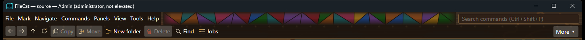

# Steampunk header vitrage — native visual comparison

The owner reported that the original colored glass looked clipped and poorly fitted to the menu header, then asked for connected fragments and a smoother blend at its upper and lower edges. Product `6a22decd970ee0ee5426eb6fcaf0148f70cda7b7` replaces the multirow clipped cells with one connected leaded-glass mosaic. The main window measures the free space between its menu and command search; the mosaic fills only that span. Irregular triangular fragments reach the canopy's top and bottom, while a vertical color falloff and shorter side falloffs blend them into the iron. A narrow window with too little free space simply shows iron.

## Comparison and scope

The two captures below are unretouched 1450 × 102 pixel crops from actual 1450 × 900 VM window screenshots. They use the same isolated Windows 11 Insider guest, `Steampunk` setting, source/target paths, window placement and fixture. Variant A was an intermediate five-stop edge fade, App DLL SHA-256 `2A9C552A341796CE8B793A64DFF917BACEE2A5AD31682D3BBB558943AC4D0BC4`. Variant B is the committed nine-stop fade, App DLL SHA-256 `03918961CC1453888CA785D8294262D6C5F221027EBCDC9CACE6644B972FE6A1`.

**A — earlier fade:**

**B — chosen smoother fade:**

The change is deliberately subtle: B softens the straight upper and lower color boundary and keeps the varied glass and lead visible at the center. Native captures at 1450 × 900 and 900 × 650 showed no pane hidden under the menu or search field, and their labels remained readable. The exact-source self-contained app in the VM was isolated under `C:\Users\admin\Desktop\filecat-i602\steampunk-visual`; the owned source contained one 22-byte text fixture and the target stayed empty. Only that test app was restarted while comparing versions. The physical Windows workstation was not controlled.

`dotnet publish` for `win-x64` succeeded with zero compiler warnings/errors. Focused `ThemePickerTests` passed 10/10 on the host. An initial sandboxed testhost could not connect and was canceled; the exact focused suite passed when run with its normal process permissions. The earlier product `498bbf1c` passed all five required CI jobs in run 41304823137. New product CI [41309707065](https://github.com/benny-cz/FileCat/actions/runs/41309707065) was in progress at this record; tag-only jobs skip on main.

## Acceptance and limit

This is a visual improvement, not a new release blocker or a claim about other themes. Before final 1.0.0 candidate acceptance, inspect Steampunk on the installed candidate at an ordinary wide and compact window: the colored fragments should meet the header's upper and lower edges through a gradual fade, stop before the menu and search controls, preserve readable command labels, and leave the file panels unobscured. A preview.5 binary predates this source change. Stable 1.0.0 remains NO-GO.
